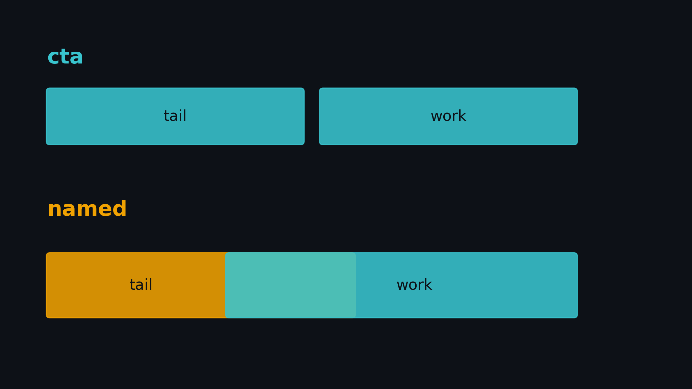
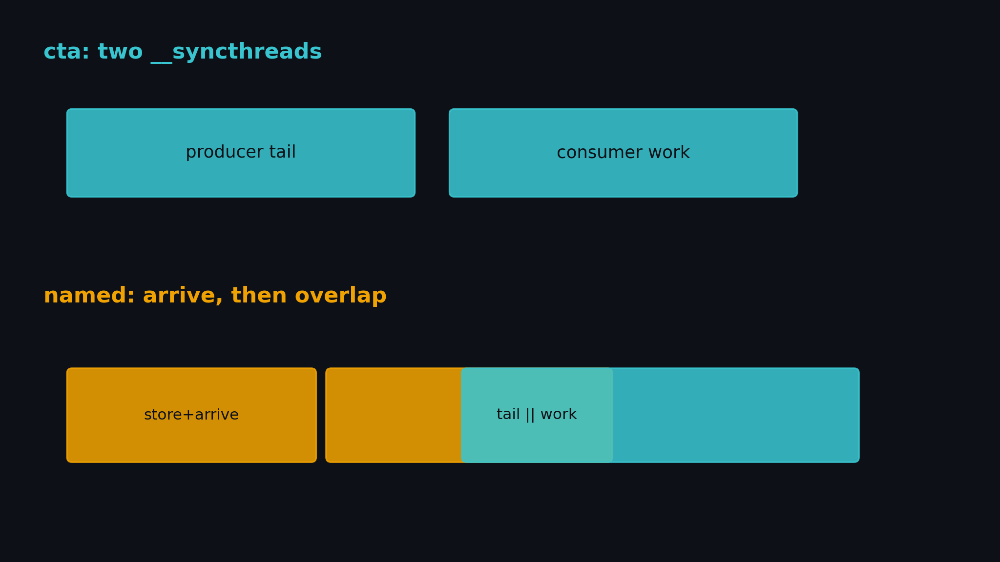
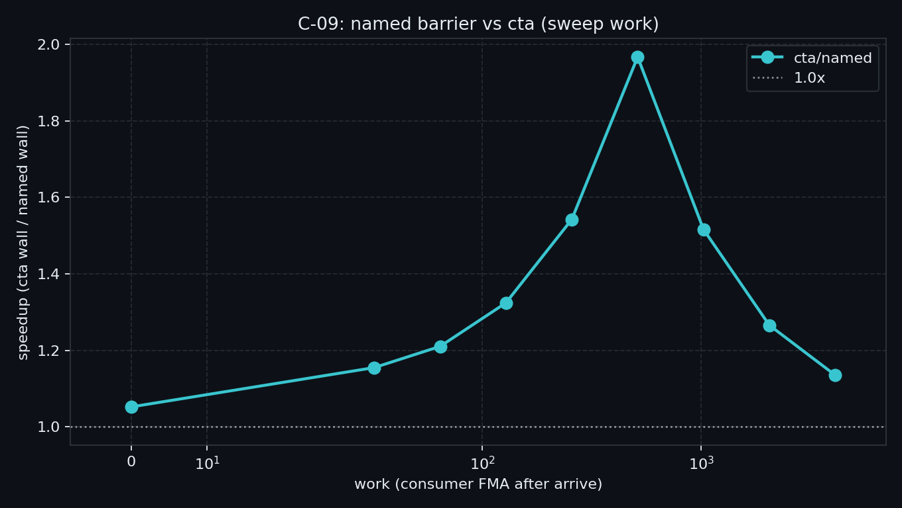
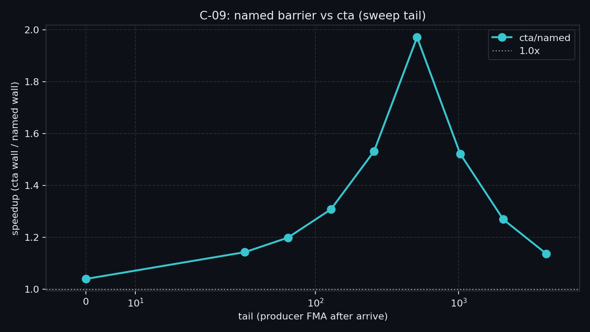

# C-09. Named Barrier：子集会合、单边 arrive 与何时叠不上



> 封面只画机制。**1.97×** 是 `sweep` 在 work=512、tail=512（1.735 ms → 0.882 ms）。同配置的 `modes` 是 **1.965×**。不要按色块长度读加速比。

> C-08 钉死：同流依赖核能不能提前启动，叠的是 trigger 之后的 tail。  
> 本章换到 **一个 CTA 里面**：两个 warp 角色不同，`__syncthreads` 会把两边的活串起来。  
> 本机：两边相等 **1.97×**；某一侧为 0 是 **1.04×～1.05×**；`named_pre` **1.007×**；`indep` **0.97×**。门槛 sm_70+。

**配套可复现**：[Yapeng-Gao/AI-System-Performance-Lab](https://github.com/Yapeng-Gao/AI-System-Performance-Lab)（文章 + `.cu` + 实测表）。有用请 Star。本章示例：[`examples/03_compute_primitives/09_named_barrier.cu`](https://github.com/Yapeng-Gao/AI-System-Performance-Lab/blob/main/examples/03_compute_primitives/09_named_barrier.cu)。

## TL;DR（工程结论）

> 口径：RTX 5090 / `sm_120`，SMs=170，`grid=170`（每 SM 一个 64 线程 block）。CUDA event **median**；event 与 kernel **同 stream**。完整表见 [`docs/results/C-09_named_barrier.md`](../../docs/results/C-09_named_barrier.md)。

1. **Named barrier 是 CTA 上 16 个硬件槽，编号 0..15。** `__syncthreads` 占 0 号，并且要等未退出的线程都到。分角色用 `barrier.sync` / `barrier.arrive`，编号从 1 起，参与线程数是 32 的倍数。
2. **单边 arrive 才腾得出重叠。** 生产者写完 SMEM 就 `arrive`，不必等消费者。消费者 `sync` 之后才能读。一条 barrier 上的计数把两边都算进去：1 warp + 1 warp 是 **64**，不是 32。
3. **能叠的是 arrive 之后的 tail 和 work。** 本机 `sweep`（tail=512）：work=0 是 **1.05×**，work=512 到 **1.97×**，work=4096 回到 **1.14×**。work≤512 时 `named` 停在 **0.87～0.88 ms**，消费者的活藏在 tail 下面。
4. **活放在 arrive 之前，或者两组互不依赖，kernel 都不缩短。** `named_pre` 1.722 ms vs `cta` 1.735 ms（**1.007×**）。`indep` 是 **0.97×**。
5. **判停**：主看 `cta/named`。1× 有效。禁止 ncu 附着墙钟。禁止用 0 号，禁止在 warp 内拆角色，禁止把 mbarrier 的字节计数写进这条曲线。

## 1. 问题：谁必须等，谁可以先走

C-04 量过三层同步。`__syncthreads` 是整个 CTA 的会合：这一相里没做完的 warp，会挡住已经做完的 warp。两个角色本来就可以并排时，这道 barrier 把它们接成一条关键路径。

本章只处理这件事。拷贝完成计数仍是 B-07 / B-08 的 mbarrier。跨 kernel 的提前启动仍是 C-08。

| 问题 | 本章交付 |
|---|---|
| 两道 `__syncthreads` 把 tail 和 work 串起来有多长？ | `cta` |
| arrive 之后两边一起烧，短多少？ | `named` + `sweep` |
| 没有尾巴还能赢吗？ | `sweep_tail` |
| 活放在 arrive 之前呢？ | `named_pre` |
| 两组根本不共享数据呢？ | `indep` |

| 章节 | 已覆盖 | 本章不重复 |
|---|---|---|
| C-04 | warp / block / grid 空同步代价 | **不重测**层间曲线 |
| C-02 | tile / coalesced | tile≤32 的 sync 不是这 16 个槽 |
| B-07 / B-08 | `cp.async` / TMA / mbarrier | 不 `init`，不 `expect_tx` |
| C-08 | 跨 kernel 的 PDL | **不重测**次核提前 boot |
| A-04 | divergence / replay | 不重开机制课 |
| D-05 | CUTLASS warp-specialized GEMM | 只钩子 |



> 上：生产者烧完 tail，全体 `__syncthreads`，消费者再烧 work。下：生产者写完并 `arrive`，tail 与消费者的 work 可以叠。消费者读令牌之前必须 `sync`。

## 2. 物理模型：16 个槽，sync 和 arrive 不是一回事

每个 CTA 有 16 个 barrier，编号 0 到 15。线程用编号选槽，用参与线程数说明要等齐多少人。人数必须是 warp 大小的倍数。到齐之后槽马上复位，下一相还能用同一个编号。

`barrier.sync` 是到达并等待其他参与 warp。`barrier.arrive` 只把自己这一 warp 的到达记下，然后继续执行。生产者和消费者用两个槽：

```text
cta:    [ producer tail | store ][ consumer load | work ]
named:  [ store | arrive | producer tail ]
                 [ consumer sync | load | arrive | work ]
```

能叠的是后半段：生产者的 tail，和消费者交还缓冲之后的 work。store 发生在 arrive 之前，load 发生在 sync 之后。把 tail 挪到 arrive 前面，重叠窗口就没了。

`bar.sync` 是 `barrier.sync.aligned` 的别名。aligned 要求 CTA 里未退出的线程都执行同一条 barrier。本章两个 warp 执行的形式不同，一个 `sync`、一个 `arrive`，用的是不带 `.aligned` 的指令。PTX 写明：sm_6x 及以下，不带 `.aligned` 的 `barrier` 等价于 aligned。门槛因此是 **sm_70+**。

和 mbarrier 分开记：

| | Named barrier | `cuda::barrier` / mbarrier |
|---|---|---|
| 住哪 | 硬件槽 0..15 | SMEM 对象，先 `init` |
| 等待 | `sync` 等齐；`arrive` 不等 | `arrive` 交 token，`wait(token)` 等这一相 |
| 计数 | 这条槽上所有 sync 和 arrive 的线程 | 每次 arrive 的更新；TMA 还可以加字节 |
| 本章 | 主测 | 回 B-07 / B-08 |

两个 warp 对接时，named barrier 的计数是 64。mbarrier 可以只计发出 arrive 的那一侧，32 就够。把 32 填进本章的 `barrier.sync`，另一侧等不齐。

## 3. API / 实验形态

| 路径 | 做法 |
|---|---|
| `cta` | 生产者烧 `tail` 并写令牌 → `__syncthreads` → 消费者读令牌并烧 `work` → `__syncthreads` |
| `named` | 生产者写令牌 → `barrier.arrive` full → 再烧 `tail`。消费者 `barrier.sync` full → 读令牌 → `barrier.arrive` empty → 再烧 `work` |
| `named_pre` | 同一对指令，但 `tail` / `work` 都在各自的 `arrive` 之前 |
| 网格 | `grid = SM 数`，每 SM 一个 block。block 固定 64 |
| 编号 | full=1，empty=2，count=64 |
| 正确性 | 消费者累加的令牌 = `phases*(phases+1)/2` |

阶段 0 生产者不等 empty。从阶段 1 起，先 `sync` empty，确认消费者已经把上一相的令牌读走，再覆写。两边的 `phases` 必须相同。

下面两行只是指令形状。full / empty 两个槽、阶段 0 生产者不等 empty，按上面这段协议写，不要只贴这两行。

```cuda
asm volatile("barrier.arrive %0, %1;" :: "r"(full_id), "r"(64) : "memory");
asm volatile("barrier.sync %0, %1;" :: "r"(full_id), "r"(64) : "memory");
```

角色按 `threadIdx.x / 32` 切。一个 warp 里所有未退出线程执行同一条 barrier。按 lane 把 warp 劈开，这一 warp 自己就不收敛。

计时用 `cudaEventRecord(..., stream)`。每个 SM 只放一个 block，避免别的 block 把停在 `__syncthreads` 上的 warp 补满。铺满 GPU 再读比值，空档会被别人填上。

## 4. 决策表

| 信号 | 建议 |
|---|---|
| 同一 CTA 里按 warp 分了角色，而且 arrive 之后还有独立活 | 看 `cta/named`。本机两边相等 **1.97×**（1.735 ms → 0.882 ms） |
| 长计算在 arrive 之前，或者某一侧迭代数是 0 | 别指望。`named_pre` **1.007×**；work=0 或 tail=0 是 **1.04×～1.05×** |
| 两组不读对方的 SMEM | kernel 墙钟看慢组。本机 `indep` **0.97×** |
| 全体线程本来就要会合 | 回 C-04 的 `__syncthreads` |
| 只是 warp 内 mask | 回 C-01 / `__syncwarp` |
| 等的是 `cp.async` 或 TMA 的字节 | 回 B-07 / B-08，用 mbarrier |
| 等的是另一个 kernel | 回 C-08 |
| 两个角色该合成一个 | 回 C-05，不要拆开再 barrier |
| 生产 GEMM 的 warp specialization | 回 D-05。那里 NamedBarrier 和 mbarrier 会同时出现 |

## 5. 实验怎么设计

代码：`examples/03_compute_primitives/09_named_barrier.cu`。  
burn 与 C-08 相同，是循环依赖的 FMA，故意打不满 FMA 管道。打满之后两个 warp 没有可叠的发射槽，比值会贴 1×，那读不出 arrive 之后有没有窗口。

主命令：

```bash
./bin/03_compute_primitives_09_named_barrier --mode sweep
```

| mode | 要回答的问题 | 进主结论？ |
|---|---|---|
| `sweep` | 固定 tail=512，扫 work。比值抬起来还是贴 1？ | **主曲线** |
| `sweep_tail` | 固定 work=512，扫 tail | 重叠轴 |
| `modes` | 定点、`named_pre`、`indep`、校验和 | 反例表 |
| `cta` / `named` | 单点复现 | 不单独当曲线 |

work / tail 扫描点：`0, 32, 64, 128, 256, 512, 1024, 2048, 4096`。  
`indep`：block=256，前 4 个 warp 烧 2048，后 4 个 warp 烧 32，各用自己的槽（计数 128），phases=128。这组不进主 sweep。

证据优先级：裸跑 event median。默认不加 NCU。校验失败先查计数和编号，不解释加速比。

### 5.1 本机实测

平台：RTX 5090 / `sm_120` / 170 SM / `grid=170`。phases=1024，block=64，count=64。表与怎么读：[`docs/results/C-09_named_barrier.md`](../../docs/results/C-09_named_barrier.md)。

固定 tail=512，扫 work：

| work | cta_ms | named_ms | cta/named |
|---:|---:|---:|---:|
| 0 | 0.9190 | 0.8735 | **1.05×** |
| 128 | 1.1552 | 0.8724 | **1.32×** |
| 512 | 1.7347 | 0.8820 | **1.97×** |
| 4096 | 7.1569 | 6.3048 | **1.14×** |



固定 work=512，扫 tail：

| tail | cta_ms | named_ms | cta/named |
|---:|---:|---:|---:|
| 0 | 0.9155 | 0.8806 | **1.04×** |
| 512 | 1.7358 | 0.8806 | **1.97×** |
| 4096 | 7.1547 | 6.2945 | **1.14×** |



定点 `modes`：cta 1.7347 ms / named 0.8827 ms = **1.965×**。`named_pre` 1.7224 ms，相对 cta **1.007×**。`indep` 0.4034 ms / 0.4170 ms = **0.967×**。

怎么读：work 还没超过 tail 时，`named` 的墙钟几乎不动，多出来的消费者 FMA 叠在 tail 里。两边一样长，接近 2×。再往长了拉，比值往 1 收，因为杆是更长的那一段。CudaDMA 在 Fermi 上的 1.37× / 1.15×–3.2× 是专用 DMA warp 的算子结果，不是这条曲线的达标线。

## 6. 工程边界

- **sm_70+。** 更老的卡上，unaligned `barrier.sync` 按 aligned 解释，子集参与不能当正确实现。binary 会直接退出。
- 编号只用 1 和 2。0 和 `__syncthreads` 抢同一个槽。编号 ≥16 会折回 0..15，16 会撞上 0。
- 计数是线程数，而且是两边之和。漏掉消费者那 32 个线程，`sync` 等不到复位。
- 最后一相消费者的 `arrive` empty 没有人再等。`arrive` 本身不等待，CTA 退出即可。不要在计时路径里故意少一次 `sync` 来看会不会挂死。
- 令牌只有一份。消费者读走之后才能 `arrive` empty；生产者过了 empty 才能写下一相。把读放在 `arrive` 之后，会和下一相的写撞上。
- median 低于 0.05 ms 时先加大 `--phases`。那是 launch 噪声，不是屏障没生效。

## 7. 扩展阅读（不抢后续 Module）

1. PTX `bar` / `barrier` 的参与集和 aligned 规则：见 §10-1。  
2. `cuda::barrier` 的 warp specialization 例是另一条机制：见 §10-2，回 B-07 / B-08。  
3. CUTLASS 同时用 NamedBarrier 和 mbarrier 写 GEMM：见 §10-9 → **Module D**。  
4. 索引收束在 C-10。本章的 **1.97×** 不靠那张总表才成立。

## 8. SOP + 误区

1. 先确认等的是 **CTA 内另一组 warp**，不是拷贝完成（B-07/B-08）或另一个 kernel（C-08）。  
2. 角色按 warp 切。编号避开 0。计数写成两边线程数之和。  
3. 长的独立活放在 `arrive` 之后。  
4. `--mode sweep` 看 `cta/named` vs `work`。  
5. `--mode modes` 看 `named_pre` 和 `indep` 是否贴 1×。  
6. 1× 就停。不要改成两个 kernel，也不要改成 mbarrier 再宣称本章赢了。

| 误区 | 纠正 |
|---|---|
| `bar.sync` 就能做子集同步 | 那是 aligned。分角色用 `barrier.sync` / `barrier.arrive` |
| 计数填 32，因为这一侧只有一个 warp | 另一侧也在这条槽上。1+1 warp 填 64 |
| 用 0 号，反正没写 `__syncthreads` | 运行时和别的 CTA barrier 会用 0。本章用 1 和 2 |
| 短组先结束，kernel 就该变短 | 慢组还在。`indep` 量的就是这件事 |
| 1× 说明实现错了 | 活在 arrive 前、某一侧为 0、两组无依赖，1× 都合法 |
| 把 CudaDMA 的倍数当成 5090 达标线 | 那是 Fermi 上整颗 DMA warp 的算子，不是这条曲线 |

## 9. 小结与下一章

全体会合回 C-04，拷贝完成回 B-07 / B-08，另一个 kernel 回 C-08。  
Named barrier 只解决 CTA 内按 warp 分角色：单边 arrive，重叠发生在 arrive 之后。  
本机两边相等是 **1.97×**。活在 arrive 之前，或两组无依赖，就贴 1×。

下一篇是 C-10 Checklist：先对上症状，再打开这一章的 binary。

---

> 本文配套代码与实测：[AI-System-Performance-Lab](https://github.com/Yapeng-Gao/AI-System-Performance-Lab)。觉得有用请 Star，后续章更新更好找。  
> 本章示例：[`examples/03_compute_primitives/09_named_barrier.cu`](https://github.com/Yapeng-Gao/AI-System-Performance-Lab/blob/main/examples/03_compute_primitives/09_named_barrier.cu)。下一篇：[C 模块文章目录](https://github.com/Yapeng-Gao/AI-System-Performance-Lab/tree/main/article/03_compute_primitives/)。

## 10. 参考文献

### A. 官方

1. [PTX ISA — `bar` / `barrier`](https://docs.nvidia.com/cuda/parallel-thread-execution/index.html#parallel-synchronization-and-communication-instructions-bar-barrier)：16 个槽；`sync` 与 `arrive`；`bar.sync` = aligned；sm_6x 及以下 unaligned 退回 aligned。  
2. [CUDA PG — Asynchronous Barriers](https://docs.nvidia.com/cuda/cuda-programming-guide/04-special-topics/async-barriers.html)：全体 block / warp 仍建议 `__syncthreads` / `__syncwarp`。`cuda::barrier` 不是这 16 个槽。  
3. [Turing Tuning Guide](https://docs.nvidia.com/cuda/turing-tuning-guide/)：有未退出线程到不了 aligned barrier 时，不能靠「它不会执行到」蒙混。

### B. 工程

4. [CUTLASS `barrier.h`](https://github.com/NVIDIA/cutlass/blob/main/include/cutlass/arch/barrier.h)：不要用 0 号；`bar.sync` 与 `barrier.sync` 分成 aligned / unaligned。  
5. [CuTe `NamedBarrier`](https://docs.nvidia.com/cutlass/latest/media/docs/pythonDSL/cute_dsl_api/pipeline.html)：两个 warp 对接时 named barrier 计数是 64，mbarrier 可以是 32。  
6. [CUTLASS issue #2672](https://github.com/NVIDIA/cutlass/issues/2672)：编号超出 0..15 会折回。

### C. 实证

7. Bauer, Cook, Khailany, CudaDMA, SC’11。Fermi：合成微基准最高约 1.37×，科学 kernel 1.15×–3.2×。不作为本章达标线。  
8. Sharma, Bauer, Aiken, Weft, PLDI’15。named barrier 上要查死锁、槽复用和 SMEM 是否被 barrier 盖住。

### D. 前沿 / 扩展

9. CUTLASS warp-specialized GEMM：角色同步用 NamedBarrier，TMA 完成用 mbarrier → Module D。  
10. [Colfax / SIGARCH GEMM pipeline](https://www.sigarch.org/efficient-gemm-kernel-designs-with-pipelining/) 里的 full/empty 是 mbarrier，不要和本章槽位写成同一个对象。
