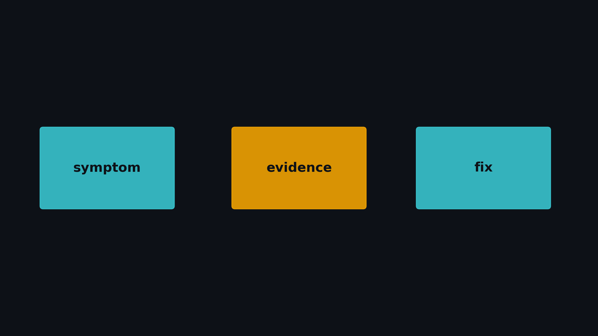

# C-10. Module C Checklist：从症状到证据到处方

> C-09 把 CTA 内两角色的重叠钉在 arrive 之后：两边相等 **1.97×**，活在 arrive 前 **1.007×**。  
> Module C 读完仍常卡在一件事：眼前这份墙钟，该打开通信、同步、提交，还是重叠。  
> 本章不新开 micro-bench。先用自问锁到一行，再打开那一章的 binary。

**配套可复现**：[Yapeng-Gao/AI-System-Performance-Lab](https://github.com/Yapeng-Gao/AI-System-Performance-Lab)（文章 + `.cu` + 实测表）。有用请 Star。本章无独立 `.cu`。证据索引：[docs/results/C-10_checklist.md](https://github.com/Yapeng-Gao/AI-System-Performance-Lab/blob/main/docs/results/C-10_checklist.md)。

---

## TL;DR

> 数字都是 RTX 5090 / `sm_120` 上 C-01～C-09 已落盘的 CUDA event **median**。完整锚点见 [`docs/results/C-10_checklist.md`](../../docs/results/C-10_checklist.md)。

1. **先定层，再换 API**。访存或布局像墙，回 [B-10](../02_memory_optim/B-10.%20Module%20B%20Checklist：从症状到证据到处方.md)。层对不上，后面的倍数没有意义。
2. **每行只挂一个证据入口**。`examples/03_compute_primitives/0N_*.cu --mode …`。主证据是裸跑 median。**禁止**把 ncu 附着时程序自打印的 ms 写进结论。
3. **少发 kernel 有三套倍数，各算各的**。瘦融合随链长 **3.87×→9.81×**，fat 相对瘦融合慢 **8.01×**。Graph 在短链上 **~3.3～4.1×**，`work=4096` → **1.01×**。一任务一发的 persistent 是 **32×→3740×**，`work=4096` 仍 **314×**。
4. **重叠也分三处**。同流、后一个核读前一个核的结果：C-08 贴 **1×**（定点 **1.13×**）。同一个 CTA 里两个 warp 角色：C-09 两边相等 **1.97×**，arrive 之前 **1.007×**。两条独立的流回 A-08。拷贝完成回 B-07 / B-08。
5. **形状对上就停**。复现不了该章曲线，先查口径，不要再加一层 API。

---

## 1. 问题

C-01～C-09 各自有决策表。排查时卡住的往往是表之前那一步：还不知道自己是哪一行。

| 交付 | 在哪 |
|---|---|
| 认出症状 | §2，第一个「是」锁一行 |
| 对上处方 | §3 |
| 防混层 | §4：少发 kernel、重叠、同步 |
| 命令索引 | §5，明细在 `docs/results/C-10_checklist.md` |

| 边界 | 本章做 | 本章不做 |
|---|---|---|
| C-01～C-09 | 回链本机形状和 binary | 不重讲机制、不重跑 |
| B-10 | 访存症状一行出口 | 不重开 coalescing / TMA / 布局 |
| Module D / E | 一句钩子 | 不写算子、不写 Torch capture |

> 最上一层是访存，回 B-10。下面四层才是 Module C。图只标层名。

---

## 2. 如何认出自己的症状

从上往下，**第一个答「是」的问题**决定打开哪一章。顺序按先贵的层，不是章号，所以 C-01 / C-02 在表尾。不要先把 Graph、PDL、named barrier 都试一遍。

| # | 自问 | 层 | 去哪 |
|---|---|---|---|
| 1 | Memory SOL 高，或 sectors/request、useful 带宽形状异常？ | 访存 | B-10 |
| 2 | 热路径是同一地址上的 `atomicAdd`？ | 争用 | C-03 |
| 3 | 必须在**一个 kernel** 里让不同 block 见面？ | grid sync | C-04 |
| 4 | 一串很短的 elementwise，中间结果写回 GMEM？ | 融合 | C-05 |
| 5 | 多个短 kernel，每次都从 host 提交？ | 提交 | C-06 |
| 6 | 大量独立小任务，每个任务一次 launch，而且对照网格只有 1 个 block？ | 常驻 | C-07 |
| 7 | 同一条 stream 上，后一个 kernel 要读前一个的结果，想让它提前起来？ | 依赖核 | C-08 |
| 8 | 同一个 CTA 里两个 warp 角色，想叠 `arrive` 之后的活？ | 子集 barrier | C-09 |
| 9 | warp 内规约走了 SMEM 树加 `__syncthreads`？ | warp 通信 | C-01 |
| 10 | `thread_block_tile` 的 size 大于 32？ | CG tile | C-02 |

结果错了、出现竞争或未定义值：先跑 sanitizer（A-09），再核对 mask（C-01）。那种错先修正确性，再谈墙钟。发散机制在 A-04。

没有 profiler 时，用墙钟拆开也够定层：单 kernel 内部的通信和同步走 2、3、8、9、10；一串 kernel 的提交和融合走 4、5、6；两个有依赖的 kernel 走 7。拆不开 Host 与 Kernel 时，先上 NSYS 看时间线，再决定要不要进 NCU。NCU 只用来回答第 1 问：Compute SOL 还是 Memory SOL。Memory 高，离开本章。

---

## 3. 症状 → 证据 → 处方

本机均为 RTX 5090 / `sm_120`，裸跑 median。Binary 在 `build/bin/` 或 `cmake-build-*/bin/`，前缀 `03_compute_primitives_`。

| 症状 | 本机形状 | 证据入口 | 处方 | 回链 |
|---|---|---|---|---|
| 其实是带宽或布局 | 见 B-10 锚点（touch=1 时 SoA/AoS ≈ **13.6×**） | [`B-10_checklist.md`](../../docs/results/B-10_checklist.md) | 先改访存。不要从原子或融合开刀 | B-10 |
| warp 内用 SMEM 树通信 | 1 warp ≈ **1.02×**；16 warp **1.15×**；32 warp **1.27×**。int `__reduce_add_sync` ≈ **1.06×** | `01_warp_primitives --mode sweep` | 大 block 换 shfl。float 没有 redux 这条路 | C-01 |
| CG tile 拉过一个 warp | tile≤32 ≈ **0.93～1.00×**；tile 64/128 = **1.60× / 1.66×** | `02_cooperative_groups --mode sweep` | tile 停在 32。更大的组回 C-04 的 block barrier | C-02 |
| 同一地址 atomic 很热 | hit=1 时 smem/naive **6.31×**；手写 warp-agg ≈ **1.00×** | `03_atomics_contention --mode sweep` | 进 SMEM，每 block 一次 global。别按旧论文期待手写 agg 的数量级 | C-03 |
| 同步层选错 | grid/block **17.2×**；block/warp **1.10×～1.23×**；`phases` ≈ **1.0** | `04_sync_layers --mode modes` | 跨 block 的会合能拆成两个 kernel 就拆。block 与 warp 只差 **1.1×** 量级 | C-04 |
| 短 elementwise 链写回 GMEM | k=2 **3.87×** → k=8 **9.81×**。fat occupancy 6→1，fat/fused **8.01×** | `05_kernel_fusion --mode sweep` | 瘦链融合。寄存器把 occupancy 打到 1 就拆开 | C-05 |
| 短核反复从 host 提交 | 节点≥2：**~3.3～4.1×**（峰值 @8 = **4.08×**）。work=0 **5.48×**；work=4096 **1.01×**。定点 **3.68×** | `06_cuda_graph --mode sweep` | 短链用 Graph。body 已经主导就停 | C-06 |
| 一个小任务一次 launch | n_tasks 64→**32×**，16384→**3740×**。work=4096 仍 **314×**。oversub/persistent **1.48×**（更慢） | `07_persistent --mode sweep` | 常驻网格、block 内拉活。不要超订。这个倍数只属于「1 block 串行 vs 常驻」 | C-07 |
| 同流两个有依赖的 kernel | 整条曲线贴 **1×**。sweep 峰值 **1.10×**；work=0 **0.95×**（PDL 更慢）。定点 serial/pdl **1.13×**；`pdl_full`/`pdl` **0.999×** | `08_pdl --mode sweep` | 要有可叠的 tail，并让前一个核空出 SM。1× 是合法结果 | C-08 |
| CTA 内两个 warp 角色 | 两边工作相等 **1.97×**。某一侧为 0：**1.04×～1.05×**。`named_pre` **1.007×**。两组无依赖 **0.97×** | `09_named_barrier --mode sweep` | 独立活放在 `arrive` 之后。编号避开 0。计数写成两边线程数之和 | C-09 |

读表时只看**形状是否同向**。0.95× 和 1.10× 落在几十微秒的噪声缝里（C-08），当同一档。C-01 的 NCU（指令约 −42%，shared wavefront 约 −78%）说明 shfl 少碰 SMEM，墙钟仍以裸跑 **1.27×** 为准。

---

## 4. 三处容易混的层

### 4.1 少发 kernel

三行都在减 launch，减的对象不一样。把 **3740×** 写到 Graph 上，或把 **4×** 当成融合的下限，是把两行抄混了。

| 杠杆 | 少掉的是什么 | 本机 | 何时停 |
|---|---|---|---|
| 融合 C-05 | 中间结果写回 GMEM | 瘦链 **3.87×→9.81×**；fat 慢 **8.01×** | occupancy 塌了就拆 |
| Graph C-06 | host 一次次提交 | 短链 **~4×**；`work=4096` → **1.01×** | body 主导 |
| Persistent C-07 | 「一任务一次 launch」且对照是 1 block 串行 | **32×→3740×**；加重仍 **314×** | 超订更慢（**1.48×**）。不要拿去要求 Graph |

C-07 加重之后仍有 **314×**：对照是串行单 block，常驻网格还有并行度。C-06 加重之后收到 **1.01×**：两边都是满网格，剩下的是提交税。两条曲线。

### 4.2 重叠

| 谁和谁叠 | 回哪 | 本机怎么读 |
|---|---|---|
| 独立 kernel 或拷贝，不同 stream | A-08 | 本章不重测 |
| 同流，后一个读前一个的 GMEM | C-08 | 贴 **1×**。没有 tail 时 PDL 可以更慢（**0.95×**） |
| 同 CTA 的两个 warp 角色 | C-09 | 相等 **1.97×**。活在 `arrive` 前、或两组无依赖，贴 **1×** |
| 拷贝完成，生产者是 `cp.async` / TMA | B-07 / B-08 | `cuda::barrier` / mbarrier 住在 SMEM，计数的是拷贝完成 |

### 4.3 同步

| 层 | 对象 | 别读成 |
|---|---|---|
| warp mask | C-01 `__shfl_sync` / `__syncwarp` | 小 block 上相对 SMEM 树几乎持平（≈ **1.02×**） |
| block | C-04 `__syncthreads` | 相对 warp 只有 **1.1×** 量级 |
| grid | C-04 `this_grid().sync()` | 相对 block **17.2×**。`phases` ≈ **1.0**，少一次 sync 不会自动变快 |
| 子集 | C-09 `barrier.sync` / `barrier.arrive` | 按 warp 分角色。全体会合仍用 `__syncthreads` |
| 拷贝完成 | B-07 / B-08 mbarrier | 计数可以只含一侧。named barrier 的计数含两边 |
| host | A-08 stream / event | 管 host 上的 stream 顺序 |

`bar.sync` 是 aligned 全体会合。分角色用 `barrier.sync` / `barrier.arrive`。细节在 C-09，这里只防止选错入口。

---

## 5. 证据落在哪

本章没有新的 CSV。锚点和命令全表在 [`docs/results/C-10_checklist.md`](../../docs/results/C-10_checklist.md)。

复现某一行时只跑该行的 `--mode`。C-06 / C-07 / C-08 / C-09 的第二条曲线（`sweep_work` 或 `sweep_tail`）用来看「加重或加长尾巴之后倍数怎么收」，不替代主 sweep。

可选旁证只有 C-01 已有的 `01_profile_warp.sh`。附着墙钟丢掉。本章不新增 NCU / SASS。

---

## 6. 工程边界

- **无新 `.cu`、无新主结论 CSV**。数字全部回已发布章。
- **硬件**：总表不限架构。C-08 行继承 **sm_90+**。C-09 的 unaligned named barrier 继承 **sm_70+**（5090 为 sm_120）。
- **口径**：event median。禁止 ncu 附着 ms。C-08 上 1× 附近的点差几微秒，不当成架构差异。
- **与 Module B**：带宽、bank、布局、设备内拷贝收在 B-10。
- **与 Module D / E**：device reduce、Softmax、GEMM 不在这里写。Graph 的生产 capture、PyTorch 留给 E。

---

## 7. 扩展阅读

- 分流结构可参考 GPU MODE Lecture 8 的 checklist 笔记，见 §10-4。**数字以本仓库 C-01～C-09 为准**。
- 访存症状回 [B-10](../02_memory_optim/B-10.%20Module%20B%20Checklist：从症状到证据到处方.md)。
- 下一模块是算子（device reduce → GEMM）。规划在 [`Module-D.md`](../../docs/CUDA专栏大纲/Module-D.md)，本章不写。

各章机制和文献回对应章 §10，这里不抄表。

---

## 8. SOP 与常见误区

1. 用 §2 锁一行。两行都像，先拆墙钟：单 kernel 内部，还是一串 kernel 的提交。
2. 只跑 §3 那一行的 `--mode`。
3. 对照 `docs/results/C-0N_*`，看加速比随横轴（block 大小、tile、hit_rate、链长、节点数、任务数、work、tail）的走向是否相同。
4. 改一处，用同一条命令回归。
5. 走向已经对齐，或加重之后收到 **1×**，就停。
6. 倍数留在它那一行。C-07 的 **3740×** 不拿去要求 C-06，也不拿去要求算子。

**判停**

- 复现不了该章形状：查问题规模、是不是 median、跑的时候有没有套着 ncu。
- 换了 API，层没变：回 §2 和 §4。
- 第 1 问已经是 Memory SOL：回 B-10，不要在本章继续加原语。

| 误区 | 纠正 |
|---|---|
| 还没定层就换 API | 先走完 §2 |
| Graph 的 ~4×、融合的 ~10×、persistent 的千倍是同一个「少 launch」 | §4.1 三行减的东西不同 |
| PDL、named barrier、mbarrier、host stream 都叫 overlap | §4.2。对象不同，1× 的含义也不同 |
| 手写 warp-agg 应该有数量级 | 本机 agg/naive ≈ **1.00×**。热原子走 SMEM staging |
| `grid.sync` 只是贵一点的 `__syncthreads` | 本机 grid/block **17.2×** |
| tile 越大 CG 越合适 | tile 64/128 是 **1.60× / 1.66×** 的悬崖 |
| 1× 说明实现坏了 | C-06 重 body、C-08 无 tail、C-09 活在 arrive 前，1× 都合法 |
| 用 ncu 附着墙钟写结论 | 主证据只认裸跑 median |
| Checklist 本身是一套新理论 | 它是目录。改生产代码前回对应章正文 |

---

## 9. 小结

Module C 收到这里。

1. 用 §2 定层，用 §3 打开那一个 binary。
2. 少发 kernel 的三套倍数、重叠的三处、同步的六层，各留在自己的行。
3. 细节在同目录 C-01～C-09。访存回 B-10。算子还没开。

下一模块从 device reduce 起笔，不在本章写。规划见 [`Module-D.md`](../../docs/CUDA专栏大纲/Module-D.md)。

---

> 本文配套代码与实测：[AI-System-Performance-Lab](https://github.com/Yapeng-Gao/AI-System-Performance-Lab)。觉得有用请 Star，后续章更新更好找。  
> 本章无独立 `.cu`。证据索引：[`docs/results/C-10_checklist.md`](https://github.com/Yapeng-Gao/AI-System-Performance-Lab/blob/main/docs/results/C-10_checklist.md)。本模块目录：[article/03_compute_primitives](https://github.com/Yapeng-Gao/AI-System-Performance-Lab/tree/main/article/03_compute_primitives/)。

## 10. 参考文献

### A. 官方

1. [CUDA C++ Best Practices Guide](https://docs.nvidia.com/cuda/cuda-c-best-practices-guide/)：先看时间花在哪一层，再改代码。
2. [Nsight Compute Profiling Guide](https://docs.nvidia.com/nsight-compute/ProfilingGuide/)：Speed of Light 把 Compute 和 Memory 分开。Memory 高则回 B-10。
3. [PTX ISA — `bar` / `barrier`](https://docs.nvidia.com/cuda/parallel-thread-execution/index.html#parallel-synchronization-and-communication-instructions-bar-barrier) · [CUDA PG — Asynchronous Barriers](https://docs.nvidia.com/cuda/cuda-programming-guide/04-special-topics/async-barriers.html)：16 个 named 槽、`__syncthreads`、`cuda::barrier` 各算各的对象。用法留在 C-09 与 B-07/B-08。

### B. 结构参考

4. GPU MODE Lecture 8 笔记：[CUDA Performance Checklist](https://christianjmills.com/posts/cuda-mode-notes/lecture-008/)。只借分流的排法。加速比以 `docs/results/C-01_warp_primitives.md` 至 `C-09_named_barrier.md` 为准。

本章没有新的实证论文。各章已经拒绝过的外来倍数（IPDPS’17 的 1.2～2.1×、CudaDMA 的 Fermi 区间、Kepler 上 warp-agg 的数量级）不要写回这张总表。
