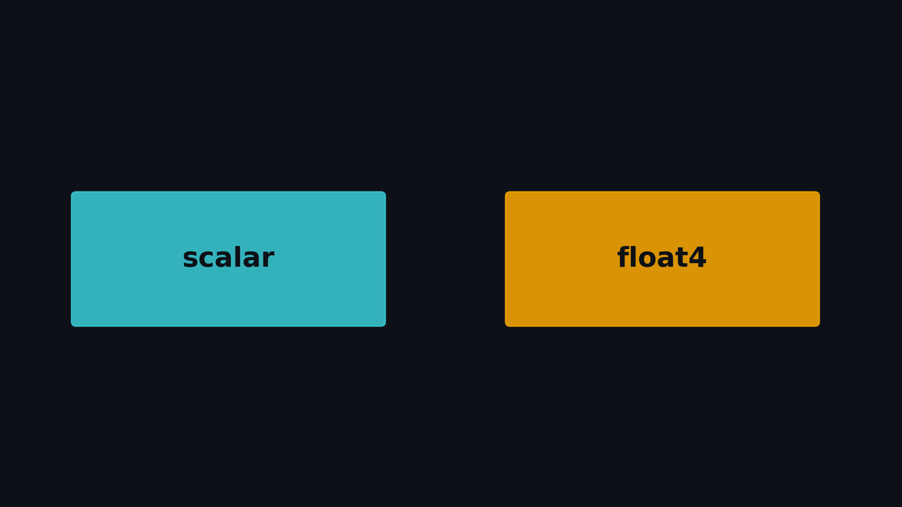
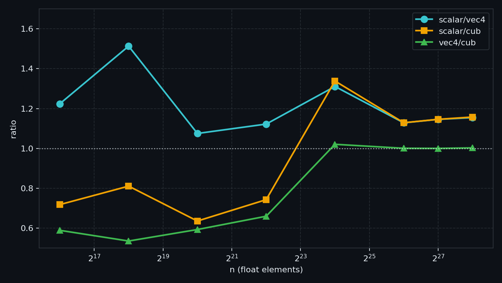

# D-01. Device Reduction：大数组求和、向量化加载与何时不用第二次 kernel



> C-10 把并发原语收成一张索引。整段数组怎么加完，不在那张表里。  
> 本章只做 device 级求和。block 里面的 shuffle 已经在 C-01 量过，最大约 **1.27×**。  
> 本机：工作集到 256 MiB 以后，`float4` 相对标量加载是 **1.13×～1.15×**。第二次 kernel 和 CUB 都贴着这条线。

**配套可复现**：[Yapeng-Gao/AI-System-Performance-Lab](https://github.com/Yapeng-Gao/AI-System-Performance-Lab)（文章 + `.cu` + 实测表）。有用请 Star。本章示例：[`examples/04_operators/01_device_reduce.cu`](https://github.com/Yapeng-Gao/AI-System-Performance-Lab/blob/main/examples/04_operators/01_device_reduce.cu)。

## TL;DR（工程结论）

> 口径：RTX 5090 / `sm_120`，SMs=170。元素是 float，`x[i]=(i&255)`，host 用 double，相对误差 ≤ 1e-3。CUDA event **median**。完整表见 [`docs/results/D-01_device_reduce.md`](../../docs/results/D-01_device_reduce.md)。有效 GB/s 用 `n * 4` 字节，**含 L2**，不当总线利用率。

1. **求和读 N 个数、写出 1 个。** 每个元素 4 字节，加法很少。墙在加载。
2. **跨 block 的收尾，每 block 一次 `atomicAdd` 就够。** block 内仍是 shuffle 加一小块 SMEM。这不是 C-01 那条 1.27× 曲线。
3. **大数组上，加宽加载是唯一拉开的那一下。** 256 MiB / 512 MiB / 1 GiB：`scalar/vec4` = **1.128× / 1.146× / 1.154×**。1 GiB 墙钟 0.746 ms → 0.646 ms。
4. **手写 `float4` 已经贴着 CUB。** 1 GiB：`vec4/cub` = **1.003**（0.646 / 0.645 ms）。twopass 同档。再发一次 kernel 不赚。
5. **判停**：median 低于 0.05 ms 的比值不要写进结论。小 n 上 CUB 更慢，是 launch 税。已经和库同档，就停。float 相对误差约 **1e-5**。

---

## 1. 问题：一个 block 加不完

C-01 的数组只活在一个 block 里。整段输入长过一个 block 时，每个 block 得到一份部分和，还要有人把这些部分和加成一个数。

CUDA 没有免费的「所有 block 到齐再继续」。`__syncthreads` 只在一个 block 里有效。跨 block 只有两条常用的路：每个 block 往同一个全局地址 `atomicAdd` 一次；或者把部分和写到一张表，再发一个小 kernel 把表加完。库的默认 `cub::DeviceReduce::Sum` 走的是后一种固定树，为的是同卡上每次 bitwise 一样。

| 问题 | 本章交付 |
|---|---|
| 标量加载离 16 字节加载有多远？ | `scalar` vs `vec4` |
| 再发一个 kernel 收尾，大数组上还赚吗？ | `twopass` |
| 手写的单次原子收尾离库有多远？ | `vec4/cub` |
| 数组很小的时候这些比值还成立吗？ | sweep 的左半段（只当噪声） |

| 章节 | 已覆盖 | 本章不重复 |
|---|---|---|
| C-01 | warp 内 shfl vs SMEM，最大约 **1.27×** | 不扫 nwarps |
| C-03 | 同址 atomic 的争用曲线 | 不做「每个元素一次 atomicAdd」 |
| C-04 | `grid.sync` 约 **17×** | 不重测空同步 |
| B-01 / A-10 | 合并、Roofline | GB/s 只用来认出缓存 |
| D-02 | 两向量点积 | 本章只做一元 sum |


> 上面是一次 4 字节加载，下面是一次 16 字节加载。block 归约相同。收尾可以是 thread 0 的一次 `atomicAdd`，也可以是「写下部分和 + 第二个 kernel」。

## 2. 四条路径怎么走

网格默认 `min(SMs×8, ceil(n/256))`。5090 上大数组是 1360 个 block，每 block 256 线程。一个线程按 grid-stride 扫自己的那一段，先在寄存器里累加，再进 block 归约。

block 内固定两步：32 个线程用 `__shfl_down_sync` 收成一个 warp 和；8 个 warp 的结果放进 8 格 SMEM，再由 warp 0 收成一个 float。只有 thread 0 去碰全局输出。C-01 已经证明这一段相对纯 SMEM 树大约 **1.27×**，本章不再扫 nwarps。

跨 block 没有同步点。`scalar` / `vec4` 让每个 block 的 thread 0 对同一个 `out` 做一次 `atomicAdd`。谁先到谁先加，float 的加法顺序每次运行可以不同。`twopass` 把部分和写到 `partials[blockIdx.x]`，再发一个 256 线程的 kernel 把这张表加完；顺序由这张表决定。`cub` 默认也是两次 kernel 的固定树，同卡同配置下 bitwise 稳定。三者数值都对 host double，容差 1e-3；差别在确定性和有没有第二次 launch，不在大数组上的墙钟。

| 路径 | 加载 | 跨 block |
|---|---|---|
| `scalar` | `float` | 每 block 一次 `atomicAdd` |
| `vec4` | `float4`（16 字节） | 同上 |
| `twopass` | `float4` | 部分和写入表，再一个 block 加完 |
| `cub` | 库自己选 | `cub::DeviceReduce::Sum`，临时存储不算进墙钟 |

输入是 `x[i] = (float)(i & 255)`。`n` 是 256 的倍数时，host 真值是 `n * 255 / 2`（double）。相对误差超过 `1e-3` 就退出。本机最大约 **1e-5**。大 n 上 float 的 ulp 会盖过「少加一个元素」，所以没丢元素另用归档的 int32 全 1 校验证明（和必须等于 `n`，见 `docs/results/D-01_sweep_int.csv`）。

`scalar` 和 `vec4` 的计时含一次 4 字节 `memset`，因为原子是往旧值上加。到了几百微秒，这 4 字节看不见。`twopass` 和 CUB 用最后一次写覆盖输出。

## 3. 决策表

| 信号 | 建议 |
|---|---|
| 数组已经大到 median 超过 0.05 ms，加载仍是标量 | 换成 16 字节加载。本机 1 GiB **1.15×**（0.746 ms → 0.646 ms） |
| 已经是 `float4`，想再发一个 kernel 收尾 | 大数组上不赚。1 GiB 的 twopass 是 0.645 ms |
| 想知道离 CUB 还有多远 | 看 `vec4/cub`。1 GiB 是 **1.003** |
| 墙钟还在 0.03 ms 以下 | 先把 n 加大。左半段比值只当噪声 |
| 有效带宽到了数 TB/s | 工作集还在缓存里。同一条 `vec4`：64 MiB **2.69 TB/s**，1 GiB **1.66 TB/s** |
| 要 bitwise 稳定的 float 和 | 用 CUB 默认树，或自己的 twopass。单次 atomic 顺序不固定 |
| 要的是两个向量的点积 | 去 D-02 |
| 只是一个 warp 里的规约 | 回 C-01 |

## 4. 实验怎么设计

代码：`examples/04_operators/01_device_reduce.cu`。

主命令：

```bash
./bin/04_operators_01_device_reduce --mode sweep
```

| mode | 要回答的问题 | 进主结论？ |
|---|---|---|
| `sweep` | n 从 2^16 到 2^28。四条路径一起扫 | **主曲线** |
| `modes` | 定点 n，四条再跑一遍 | 复现 |
| `scalar` / `vec4` / `twopass` / `cub` | **只跑这一条** | 单点核对 |

证据优先级：裸跑 event median。默认不加 NCU。相对误差超限先修归约，不解释加速比。

### 4.1 本机实测

平台：RTX 5090 / `sm_120` / 170 SM。runs=7，warmup=2。完整表：[`docs/results/D-01_device_reduce.md`](../../docs/results/D-01_device_reduce.md)。

主结论看右半段（median 已过 0.05 ms）：

| n | 字节 | scalar_ms | vec4_ms | twopass_ms | cub_ms | scalar/vec4 | vec4/cub |
|---:|---:|---:|---:|---:|---:|---:|---:|
| 2^26 | 256 MiB | 0.1972 | 0.1748 | 0.1710 | 0.1747 | **1.13×** | **1.001** |
| 2^27 | 512 MiB | 0.3805 | 0.3321 | 0.3316 | 0.3321 | **1.15×** | **1.000** |
| 2^28 | 1 GiB | 0.7461 | 0.6463 | 0.6452 | 0.6446 | **1.15×** | **1.003** |

左半段（2^16～2^24）median 多在 0.01–0.03 ms，比值噪声大，CUB 还会更慢。完整 CSV 里有这些点，正文不当结论。



> 青线是 `scalar/vec4`。琥珀线是 `scalar/cub`。绿线是 `vec4/cub`。右端青线停在 **1.15×**，绿线贴着 **1.0**。

怎么读：掉出缓存之后，把加载改成 `float4` 大约快 **1.15×**。同一条 `float4` 相对 CUB 已经是 **1.00**。64 MiB 时有效带宽冲到 **2.69 TB/s**，1 GiB 回到 **1.66 TB/s**。算法没变，工作集从缓存里掉出去了。

Harris 2007 在 G80 上从交织寻址走到完全展开，累计有十余倍。那是另一台机器、另一条基线。本章的及格线是这条 1.15×，以及 `vec4/cub` 是否还离 1 很远。归档的 int 档形状相同，见 `D-01_sweep_int.csv`。

## 5. 工程边界

- 元素是 float。正确性对 host double，容差 1e-3。没丢元素看 int 归档。
- block 固定 256。`block_sum` 按 8 个 warp 写的。
- 不做每个元素一次全局原子。那条曲线在 C-03。
- 不扫 CUB 的 `not_guaranteed` / `gpu_to_gpu`。本章的 `cub` 是默认 `Sum`。
- fp8 归约不做。带宽形状不同，不挡本章收口。
- 不报 NCU。禁止把 ncu 附着时的 ms 写进结论。
- 有效 GB/s 含 L2。主看加速比和 `vec4/cub`。

## 6. 扩展阅读

- Harris 2007 的七步展开，见 §9-3。只借「先把加载加宽」。倍数留在 G80。
- CUB 三种确定性，见 §9-2。本章不扫那张表。
- 下一章是 D-02 Dot。两向量点积，天花板是 `cublasSdot`。

## 7. SOP 与误区

1. 先看 median 是否超过 0.05 ms。没有，就把 `--n` 加大，不要解释左半段的比值。
2. `--mode sweep`，看 `scalar/vec4` 在 256 MiB 以后是否停在 **1.15×** 附近。
3. 同时看 `vec4/cub`。已经贴着 1.0，就停。
4. 相对误差必须 ≤ 1e-3。超了先修归约。
5. 数 TB/s 先当成缓存，再决定要不要改算法。

| 误区 | 纠正 |
|---|---|
| 规约应该有 Harris 幻灯片里的十余倍 | 本机大数组是 **1.15×**。基线已经是 block 归约，不是交织寻址 |
| 没有 grid.sync，就必须再发一个 kernel | 每 block 一次原子在 1 GiB 上和 twopass 同档 |
| CUB 永远更快 | 小 n 上更慢。1 GiB 上 `vec4/cub` = **1.003** |
| 2.69 TB/s 说明已经打满总线 | 同一条 `vec4` 到 1 GiB 是 **1.66 TB/s** |
| float 相对误差过了就说明丢了元素 | 本机约 **1e-5**。没丢元素看 int 归档 |
| atomic 和 CUB 数值应该逐 bit 相同 | atomic 的 float 加法顺序不固定；容差内一致即可 |

## 8. 小结与下一章

Device reduce 的墙是加载。block 内的 shuffle 沿用 C-01，不在这里重测。  
大数组上把加载改成 `float4`，本机是 **1.15×**，相对 CUB 是 **1.00**。再发一个 kernel 不抬这一档。  
小于 0.05 ms 的比值，包括小数组上 CUB 更慢，都不作为改算法的理由。

下一章是 D-02 Dot：两向量点积，对照 `cublasSdot`。

---

> 本文配套代码与实测：[AI-System-Performance-Lab](https://github.com/Yapeng-Gao/AI-System-Performance-Lab)。觉得有用请 Star，后续章更新更好找。  
> 本章示例：[`examples/04_operators/01_device_reduce.cu`](https://github.com/Yapeng-Gao/AI-System-Performance-Lab/blob/main/examples/04_operators/01_device_reduce.cu)。下一篇：[D 模块文章目录](https://github.com/Yapeng-Gao/AI-System-Performance-Lab/tree/main/article/04_operators/)。

## 9. 参考文献

### A. 官方

1. [CUB `DeviceReduce`](https://nvidia.github.io/cccl/unstable/cub/api/structcub_1_1DeviceReduce.html)：工作量线性。默认 `run_to_run` 是固定的归约树，不用原子，所以同卡、同配置下 bitwise 稳定。
2. [CCCL 3.1：浮点归约的确定性](https://developer.nvidia.com/blog/controlling-floating-point-determinism-in-nvidia-cccl/)：`not_guaranteed` 可以单 kernel 加原子，小数组上更快；H200/B200 上 2^16 约快 20%。本章不扫这三档，也不把 20% 当成 5090 的达标线。

### B. 工程

3. Mark Harris, *Optimizing Parallel Reduction in CUDA*（2007）[PDF](https://developer.download.nvidia.com/assets/cuda/files/reduction.pdf)：规约大约 1 flop/元素，目标是带宽。G80 上从交织寻址到展开，带宽从约 2 GB/s 到约 30 GB/s。只借步骤，不搬倍数。
4. Mark Harris, [Faster Parallel Reductions on Kepler](https://developer.nvidia.com/blog/faster-parallel-reductions-kepler/)：shuffle 代替 SMEM 里的 warp 归约。这件事 C-01 已经量过。

### C. 实证

5. Nicholas Wilt, *The CUDA Handbook* 第 12 章，[Optimizing for Bandwidth](https://cudahandbook.com/book/ch12/optimizing-for-bandwidth)。RTX 3060、64M 个 int：两遍 shuffle 316 GB/s，向量化单次原子 339 GB/s，CUB 340 GB/s。机器不是 5090。本章对应的结论是：1 GiB 上 `vec4/cub` ≈ 1.0。
