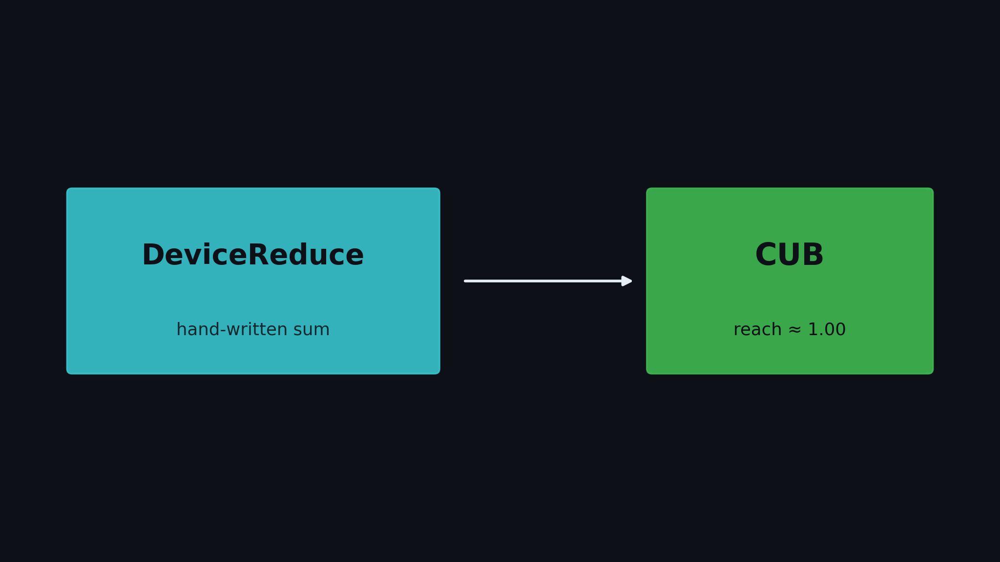
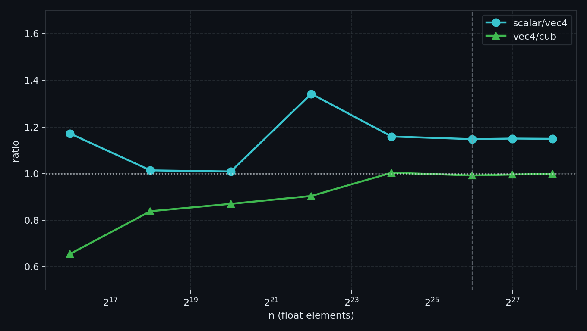

# D-01. DeviceReduce：手写求和达到 CUB



> C-10 把并发原语收成一张索引。整段数组怎么加完，不在那张表里。  
> **Module D = 手写算子**：对官方 **达到为达标，有缝则超过**。前三章先把手写做到「达到」。  
> 本章手写 `sum(x)`，对照 CUB。block 内 shuffle 已在 C-01 量过（最大约 **1.27×**），这里不重测。  
> 本机：大数组 `float4` 相对标量 **1.15×**；`vec4/cub` ≈ **1.00** → **已达到官方**。第二次 kernel 不抬这一档。

**配套可复现**：[Yapeng-Gao/AI-System-Performance-Lab](https://github.com/Yapeng-Gao/AI-System-Performance-Lab)（文章 + `.cu` + 实测表）。有用请 Star。本章示例：[`examples/04_operators/01_device_reduce.cu`](https://github.com/Yapeng-Gao/AI-System-Performance-Lab/blob/main/examples/04_operators/01_device_reduce.cu)。

## TL;DR

> 口径：RTX 5090 / `sm_120`，SMs=170。`x[i]=(i&255)`，host double，相对误差 ≤ 1e-3。CUDA event **median**。表见 [`docs/results/D-01_device_reduce.md`](../../docs/results/D-01_device_reduce.md)。有效字节 `n*4`，**含 L2**。

1. **定位**：手写 `sum(x)`。达标 = 大数组达到 CUB；本章未超过。
2. **形状**：读 N 个 float，写出 1 个。墙在加载。
3. **版本**：`scalar` → `vec4` → `twopass` → `cub`。大数组只拉开 `scalar→vec4`（**1.15×**）。
4. **结果**：1 GiB `vec4/cub` = **0.999**（0.638 / 0.639 ms）→ **达标**。twopass 同档。
5. **判停**：`vec4/cub`≈1 收工。标准形状可调 CUB（同水位封装）。median < 0.05 ms 不当结论。

---

## 1. 定义与形状

`sum(x)`：一元归约。一个 block 装不下整段输入时，每个 block 先出一份部分和，再收成一个标量。

CUDA 没有免费的「所有 block 到齐」。跨 block 常用两条路：每 block 对同一地址一次 `atomicAdd`；或把部分和写入表，再发一个小 kernel。`cub::DeviceReduce::Sum` 默认走固定树（后一种），同卡同配置 bitwise 稳定。

| | 本章 |
|---|---|
| 输入 | 一维 `float* x`，长度 `n`（256 的倍数） |
| 输出 | 一个 `float` |
| 有效字节 | `n * 4`（只计读） |
| 官方对照 | `cub::DeviceReduce::Sum` |
| 不是 | C-01 的单 block 规约；不是 D-02 点积 |

| 邻章 | 已有 | 本章不重复 |
|---|---|---|
| C-01 | warp shfl vs SMEM ≈ **1.27×** | 不扫 nwarps |
| C-03 | 同址 atomic 争用 | 不做「每元素一次 atomic」 |
| D-02 | 两向量点积 | 本章只做一元 sum |

## 2. 版本表

网格默认 `min(SMs×8, ceil(n/256))`。5090 大数组是 1360 block × 256 线程。线程 grid-stride 扫一段，寄存器累加后进 block 归约：warp shuffle → 8 格 SMEM → warp 0。只有 thread 0 碰全局输出。


> 四档共用同一套 block 归约。变的是加载宽度和跨 block 收尾。

| 路径 | 加载 | 跨 block | 计时备注 |
|---|---|---|---|
| `scalar` | `float` | 每 block 一次 `atomicAdd` | 含 4B `memset` 清累加器 |
| `vec4` | `float4`（16B） | 同上 | 同上 |
| `twopass` | `float4` | 写 `partials[]`，再一个 256 线程 kernel | 最后一次写覆盖 |
| `cub` | 库自选 | `cub::DeviceReduce::Sum` | 临时存储不计墙钟 |

**正确性**：`n` 为 256 倍数时，host 真值 `n * 255 / 2`（double）。相对误差 > 1e-3 退出。本机最大约 **1e-5**。没丢元素另用 int32 全 1 归档（和必须等于 `n`，见 `docs/results/D-01_sweep_int.csv`）。atomic 路径 float 加法顺序可不固定；和 CUB 比的是容差，不是逐 bit。

## 3. 本机数字与判停

```bash
./bin/04_operators_01_device_reduce --mode sweep
```

| mode | 作用 |
|---|---|
| `sweep` | 主曲线（2^16…2^28） |
| `modes` | 定点四条 |
| `scalar` / `vec4` / `twopass` / `cub` | 只跑一条 |

证据：裸跑 event median；相对误差超限先修归约。

主结论看右半段（median 已过 0.05 ms）：

| n | 字节 | scalar_ms | vec4_ms | twopass_ms | cub_ms | scalar/vec4 | vec4/cub |
|---:|---:|---:|---:|---:|---:|---:|---:|
| 2^26 | 256 MiB | 0.1889 | 0.1646 | 0.1656 | 0.1660 | **1.15×** | **0.992** |
| 2^27 | 512 MiB | 0.3707 | 0.3223 | 0.3247 | 0.3236 | **1.15×** | **0.996** |
| 2^28 | 1 GiB | 0.7333 | 0.6381 | 0.6390 | 0.6388 | **1.15×** | **0.999** |



> 青线 `scalar/vec4` 右端停在 **1.15×**。绿线 `vec4/cub` 贴着 **1.0**。左半段（0.01–0.03 ms）不当结论；小 n 上 CUB 更慢是 launch 税。

掉出缓存后：同一条 `vec4`，1 GiB 有效带宽约 **1.68 TB/s**；更小工作集上的数 TB/s 先当缓存。Harris 2007 在 G80 上十余倍是另一台机器、另一条基线；本章看两条：加载加宽是否约 **1.15×**，以及手写是否**达到** CUB（`vec4/cub`≈1）。

## 4. 生产建议

| 信号 | 建议 |
|---|---|
| 大数组仍是标量加载 | 换成 `float4`。本机 1 GiB **1.15×** |
| 已是 `float4`，想再发 kernel 收尾 | 大数组不赚。1 GiB twopass = 0.639 ms |
| `vec4/cub`≈1 | **达标**。标准形状可调 CUB（同水位封装）；`.cu` 留作对照 |
| 要 bitwise 稳定 | CUB 默认树，或自己的 twopass |
| 想超过默认 CUB | 标准大数组 `sum` 通常无缝 → 融合 / `not_guaranteed`（后章） |
| median < 0.05 ms 或数 TB/s | 先加大 `--n`；TB/s 先当缓存 |
| 点积 / 单 warp 规约 | 去 D-02 / 回 C-01 |

| 误区 | 纠正 |
|---|---|
| 规约该有 Harris 十余倍 | 本机大数组 **1.15×**；基线已是 block 归约 |
| 没有 grid.sync 就必须第二次 kernel | 每 block 一次原子与 twopass 同档 |
| 贴库 / 调库 = 手写失败 | 贴库 = **达到官方**；调库 = 同水位封装 |
| 缓存内数 TB/s = 打满总线 | 1 GiB 回到约 **1.68 TB/s** |
| float 误差过了 = 丢元素 | 本机约 **1e-5**；丢元素看 int 归档 |

**边界**：float；block 固定 256；不扫 CUB `not_guaranteed` / `gpu_to_gpu`；不报 NCU；fp8 不做。

## 5. 下一算子

下一张：D-02 Dot，手写点积对照 `cublasSdot`。同一套 block 归约，多一路读。

---

> 本文配套代码与实测：[AI-System-Performance-Lab](https://github.com/Yapeng-Gao/AI-System-Performance-Lab)。觉得有用请 Star。  
> 本章示例：[`examples/04_operators/01_device_reduce.cu`](https://github.com/Yapeng-Gao/AI-System-Performance-Lab/blob/main/examples/04_operators/01_device_reduce.cu)。下一篇：[D 模块文章目录](https://github.com/Yapeng-Gao/AI-System-Performance-Lab/tree/main/article/04_operators/)。

## 参考文献

### A. 官方

1. [CUB `DeviceReduce`](https://nvidia.github.io/cccl/unstable/cub/api/structcub_1_1DeviceReduce.html)：工作量线性。默认 `run_to_run` 固定归约树，不用原子，同卡同配置 bitwise 稳定。
2. [CCCL 3.1：浮点归约确定性](https://developer.nvidia.com/blog/controlling-floating-point-determinism-in-nvidia-cccl/)：`not_guaranteed` 可单 kernel 加原子；H200/B200 上 2^16 约快 20%。本章不扫三档，也不把 20% 当 5090 达标线。

### B. 工程

3. Mark Harris, *Optimizing Parallel Reduction in CUDA*（2007）[PDF](https://developer.download.nvidia.com/assets/cuda/files/reduction.pdf)：约 1 flop/元素，目标带宽。G80 上从交织寻址到展开约 2→30 GB/s。只借步骤，不搬倍数。
4. Mark Harris, [Faster Parallel Reductions on Kepler](https://developer.nvidia.com/blog/faster-parallel-reductions-kepler/)：shuffle 代 SMEM warp 归约。C-01 已量过。

### C. 实证

5. Nicholas Wilt, *The CUDA Handbook* 第 12 章，[Optimizing for Bandwidth](https://cudahandbook.com/book/ch12/optimizing-for-bandwidth)。RTX 3060、64M int：shuffle 316 GB/s，向量化单次原子 339 GB/s，CUB 340 GB/s。机器不是 5090。本章对应结论：1 GiB `vec4/cub` ≈ 1.0。
