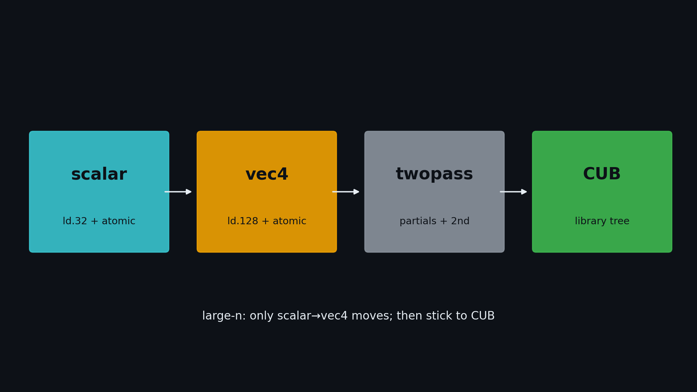

# D-01. DeviceReduce：手写求和达到 CUB


> C-10 讲的是并发原语。整段数组怎么加完，要到这一章。  
> 手写 `sum(x)`，用 CUB 比快慢。数组一大，时间主要花在从显存读数。一次读 `float4`，大约比一次读一个 float 快 **1.15×**。block 之间用原子累加，或再开一趟小 kernel，大数组上几乎一样快。手写和 CUB 打平（`vec4/cub`≈**1.00**），再抠也抠不出稳定优势。  
> Module D 的达标线：手写跑到和官方库一样快。block 里的 shuffle 已在 C-01 测过，这里不重测。

**配套可复现**：[Yapeng-Gao/AI-System-Performance-Lab](https://github.com/Yapeng-Gao/AI-System-Performance-Lab)（文章 + `.cu` + 实测表）。有用请 Star。本章示例：[`examples/04_operators/01_device_reduce.cu`](https://github.com/Yapeng-Gao/AI-System-Performance-Lab/blob/main/examples/04_operators/01_device_reduce.cu)。

## TL;DR

> 口径：RTX 5090 / `sm_120`，SMs=170。`x[i]=(i&255)`，host double，相对误差 ≤ 1e-3。CUDA event **median**。表见 [`docs/results/D-01_device_reduce.md`](../../docs/results/D-01_device_reduce.md)。有效字节 `n*4`，**含 L2**。

1. **结论**：大数组求和，慢在读显存；手写可以和 CUB 一样快，本章没有更快。
2. **读写**：读 N 个 float，写出 1 个总和。
3. **怎么比**：四种实现共用同一套 block 内归约；只改「一次读多宽」和「block 之间怎么收部分和」。CUB 用来卡时间。
4. **数字**：1 GiB 上 `scalar/vec4`=**1.15×**；`vec4/cub`=**0.999**；twopass ≈ vec4。
5. **怎么用**：大数组求和直接调 CUB。要自己对照或嵌进别的 kernel，用手写 `float4` + 每个 block 原子加一次。median < 0.05 ms 的点不当结论。

---

## 1. 定义与形状

`sum(x)`：把一长串 float 加出**一个**数。

一个 block（线程块）装不下整段数组。做法是：每个 block 先算出自己的部分和，再合成全局总和。读 N 个数、只写回 1 个数。加法很便宜；数组一大，时间主要花在**从显存读数据**。

多个 block 之间，没有「全部跑完再继续」这种免费同步。常见两种收法：

1. 每个 block 把自己的部分和，往同一个全局地址做一次 `atomicAdd`
2. 先把各 block 的部分和写进一张表，再启动一个小 kernel 把表加完

`cub::DeviceReduce::Sum` 默认走第 2 种（固定归约树），同卡同配置下结果可以逐 bit 相同。本章只用 CUB 比快慢，不讲它内部树怎么长。

| | 本章 |
|---|---|
| 输入 | 一维 `float* x`，长度 `n`（256 的倍数） |
| 输出 | 一个 `float` |
| 有效字节 | `n * 4`（只计读） |
| 官方对照 | `cub::DeviceReduce::Sum` |
| 不是 | C-01 的单 block 规约；不是 D-02 点积 |

| 邻章 | 已有 | 本章不重复 |
|---|---|---|
| C-01 | warp shfl vs SMEM ≈ **1.27×** | 不扫 nwarps |
| C-03 | 同址 atomic 争用 | 不做「每元素一次 atomic」 |
| D-02 | 两向量点积 | 本章只做一元 sum |

## 2. 版本表

网格默认 `min(SMs×8, ceil(n/256))`。5090 上大数组是 1360 个 block，每个 256 线程。四种路径共用同一套 **block 内部**归约，只改两处：

1. **一次读多宽**：每次读 1 个 float，还是一次读 `float4`（16 字节）
2. **block 之间怎么收**：每个 block 原子加一次，还是先写 `partials[]`、再开第二次 kernel（`finalize`）



> block 里怎么收，四档一样。变的是读多宽，以及 block 之间用原子还是再开一趟 kernel。

| 路径 | 怎么读 | block 之间 | 计时备注 |
|---|---|---|---|
| `scalar` | 每次 1 个 `float` | 每 block 一次 `atomicAdd` | 含 4B `memset` 清累加器 |
| `vec4` | 每次 1 个 `float4`（16B） | 同上 | 同上 |
| `twopass` | 同上 `float4` | 写 `partials[]`，再开一个 256 线程的 kernel | 最后一次写覆盖；无 memset |
| `cub` | 库自己选 | `cub::DeviceReduce::Sum` | 临时缓冲的分配不计入计时 |

**正确性**：`n` 为 256 倍数时，host 真值是 `n * 255 / 2`（用 double 算）。相对误差 > 1e-3 就退出。本机最大约 **1e-5**。是否漏加元素，另用 int32 全 1 做归档（和必须等于 `n`，见 `docs/results/D-01_sweep_int.csv`）。走原子时，float 加法顺序可以不固定；和 CUB 比的是误差是否够小，不是每一位都相同。

## 3. 实现思路与代码

每个 block 里做三步：

1. 线程按固定步长跳着扫自己负责的那段（grid-stride），边扫边累加
2. `block_sum` 收成该 block 的部分和（只有 thread 0 上的值有效）
3. 把部分和交到全局（原子，或写入 `partials[]`）

| 步骤 | 做法 | 代码 |
|---|---|---|
| 标量读 | `acc += in[i]` | `acc_scalar` |
| 加宽读 | 循环上界改成 `n/4`，一次读 `float4`，四点相加 | `acc_vec4` |
| block 内收 | warp shuffle → 8 格共享内存 → 第 0 个 warp 再收；只信 thread 0 | `block_sum` |
| block 间（原子） | 每 block 一次 `atomicAdd` | `kernel_vec4` |
| block 间（两趟） | 写 `partials[]` → 单个 block 做 `finalize` | `kernel_partial` / `kernel_finalize` |
| 计时 | 原子路径含 `memset`；CUB 临时缓冲在计时外 | `time_vec4` / `time_cub` |

主对照：`float4` 加载 + 每个 block 原子加一次。

```183:202:examples/04_operators/01_device_reduce.cu
__device__ __forceinline__ float acc_vec4(const float* in, int n) {
  const int n4 = n >> 2;
  const float4* in4 = reinterpret_cast<const float4*>(in);
  float acc = 0.f;
  for (int i = blockIdx.x * blockDim.x + threadIdx.x; i < n4; i += blockDim.x * gridDim.x) {
    const float4 v = in4[i];
    acc += (v.x + v.y) + (v.z + v.w);
  }
  return acc;
}

__global__ void kernel_vec4(const float* in, float* out, int n) {
  const float sum = block_sum(acc_vec4(in, n));
  if (threadIdx.x == 0) atomicAdd(out, sum);
}
```

`acc_scalar` 结构相同，只是每次加一个 `in[i]`。四种路径共用的 block 内归约：

```160:173:examples/04_operators/01_device_reduce.cu
__device__ __forceinline__ float block_sum(float v) {
  v = warp_sum(v);
  __shared__ float warp_sums[8];
  const int lane = threadIdx.x & 31;
  const int warp = threadIdx.x >> 5;
  if (lane == 0) warp_sums[warp] = v;
  __syncthreads();
  float x = 0.f;
  if (warp == 0) {
    x = (lane < 8) ? warp_sums[lane] : 0.f;
    x = warp_sum(x);
  }
  return x;
}
```

twopass 仍然用 `acc_vec4` 读数，block 之间改成两趟、不用原子。大数组上要看的是：多开第二次 kernel 会不会更快。

```204:214:examples/04_operators/01_device_reduce.cu
__global__ void kernel_partial(const float* in, float* partials, int n) {
  const float sum = block_sum(acc_vec4(in, n));
  if (threadIdx.x == 0) partials[blockIdx.x] = sum;
}

__global__ void kernel_finalize(const float* partials, int npartials, float* out) {
  float acc = 0.f;
  for (int i = threadIdx.x; i < npartials; i += blockDim.x) acc += partials[i];
  const float sum = block_sum(acc);
  if (threadIdx.x == 0) *out = sum;
}
```

计时里包了什么：原子路径把「清零输出」的 4B `memset` 也算进去；CUB 的临时缓冲在分配阶段就准备好，计时里只跑 `Sum`。

```315:338:examples/04_operators/01_device_reduce.cu
static float time_vec4(Buffers& b, int runs, int warmup, double* rel) {
  const float ms = time_median(b, runs, warmup, [&] {
    CUDA_CHECK(cudaMemsetAsync(b.out, 0, sizeof(float), b.stream));
    kernel_vec4<<<b.grid, b.block, 0, b.stream>>>(b.in, b.out, b.n);
  });
  *rel = check_sum(b, "vec4");
  return ms;
}

static float time_twopass(Buffers& b, int runs, int warmup, double* rel) {
  const float ms = time_median(b, runs, warmup, [&] {
    kernel_partial<<<b.grid, b.block, 0, b.stream>>>(b.in, b.partials, b.n);
    kernel_finalize<<<1, b.block, 0, b.stream>>>(b.partials, b.grid, b.out);
  });
  *rel = check_sum(b, "twopass");
  return ms;
}

static float time_cub(Buffers& b, int runs, int warmup, double* rel) {
  const float ms = time_median(b, runs, warmup, [&] {
    CUDA_CHECK(cub::DeviceReduce::Sum(b.cub_temp, b.cub_bytes, b.in, b.out, b.n, b.stream));
  });
  *rel = check_sum(b, "cub");
  return ms;
}
```

手写这边多包了一次 `memset`，大数组上 `vec4` 仍然和 CUB 一样快。数字见下一节。

## 4. 本机数字与判停

```bash
./bin/04_operators_01_device_reduce --mode sweep
```

| mode | 作用 |
|---|---|
| `sweep` | 主曲线（2^16…2^28） |
| `modes` | 定点跑四条 |
| `scalar` / `vec4` / `twopass` / `cub` | 只跑一条 |

看右半段（median 已经超过 0.05 ms）：

| n | 字节 | scalar_ms | vec4_ms | twopass_ms | cub_ms | scalar/vec4 | vec4/cub |
|---:|---:|---:|---:|---:|---:|---:|---:|
| 2^26 | 256 MiB | 0.1889 | 0.1646 | 0.1656 | 0.1660 | **1.15×** | **0.992** |
| 2^27 | 512 MiB | 0.3707 | 0.3223 | 0.3247 | 0.3236 | **1.15×** | **0.996** |
| 2^28 | 1 GiB | 0.7333 | 0.6381 | 0.6390 | 0.6388 | **1.15×** | **0.999** |


> 青线右端 **1.15×**：一次读更宽有用。绿线贴 **1.0**：手写达到 CUB。twopass 和 `vec4` 差不多。左边时间太短，不当结论。

数组大到掉出缓存之后，同一条 `vec4` 在 1 GiB 大约 **1.68 TB/s**。更小数组上冒出来的「好几 TB/s」，多半还在吃缓存，不要当成打满了显存带宽。Harris 2007 在老卡 G80 上看到十余倍，那是另一台机器、另一条对比起点；本章一上来就已经做完 block 内归约，只关心两件事：加宽读取有没有约 **1.15×**，以及能不能和 CUB 打平。

**判停**：`vec4/cub`≈1 就收工。

## 5. 生产建议

大数组求和：直接调 CUB。

要自己对照、或嵌进别的 kernel：用手写 `float4` + 每个 block 原子加一次，速度和库同一档。想比默认 CUB 更快，别在这种标准大数组 `sum` 上死磕；去做算子融合，或看后面专门挖空子的章节（例如 CUB 的 `not_guaranteed`）。

| 信号 | 建议 |
|---|---|
| 还在一次读一个 float | 换成 `float4`。本机 1 GiB **1.15×** |
| 已经 `float4`，还想再开一趟 kernel 收尾 | 大数组不赚。1 GiB twopass = 0.639 ms |
| 要每次结果逐 bit 相同 | 用 CUB 默认树，或自己的 twopass |
| median < 0.05 ms，或冒出好几 TB/s | 加大 `--n`；TB/s 先当缓存 |
| 点积 / 单个 warp 里的规约 | 去 D-02 / 回 C-01 |

| 误区 | 纠正 |
|---|---|
| 规约该有 Harris 那种十余倍 | 本机大数组只有 **1.15×** |
| 没有 grid.sync 就只能开第二次 kernel | 每 block 原子一次，和 twopass 一样快 |
| 追上库 = 手写失败 | 追上库 = 达标；调库 = 同一速度的封装 |
| 缓存里冒出的数 TB/s = 打满显存 | 1 GiB 会回到约 **1.68 TB/s** |
| float 相对误差过了 = 漏加了元素 | 本机约 **1e-5**；漏加看 int 全 1 归档 |

**边界**：只做 float；block 固定 256；不扫 CUB `not_guaranteed` / `gpu_to_gpu`；不报 NCU；不做 fp8。

## 6. 下一算子

下一张 D-02 Dot：还是这套 block 内归约，多读一路向量 `y`，对照 `cublasSdot`。

---

> 本文配套代码与实测：[AI-System-Performance-Lab](https://github.com/Yapeng-Gao/AI-System-Performance-Lab)。觉得有用请 Star。  
> 本章示例：[`examples/04_operators/01_device_reduce.cu`](https://github.com/Yapeng-Gao/AI-System-Performance-Lab/blob/main/examples/04_operators/01_device_reduce.cu)。下一篇：[D 模块文章目录](https://github.com/Yapeng-Gao/AI-System-Performance-Lab/tree/main/article/04_operators/)。

## 参考文献

### A. 官方

1. [CUB `DeviceReduce`](https://nvidia.github.io/cccl/unstable/cub/api/structcub_1_1DeviceReduce.html)：工作量线性。默认 `run_to_run` 固定归约树，不用原子，同卡同配置 bitwise 稳定。
2. [CCCL 3.1：浮点归约确定性](https://developer.nvidia.com/blog/controlling-floating-point-determinism-in-nvidia-cccl/)：`not_guaranteed` 可单 kernel 加原子；H200/B200 上 2^16 约快 20%。本章不扫三档，也不把 20% 当 5090 达标线。

### B. 工程

3. Mark Harris, *Optimizing Parallel Reduction in CUDA*（2007）[PDF](https://developer.download.nvidia.com/assets/cuda/files/reduction.pdf)：约 1 flop/元素，目标带宽。G80 上从交织寻址到展开约 2→30 GB/s。只借步骤，不搬倍数。
4. Mark Harris, [Faster Parallel Reductions on Kepler](https://developer.nvidia.com/blog/faster-parallel-reductions-kepler/)：shuffle 代 SMEM warp 归约。C-01 已量过。

### C. 实证

5. Nicholas Wilt, *The CUDA Handbook* 第 12 章，[Optimizing for Bandwidth](https://cudahandbook.com/book/ch12/optimizing-for-bandwidth)。RTX 3060、64M int：shuffle 316 GB/s，向量化单次原子 339 GB/s，CUB 340 GB/s。机器不是 5090。本章对应结论：1 GiB `vec4/cub` ≈ 1.0。
