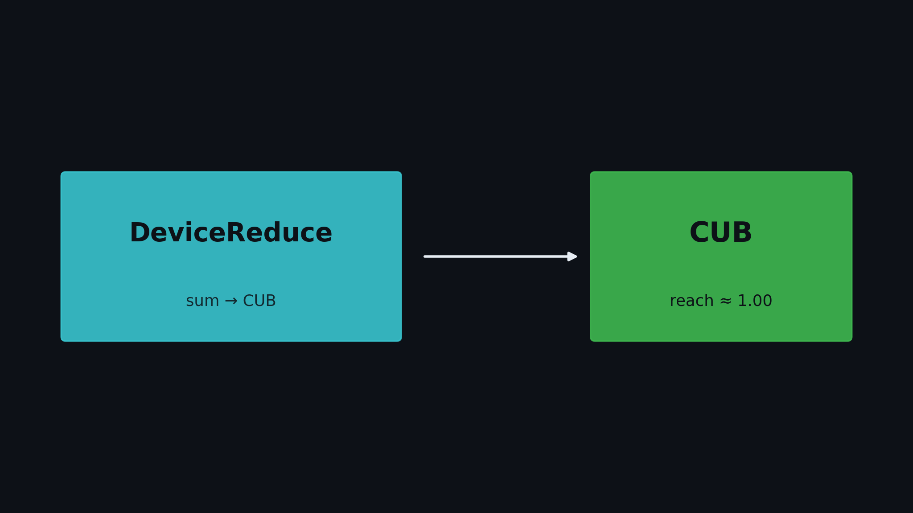
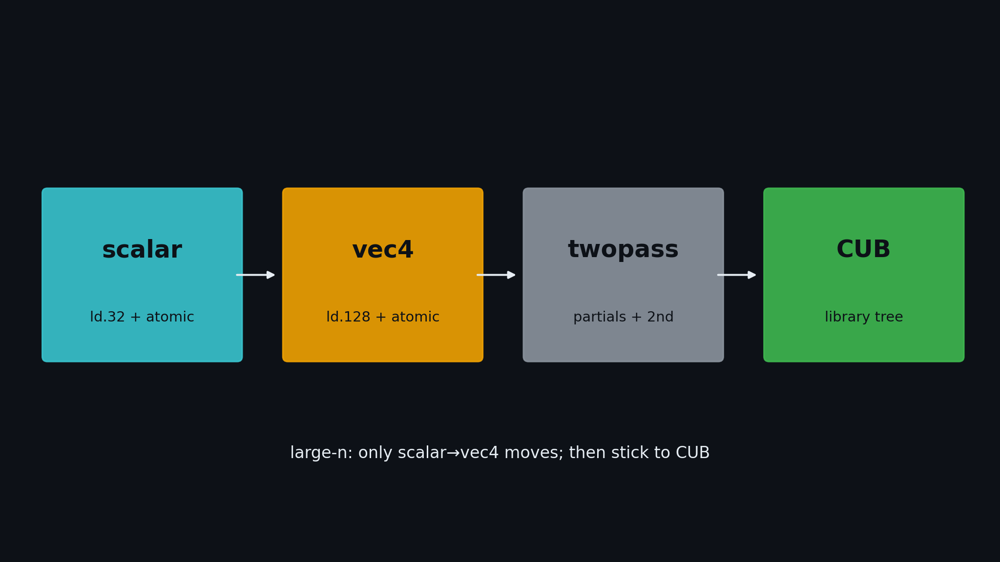
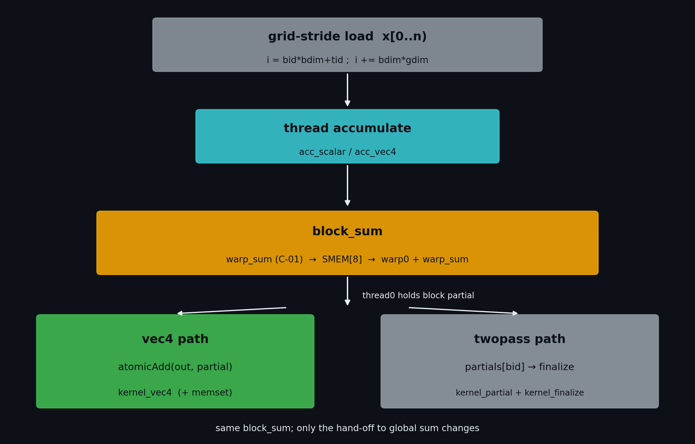
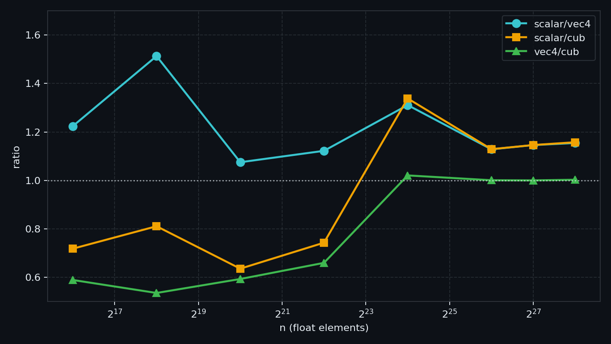

# D-01. 求和达到 CUB



> C-10 讲并发原语。整段数组求和，落到 DeviceReduce。  
> 本章写 `sum(x)`：两层归约、四档手写，用 `cub::DeviceReduce::Sum` 卡时间。  
> 本机：`float4` 约 **1.15×**；`vec4/cub`≈**1.00**。

**配套可复现**：[Yapeng-Gao/AI-System-Performance-Lab](https://github.com/Yapeng-Gao/AI-System-Performance-Lab)（文章 + `.cu` + 实测表）。有用请 Star。本章示例：[`examples/04_operators/01_device_reduce.cu`](https://github.com/Yapeng-Gao/AI-System-Performance-Lab/blob/main/examples/04_operators/01_device_reduce.cu)。

## TL;DR

> 口径：RTX 5090 / `sm_120`，SMs=170。`x[i]=(i&255)`，host double，相对误差 ≤ 1e-3。CUDA event **median**。表见 [`docs/results/D-01_device_reduce.md`](../../docs/results/D-01_device_reduce.md)。有效字节 `n*4`，**含 L2**。

1. **形状**：`y = Σ x[i]`；读 N、写 1；大数组慢在读显存。
2. **阶梯**：scalar → `float4` → 可选 twopass；block 内归约四档共用。
3. **天花板**：`cub::DeviceReduce::Sum`；达到库 = 达标。
4. **数字**：1 GiB 上 `scalar/vec4`=**1.15×**；`vec4/cub`=**0.999**；twopass ≈ vec4。
5. **用法**：生产调 CUB；嵌别的 kernel 用手写 `float4` + 每 block 一次原子加。

---

## 1. 求和：读 N 写 1

定义：

\[
y = \sum_{i=0}^{n-1} x[i]
\]

设备上常见写法是 DeviceReduce：每个 block 先出**部分和**，再合成全局 `y`。读 N 个 float、写回 1 个数。加法便宜；`n` 一大，时间花在读显存。loss、统计量、许多「先局部再全局」的骨架都是这一形。CUB 入口是 `cub::DeviceReduce::Sum`。

| | 本章 |
|---|---|
| 输入 | 一维 `float* x`，长度 `n`（256 的倍数） |
| 输出 | 一个 `float` |
| 有效字节 | `n * 4`（只计读） |
| 官方对照 | `cub::DeviceReduce::Sum` |
| 不是 | C-01 的单 block 规约；不是 D-02 点积 |

| 邻章 | 已有 | 本章不重复 |
|---|---|---|
| C-01 | warp shfl vs SMEM ≈ **1.27×** | 不扫 nwarps；block 内归约当积木 |
| C-03 | 同址 atomic 争用 | 不做「每元素一次 atomic」 |
| D-02 | 两向量点积 | 本章只做一元 sum |

## 2. 四档版本

一个 block 装不下整段 `x`，拆两层。

**block 内**：线程先各自累加，再收成该 block 的一个部分和（warp shuffle + 少量共享内存；细节回 C-01）。  
**block 间**：没有「全部 block 跑完再继续」的免费同步。两条常见路——每 block 对同一地址 `atomicAdd` 一次；或先写 `partials[]`，再开一个小 kernel 加完。

`cub::DeviceReduce::Sum` 默认更接近第二路（固定归约树），同卡同配置可逐 bit 相同。本章只用它比墙钟，不拆树。

读侧再分一档：每次 1 个 `float`，还是一次 `float4`（16B）。墙在加载时，加宽读通常更贴带宽。



> block 内收法四档相同。变的是读宽，以及 block 间用原子还是两趟。

| 路径 | 怎么读 | block 之间 | 这一档看什么 |
|---|---|---|---|
| `scalar` | 每次 1 个 `float` | 每 block 一次 `atomicAdd` | 基线 |
| `vec4` | 每次 1 个 `float4` | 同上 | 主手写 |
| `twopass` | 同上 `float4` | 写 `partials[]` + 第二次 kernel | 两趟值不值 |
| `cub` | 库自己选 | `cub::DeviceReduce::Sum` | 官方天花板 |

网格默认 `min(SMs×8, ceil(n/256))`。5090 大数组约 1360 个 block × 256 线程。

## 3. 手写主路径

按上表落地。每个 block：grid-stride 累加 → `block_sum`（只信 thread 0）→ 交到全局（原子或两趟）。

**grid-stride**：线程起点是 `blockIdx*blockDim+threadIdx`，以后每次加 `blockDim*gridDim`，把比线程数更长的 `x` 扫完。下面循环里的 `i += …` 就是这一步。



> 自上而下：grid-stride → 线程累加 → `block_sum`（含 `warp_sum`）→ 原子 / 两趟分叉。

| 步骤 | 做法 | 代码 |
|---|---|---|
| 标量读 | `acc += in[i]` | `acc_scalar` |
| 加宽读 | 上界 `n/4`，一次读 `float4` | `acc_vec4` |
| block 内收 | `warp_sum`（回 [C-01](../03_compute_primitives/C-01.%20Warp%20Primitives：寄存器级通信、mask%20正确性与规约加速比.md)）→ 8 格 SMEM → 第 0 个 warp 再收 | `block_sum` |
| block 间（原子） | 每 block 一次 `atomicAdd` | `kernel_vec4` |
| block 间（两趟） | 写 `partials[]` → `finalize` | `kernel_partial` / `kernel_finalize` |

主对照：`float4` + 每 block 一次原子加。`warp_sum` 是 warp 内 shuffle 求和，本章当积木用，不重测。

```183:202:examples/04_operators/01_device_reduce.cu
__device__ __forceinline__ float acc_vec4(const float* in, int n) {
  const int n4 = n >> 2;
  const float4* in4 = reinterpret_cast<const float4*>(in);
  float acc = 0.f;
  for (int i = blockIdx.x * blockDim.x + threadIdx.x; i < n4; i += blockDim.x * gridDim.x) {
    const float4 v = in4[i];
    acc += (v.x + v.y) + (v.z + v.w);
  }
  return acc;
}

__global__ void kernel_vec4(const float* in, float* out, int n) {
  const float sum = block_sum(acc_vec4(in, n));
  if (threadIdx.x == 0) atomicAdd(out, sum);
}
```

`acc_scalar` 同结构，每次加一个 `in[i]`。四档共用的 block 内归约（256 线程 = 8 warp，故 `warp_sums[8]`）：

```160:173:examples/04_operators/01_device_reduce.cu
__device__ __forceinline__ float block_sum(float v) {
  v = warp_sum(v);
  __shared__ float warp_sums[8];
  const int lane = threadIdx.x & 31;
  const int warp = threadIdx.x >> 5;
  if (lane == 0) warp_sums[warp] = v;
  __syncthreads();
  float x = 0.f;
  if (warp == 0) {
    x = (lane < 8) ? warp_sums[lane] : 0.f;
    x = warp_sum(x);
  }
  return x;
}
```

twopass 仍走 `acc_vec4`，block 间改两趟、不用原子：

```204:214:examples/04_operators/01_device_reduce.cu
__global__ void kernel_partial(const float* in, float* partials, int n) {
  const float sum = block_sum(acc_vec4(in, n));
  if (threadIdx.x == 0) partials[blockIdx.x] = sum;
}

__global__ void kernel_finalize(const float* partials, int npartials, float* out) {
  float acc = 0.f;
  for (int i = threadIdx.x; i < npartials; i += blockDim.x) acc += partials[i];
  const float sum = block_sum(acc);
  if (threadIdx.x == 0) *out = sum;
}
```

## 4. 复现与正确性

```bash
./bin/04_operators_01_device_reduce --mode sweep
```

| mode | 作用 |
|---|---|
| `sweep` | 主曲线（2^16…2^28） |
| `modes` | 定点四条 |
| `scalar` / `vec4` / `twopass` / `cub` | 单路径 |

**正确性**：`n` 为 256 倍数时，host 真值 `n * 255 / 2`（double）。相对误差 > 1e-3 退出；本机最大约 **1e-5**。漏加看 int32 全 1 归档（和必须等于 `n`）。原子路径下 float 加法顺序可不固定；对 CUB 只要求误差够小，不要求逐 bit。

**计时边界**：原子路径含清零输出的 4B `memset`；CUB 临时缓冲在计时外分配，计时里只跑 `Sum`。对应 `time_vec4` / `time_twopass` / `time_cub`（见 `.cu`）。主看右半段（median > 0.05 ms）。GB/s **含 L2**；缓存里冒出的「好几 TB/s」不当打满显存。

## 5. 达到 CUB

尺子：`cub::DeviceReduce::Sum`。`vec4/cub`≈1 → **达到**官方。

| n | 字节 | scalar_ms | vec4_ms | twopass_ms | cub_ms | scalar/vec4 | vec4/cub |
|---:|---:|---:|---:|---:|---:|---:|---:|
| 2^26 | 256 MiB | 0.1889 | 0.1646 | 0.1656 | 0.1660 | **1.15×** | **0.992** |
| 2^27 | 512 MiB | 0.3707 | 0.3223 | 0.3247 | 0.3236 | **1.15×** | **0.996** |
| 2^28 | 1 GiB | 0.7333 | 0.6381 | 0.6390 | 0.6388 | **1.15×** | **0.999** |



> 青线右端 **1.15×**：加宽读有用。绿线贴 **1.0**：达到 CUB。twopass ≈ `vec4`。

1 GiB 上 `vec4` 约 **1.68 TB/s**。Harris 2007 在老卡上看到十余倍，机器和对比起点都不同；本章起点已是做完 block 内归约，只看加宽读的 **1.15×** 和能否贴 CUB。

**判停**：`vec4/cub`≈1 收工。追上库 = 达标。

## 6. 生产建议

大数组求和调 CUB。嵌别的 kernel：手写 `float4` + 每 block 原子一次，与库同档。想赢默认 CUB，别在标准大数组 `sum` 上抠；去做融合，或看后面挖空子的章。

| 信号 | 建议 |
|---|---|
| 还在一次读一个 float | 换成 `float4`。本机 1 GiB **1.15×** |
| 已经 `float4`，还想再开一趟收尾 | 大数组不赚。1 GiB twopass = 0.639 ms |
| 要逐 bit 相同 | CUB 默认树，或自己的 twopass |
| median < 0.05 ms，或冒出好几 TB/s | 加大 `--n`；TB/s 先当缓存 |
| 点积 / 单 warp 规约 | 去 D-02 / 回 C-01 |

| 误区 | 纠正 |
|---|---|
| 规约该有 Harris 那种十余倍 | 本机大数组只有 **1.15×** |
| 没有 grid.sync 就只能开第二次 kernel | 每 block 原子一次，和 twopass 一样快 |
| 追上库 = 手写失败 | 追上库 = 达标；调库 = 同档封装 |
| 缓存里的数 TB/s = 打满显存 | 1 GiB 回到约 **1.68 TB/s** |
| float 相对误差过了 = 漏加元素 | 本机约 **1e-5**；漏加看 int 全 1 归档 |

**边界**：只做 float；block 固定 256；不扫 CUB `not_guaranteed` / `gpu_to_gpu`；不报 NCU；不做 fp8。

## 7. 下一算子

D-02 Dot：同一套 block 内归约，多读一路 `y`，对照 `cublasSdot`。

---

> 本文配套代码与实测：[AI-System-Performance-Lab](https://github.com/Yapeng-Gao/AI-System-Performance-Lab)。觉得有用请 Star。  
> 本章示例：[`examples/04_operators/01_device_reduce.cu`](https://github.com/Yapeng-Gao/AI-System-Performance-Lab/blob/main/examples/04_operators/01_device_reduce.cu)。下一篇：[D 模块文章目录](https://github.com/Yapeng-Gao/AI-System-Performance-Lab/tree/main/article/04_operators/)。

## 参考文献

### A. 官方

1. [CUB `DeviceReduce`](https://nvidia.github.io/cccl/unstable/cub/api/structcub_1_1DeviceReduce.html)：工作量线性。默认 `run_to_run` 固定归约树，不用原子，同卡同配置 bitwise 稳定。
2. [CCCL 3.1：浮点归约确定性](https://developer.nvidia.com/blog/controlling-floating-point-determinism-in-nvidia-cccl/)：`not_guaranteed` 可单 kernel 加原子；H200/B200 上 2^16 约快 20%。本章不扫三档，也不把 20% 当 5090 达标线。

### B. 工程

3. Mark Harris, *Optimizing Parallel Reduction in CUDA*（2007）[PDF](https://developer.download.nvidia.com/assets/cuda/files/reduction.pdf)：约 1 flop/元素，目标带宽。G80 上从交织寻址到展开约 2→30 GB/s。只借步骤，不搬倍数。
4. Mark Harris, [Faster Parallel Reductions on Kepler](https://developer.nvidia.com/blog/faster-parallel-reductions-kepler/)：shuffle 代 SMEM warp 归约。C-01 已量过。

### C. 实证

5. Nicholas Wilt, *The CUDA Handbook* 第 12 章，[Optimizing for Bandwidth](https://cudahandbook.com/book/ch12/optimizing-for-bandwidth)。RTX 3060、64M int：shuffle 316 GB/s，向量化单次原子 339 GB/s，CUB 340 GB/s。机器不是 5090。本章对应结论：1 GiB `vec4/cub` ≈ 1.0。
