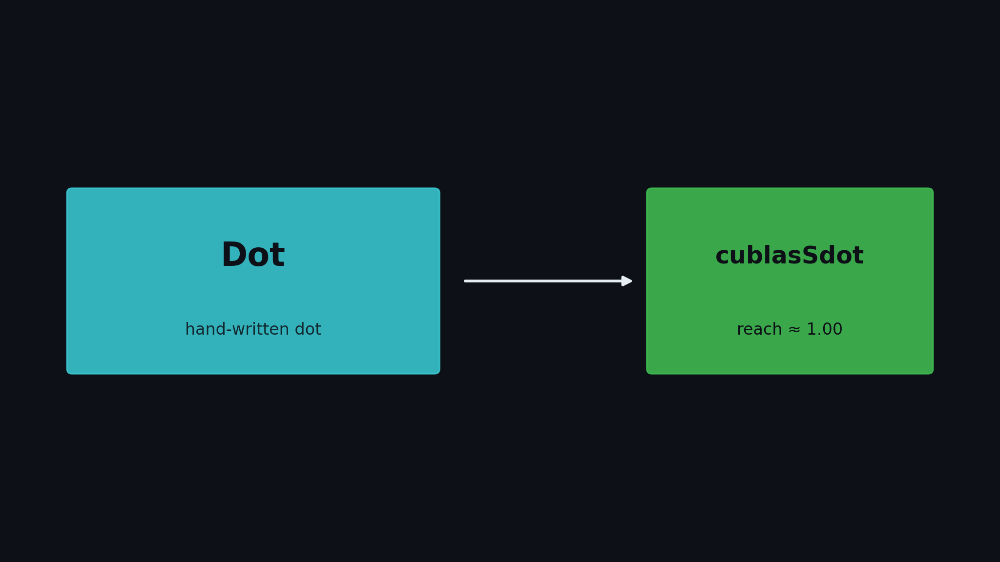
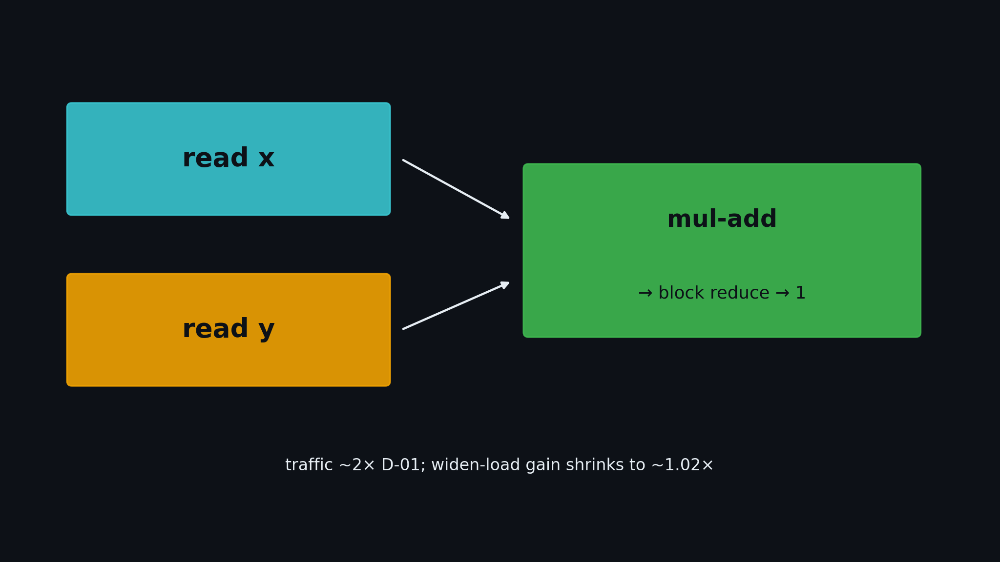

# D-02. Dot：手写点积达到 cublasSdot



> D-01 手写 `sum` 已达到 CUB。  
> **本章继续手写**：`dot(x,y)` 对照 `cublasSdot`。多一路读，看流量翻倍后还能不能达到官方。不是 GEMV。  
> 本机：大数组上 `vec4/cublas` ≈ **1.00** → **已达到**；`float4` 相对标量约 **1.02×**。

**配套可复现**：[Yapeng-Gao/AI-System-Performance-Lab](https://github.com/Yapeng-Gao/AI-System-Performance-Lab)（文章 + `.cu` + 实测表）。有用请 Star。本章示例：[`examples/04_operators/02_dot.cu`](https://github.com/Yapeng-Gao/AI-System-Performance-Lab/blob/main/examples/04_operators/02_dot.cu)。

## TL;DR

> 口径：RTX 5090 / `sm_120`，SMs=170。两路 float，host double，相对误差 ≤ 1e-3。CUDA event **median**。表见 [`docs/results/D-02_dot.md`](../../docs/results/D-02_dot.md)。有效字节 `2*n*4`，**含 L2**。

1. **定位**：手写点积。达标 = 达到 `cublasSdot`；本章大数组未超过。
2. **形状**：读 2N 个 float，写出 1 个。流量约是 D-01 的两倍。
3. **版本**：`scalar` → `vec4` → `cublas`。双流后加宽加载约 **1.02×**。
4. **结果**：2 GiB 流量 `vec4/cublas` = **0.997** → **达标**。
5. **判停**：达到就收工。标准形状可调 cuBLAS。median < 0.05 ms 不当结论。

---

## 1. 定义与形状

`dot(x,y) = sum(x[i]*y[i])`。相对 D-01，多出来的不是另一种归约树，而是**多读一整路 y**。

| | 本章 |
|---|---|
| 输入 | 两个一维 `float*`，长度 `n` |
| 输出 | 一个 `float` |
| 有效字节 | `2 * n * 4` |
| 官方对照 | `cublasSdot`（`POINTER_MODE_DEVICE`） |
| 不是 | D-19 SGEMV；不是一元 sum |

| 邻章 | 已有 | 本章不重复 |
|---|---|---|
| D-01 | 一元 sum、跨 block 收尾、达到 CUB | 不重讲 device reduce |
| C-01 | warp shfl | 只当积木 |
| D-19 | SGEMV | 本章形状是两个向量 |



> 上面读 x，下面读 y。线程里乘加，再进与 D-01 相同的 block 归约。

## 2. 版本表

网格与 block 同 D-01。每个线程 grid-stride：`x[i]*y[i]` 累进寄存器 → 同一套 `block_sum`。只有 thread 0 碰全局输出。本章不重测 shuffle；也不再测 twopass（D-01 已证大数组不赚）。

| 路径 | 加载 | 收尾 / 库 | 计时备注 |
|---|---|---|---|
| `scalar` | 标量 `x`/`y` | 每 block 一次 `atomicAdd` | 含 4B `memset` |
| `vec4` | `float4` 两路 | 同上 | 同上 |
| `cublas` | 库自选 | `cublasSdot`，结果留 device | handle/stream 在计时外 |

**正确性**：`x[i]=(i&255)`，`y[i]=((3*i)&255)`。`n` 为 256 倍数时，host 真值 `(n/256)*4624000`（double）。相对误差 > 1e-3 退出。本机约 **1e-5**。手写原子与 cuBLAS 比容差，不比逐 bit。

## 3. 本机数字与判停

```bash
./bin/04_operators_02_dot --mode sweep
```

| mode | 作用 |
|---|---|
| `sweep` | 主曲线（2^16…2^28） |
| `modes` | 定点三条 |
| `scalar` / `vec4` / `cublas` | 只跑一条 |

主结论看右半段（median 已过 0.05 ms）：

| n | 两路字节 | scalar_ms | vec4_ms | cublas_ms | scalar/vec4 | vec4/cublas |
|---:|---:|---:|---:|---:|---:|---:|
| 2^26 | 512 MiB | 0.3284 | 0.3232 | 0.3250 | **1.016** | **0.994** |
| 2^27 | 1 GiB | 0.6554 | 0.6392 | 0.6401 | **1.025** | **0.999** |
| 2^28 | 2 GiB | 1.2942 | 1.2709 | 1.2748 | **1.018** | **0.997** |


> 青线右端约 **1.02**。绿线贴着 **1.0**。左半段 CUBLAS 更慢是小 n 库开销，不当结论。

两路流量把总线更早堵住。加宽加载仍有一点点，但远小于一元归约那条 1.15×。手写**达到** `cublasSdot`，大数组上没有稳定超过。

## 4. 生产建议

| 信号 | 建议 |
|---|---|
| 大数组仍是标量加载 | 换成 `float4`。本机约 **1.02×**（不是 D-01 的 1.15×） |
| `vec4/cublas`≈1 | **达标**。标准形状可调 cuBLAS；`.cu` 留作对照 |
| 想超过 cublasSdot | 标准大数组点积通常无缝 → 融合 / D-19 |
| `y = Ax` / 一元 sum | 去 D-19 / 回 D-01 |
| median < 0.05 ms | 先加大 `--n` |

| 误区 | 纠正 |
|---|---|
| 点积也该有 1.15× | 双流后本机约 **1.02×** |
| 贴库 = 手写失败 | 贴库 = **达到官方** |
| 点积 = 小型 GEMV | 形状不同。GEMV 去 D-19 |

**边界**：只做单精度点积；半精度 / 复数不做；不用 `cublasSgemv` 冒充；不报 NCU。pointer mode 用 DEVICE：HOST 会阻塞 CPU。

## 5. 下一算子

下一张：D-03 Elementwise。无单算子库，对照有效带宽顶。

---

> 本文配套代码与实测：[AI-System-Performance-Lab](https://github.com/Yapeng-Gao/AI-System-Performance-Lab)。觉得有用请 Star。  
> 本章示例：[`examples/04_operators/02_dot.cu`](https://github.com/Yapeng-Gao/AI-System-Performance-Lab/blob/main/examples/04_operators/02_dot.cu)。下一篇：[D 模块文章目录](https://github.com/Yapeng-Gao/AI-System-Performance-Lab/tree/main/article/04_operators/)。

## 参考文献

### A. 官方

1. [cuBLAS `cublasSdot`](https://docs.nvidia.com/cuda/cublas/#cublas-t-dot)：单精度点积。
2. [cuBLAS pointer mode](https://docs.nvidia.com/cuda/cublas/#cublassetpointermode)：`CUBLAS_POINTER_MODE_DEVICE` 时结果在 device，调用可异步；HOST 模式会阻塞到结果回主机。

### B. 工程

3. 本专栏 D-01 DeviceReduce：一元归约上 `float4` 约 1.15×、手写达到 CUB。本章用同一套归约积木，对照双流收益变小。
