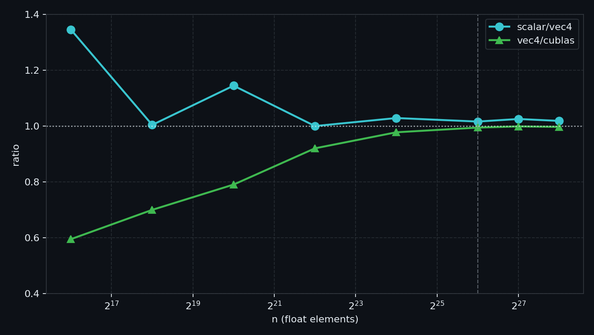

# D-02. Dot：手写点积达到 cublasSdot


> D-01 把手写 `sum` 做到和 CUB 一样快。  
> 本章换成点积 `dot(x,y)`，用 `cublasSdot` 比快慢。相对求和，多读一整路 `y`，看流量差不多翻倍之后，还能不能追上官方库。不是矩阵乘向量（GEMV）。  
> 本机：大数组上 `vec4/cublas`≈**1.00**（打平）；`float4` 相对一次读一个 float 大约只快 **1.02×**（比 D-01 的 1.15× 小很多）。

**配套可复现**：[Yapeng-Gao/AI-System-Performance-Lab](https://github.com/Yapeng-Gao/AI-System-Performance-Lab)（文章 + `.cu` + 实测表）。有用请 Star。本章示例：[`examples/04_operators/02_dot.cu`](https://github.com/Yapeng-Gao/AI-System-Performance-Lab/blob/main/examples/04_operators/02_dot.cu)。

## TL;DR

> 口径：RTX 5090 / `sm_120`，SMs=170。两路 float，host double，相对误差 ≤ 1e-3。CUDA event **median**。表见 [`docs/results/D-02_dot.md`](../../docs/results/D-02_dot.md)。有效字节 `2*n*4`，**含 L2**。

1. **结论**：多读一路之后，点积仍慢在读显存；手写可以和 `cublasSdot` 一样快，本章没有更快。
2. **读写**：读 2N 个 float，写出 1 个点积。流量大约是 D-01 的两倍。
3. **怎么比**：block 内归约复用 D-01；只改「每步累什么」和「一次读多宽」。cuBLAS 用来卡时间。
4. **数字**：2 GiB 流量上 `scalar/vec4`≈**1.02×**；`vec4/cublas`=**0.997**。
5. **怎么用**：标准大数组点积直接调 cuBLAS。要对照或嵌进别的 kernel，用手写 `float4` 两路读 + 每 block 原子加一次。median < 0.05 ms 不当结论。

---

## 1. 定义与形状

`dot(x,y) = sum(x[i]*y[i])`：两个等长向量，对应位置相乘再全部加起来，得到一个数。

相对 D-01，block 里怎么收部分和，不用换一套；多出来的是**整路 `y` 也要从显存读进来**。读 2N、写 1。乘加本身很轻，数组一大，时间主要花在读数据。

| | 本章 |
|---|---|
| 输入 | 两个一维 `float*`，长度 `n`（256 的倍数） |
| 输出 | 一个 `float` |
| 有效字节 | `2 * n * 4`（两路都计读） |
| 官方对照 | `cublasSdot`（结果留在 device：`POINTER_MODE_DEVICE`） |
| 不是 | D-19 的矩阵乘向量；不是 D-01 的一元求和 |

| 邻章 | 已有 | 本章不重复 |
|---|---|---|
| D-01 | 一元 sum、block 内归约、跨 block 原子收尾 | 不重讲 device reduce |
| C-01 | warp shuffle | 只当积木，不重测 |
| D-19 | SGEMV | 本章只有两个向量 |


> 上面读 x，下面读 y。线程里做乘加，再进与 D-01 相同的 block 内归约。

## 2. 版本表

网格与 block 大小同 D-01。每个线程按固定步长跳着扫（grid-stride）：累加 `x[i]*y[i]` → 同一套 `block_sum` → 只有 thread 0 往全局输出上做一次 `atomicAdd`。

本章不重测 shuffle；也不再测 twopass（D-01 已证明大数组上再开一趟 kernel 不赚）。

| 路径 | 怎么读 | 怎么收 / 库 | 计时备注 |
|---|---|---|---|
| `scalar` | 每次读一对标量 `x[i]`、`y[i]` | 每 block 一次 `atomicAdd` | 含 4B `memset` 清累加器 |
| `vec4` | 两路各读一个 `float4` | 同上 | 同上 |
| `cublas` | 库自己选 | `cublasSdot`，结果留 device | handle / stream 在计时外创建 |

**正确性**：`x[i]=(i&255)`，`y[i]=((3*i)&255)`。`n` 为 256 倍数时，host 真值是 `(n/256)*4624000`（用 double 算）。相对误差 > 1e-3 就退出。本机约 **1e-5**。手写走原子时加法顺序可不固定；和 cuBLAS 比的是误差够不够小，不是每一位都相同。

## 3. 实现思路与代码

本章要回答的问题就一个：**多读一路之后，手写还能不能追上 `cublasSdot`？** 顺带看 `float4` 相对标量还能不能拉开（预期比 D-01 小）。

每个 block 里：

1. grid-stride 累加乘积（标量一对，或两路 `float4`）
2. `block_sum` 收成该 block 的部分和（只信 thread 0）
3. thread 0 做一次 `atomicAdd`

| 步骤 | 做法 | 代码 |
|---|---|---|
| 标量乘加 | `acc += x[i]*y[i]` | `acc_scalar` |
| 加宽乘加 | 两路 `float4`，四点乘加 | `acc_vec4` |
| block 内收 | 同 D-01 | `block_sum` |
| block 间 | 每 block 一次 `atomicAdd` | `kernel_vec4` |
| 官方 | 计时内只调 `cublasSdot` | `time_cublas` |

主对照：两路 `float4` + 每 block 原子一次。

```194:215:examples/04_operators/02_dot.cu
__device__ __forceinline__ float acc_vec4(const float* x, const float* y, int n) {
  const int n4 = n >> 2;
  const float4* x4 = reinterpret_cast<const float4*>(x);
  const float4* y4 = reinterpret_cast<const float4*>(y);
  float acc = 0.f;
  for (int i = blockIdx.x * blockDim.x + threadIdx.x; i < n4; i += blockDim.x * gridDim.x) {
    const float4 a = x4[i];
    const float4 b = y4[i];
    acc += (a.x * b.x + a.y * b.y) + (a.z * b.z + a.w * b.w);
  }
  return acc;
}

__global__ void kernel_vec4(const float* x, const float* y, float* out, int n) {
  const float sum = block_sum(acc_vec4(x, y, n));
  if (threadIdx.x == 0) atomicAdd(out, sum);
}
```

`acc_scalar` 同结构，每次读一对标量相乘再加。`block_sum` 与 D-01 相同，这里不重贴。

计时边界：手写路径含 4B `memset`；cuBLAS 的 handle 在计时外建好，计时里只跑 `cublasSdot`。

```314:328:examples/04_operators/02_dot.cu
static float time_vec4(Buffers& b, int runs, int warmup, double ref, double* rel) {
  const float ms = time_median(b, runs, warmup, [&] {
    CUDA_CHECK(cudaMemsetAsync(b.out, 0, sizeof(float), b.stream));
    kernel_vec4<<<b.grid, b.block, 0, b.stream>>>(b.x, b.y, b.out, b.n);
  });
  *rel = check_dot(b, ref, "vec4");
  return ms;
}

static float time_cublas(Buffers& b, int runs, int warmup, double ref, double* rel) {
  const float ms = time_median(b, runs, warmup, [&] {
    CUBLAS_CHECK(cublasSdot(b.handle, b.n, b.x, 1, b.y, 1, b.out));
  });
  *rel = check_dot(b, ref, "cublas");
  return ms;
}
```

为什么 `float4` 收益变小：两路一起读，显存总线更早被堵住。D-01 一元求和大约 **1.15×**；本章大约只剩 **1.02×**。本章要验证的是「流量翻倍后还能不能追上库」，不是再讲 shuffle。

## 4. 本机数字与判停

```bash
./bin/04_operators_02_dot --mode sweep
```

| mode | 作用 |
|---|---|
| `sweep` | 主曲线（2^16…2^28） |
| `modes` | 定点跑三条 |
| `scalar` / `vec4` / `cublas` | 只跑一条 |

看右半段（median 已经超过 0.05 ms）：

| n | 两路字节 | scalar_ms | vec4_ms | cublas_ms | scalar/vec4 | vec4/cublas |
|---:|---:|---:|---:|---:|---:|---:|
| 2^26 | 512 MiB | 0.3284 | 0.3232 | 0.3250 | **1.016** | **0.994** |
| 2^27 | 1 GiB | 0.6554 | 0.6392 | 0.6401 | **1.025** | **0.999** |
| 2^28 | 2 GiB | 1.2942 | 1.2709 | 1.2748 | **1.018** | **0.997** |



> 青线右端约 **1.02**：加宽读还有一点点。绿线贴 **1.0**：手写达到 cuBLAS。左边时间太短，不当结论；小 n 上库更慢，多半是启动开销。

两路流量把总线更早堵住。加宽读取仍有一点点，但远小于 D-01 那条 1.15×。手写达到 `cublasSdot`，大数组上没有稳定超过。

**判停**：`vec4/cublas`≈1 就收工。

## 5. 生产建议

标准大数组点积：直接调 cuBLAS。

要对照或嵌进别的 kernel：用手写两路 `float4` + 每 block 原子加一次，速度和库同一档。想比 `cublasSdot` 更快，别在这种标准点积上死磕；去做融合，或去 D-19 的矩阵乘向量。

| 信号 | 建议 |
|---|---|
| 还在一次读一个 float | 换成 `float4`。本机大约只 **1.02×**（不是 D-01 的 1.15×） |
| `vec4/cublas`≈1 | 达标。标准场景调 cuBLAS；`.cu` 留作对照 |
| 想超过 `cublasSdot` | 标准大数组点积通常抠不动 → 融合 / D-19 |
| `y = Ax` / 一元 sum | 去 D-19 / 回 D-01 |
| median < 0.05 ms | 加大 `--n` |

| 误区 | 纠正 |
|---|---|
| 点积也该有 1.15× | 两路读之后本机大约只有 **1.02×** |
| 追上库 = 手写失败 | 追上库 = 达标 |
| 点积 = 小型 GEMV | 读写形态不同。矩阵乘向量去 D-19 |

**边界**：只做单精度点积；半精度 / 复数不做；不用 `cublasSgemv` 冒充点积；不报 NCU。pointer mode 用 DEVICE：改成 HOST 会把结果拷回 CPU，调用会卡住主机。

## 6. 下一算子

下一张 D-03 Elementwise：逐元素相加，没有归约，对照有效带宽上限。

---

> 本文配套代码与实测：[AI-System-Performance-Lab](https://github.com/Yapeng-Gao/AI-System-Performance-Lab)。觉得有用请 Star。  
> 本章示例：[`examples/04_operators/02_dot.cu`](https://github.com/Yapeng-Gao/AI-System-Performance-Lab/blob/main/examples/04_operators/02_dot.cu)。下一篇：[D 模块文章目录](https://github.com/Yapeng-Gao/AI-System-Performance-Lab/tree/main/article/04_operators/)。

## 参考文献

### A. 官方

1. [cuBLAS `cublasSdot`](https://docs.nvidia.com/cuda/cublas/#cublas-t-dot)：单精度点积。
2. [cuBLAS pointer mode](https://docs.nvidia.com/cuda/cublas/#cublassetpointermode)：`CUBLAS_POINTER_MODE_DEVICE` 时结果在 device，调用可异步；HOST 模式会阻塞到结果回主机。

### B. 工程

3. 本专栏 D-01 DeviceReduce：一元求和上 `float4` 约 1.15×、手写达到 CUB。本章用同一套归约，对照「多读一路」之后加宽收益变小。
