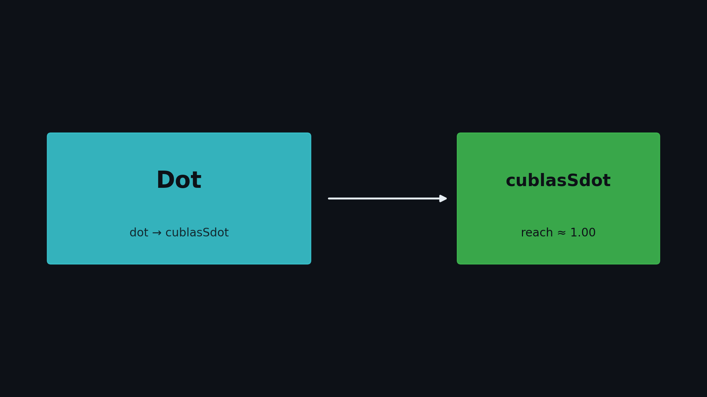
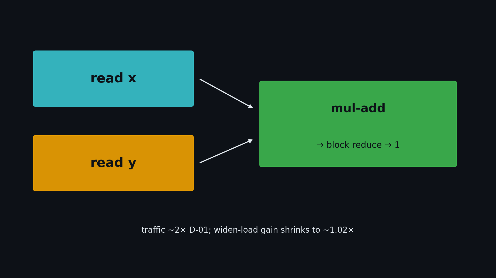
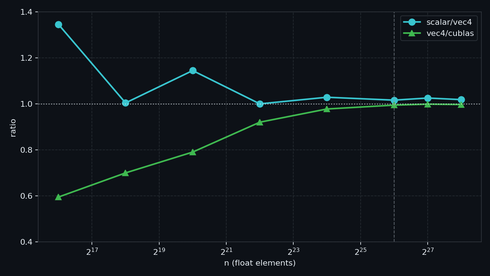

# D-02. 点积达到 cublasSdot



> D-01：`sum` 达到 CUB。  
> 本章写 `dot(x,y)`：两路读、一路写，用 `cublasSdot` 卡时间。多读一整路 `y`，流量约翻倍后还能不能追上库。不是 GEMV。  
> 本机：2 GiB 流量上 `vec4/cublas`≈**1.00**；`float4` 相对标量约 **1.02×**（小于 D-01 的 **1.15×**）。

**配套可复现**：[Yapeng-Gao/AI-System-Performance-Lab](https://github.com/Yapeng-Gao/AI-System-Performance-Lab)（文章 + `.cu` + 实测表）。有用请 Star。本章示例：[`examples/04_operators/02_dot.cu`](https://github.com/Yapeng-Gao/AI-System-Performance-Lab/blob/main/examples/04_operators/02_dot.cu)。

## TL;DR

> 口径：RTX 5090 / `sm_120`，SMs=170。两路 `float`，host double，相对误差 ≤ 1e-3。CUDA event **median**。表见 [`docs/results/D-02_dot.md`](../../docs/results/D-02_dot.md)。有效字节 `2*n*4`，**含 L2**。

1. **形状**：`y = Σ x[i]*y[i]`；读 2N、写 1；流量约为 D-01 的两倍。
2. **阶梯**：scalar → 两路 `float4` → `cublasSdot`；block 内归约与 D-01 共用。
3. **天花板**：`cublasSdot`（`POINTER_MODE_DEVICE`）；达到库 = 达标。
4. **数字**：2 GiB 上 `scalar/vec4`≈**1.02×**；`vec4/cublas`=**0.997**。
5. **用法**：生产调 cuBLAS；嵌别的 kernel 用手写两路 `float4` + 每 block 一次原子加。

---

## 1. 点积：读两路写 1

定义：

\[
y = \sum_{i=0}^{n-1} x[i]\,y[i]
\]

设备上和 D-01 一样是「全数组收成 1 个数」：每个 block 先出**部分和**，再合成全局 `y`。差别在累加项变成 `x[i]*y[i]`，且 **整路 `y` 也要从显存读进来**。读 2N 个 float、写 1 个 float。乘加便宜；`n` 一大，时间花在读两路数据。GEMV、注意力里不少「向量对向量再规约」的骨架都是这一形。官方对照是 `cublasSdot`。

| | 本章 |
|---|---|
| 输入 | 两个一维 `float*`，长度 `n`（256 的倍数） |
| 输出 | 一个 `float` |
| 有效字节 | `2 * n * 4`（两路都计读） |
| 官方对照 | `cublasSdot`（结果留在 device） |
| 不是 | D-19 矩阵乘向量；不是 D-01 一元 sum |

| 邻章 | 已有 | 本章不重复 |
|---|---|---|
| D-01 | 一元 sum、block 内归约、跨 block 原子 | 不重讲 DeviceReduce |
| C-01 | warp shuffle | 只当积木，不重测 |
| D-19 | SGEMV | 本章只有两个向量 |



> 上面读 `x`，下面读 `y`。线程里乘加，再进与 D-01 相同的 block 内归约。

## 2. 三档版本

一个 block 装不下整段向量，仍拆两层。**block 内**：线程各自累加乘积，再收成该 block 的一个部分和（`warp_sum` + 少量共享内存；细节回 [D-01](D-01.%20求和达到%20CUB.md) / C-01）。**block 间**：每 block 对同一输出地址 `atomicAdd` 一次。本章不重测 twopass（D-01 已证大数组两趟不赚）。

读侧分两档：每次读一对标量，还是两路各读一个 `float4`（16B）。两路一起占带宽，`float4` 相对标量的收益通常小于一元 sum。

| 路径 | 怎么读 | block 之间 | 这一档看什么 |
|---|---|---|---|
| `scalar` | 每次一对 `x[i]`、`y[i]` | 每 block 一次 `atomicAdd` | 基线 |
| `vec4` | 两路各一个 `float4` | 同上 | 主手写 |
| `cublas` | 库自己选 | `cublasSdot` | 官方天花板 |

网格默认 `min(SMs×8, ceil(n/256))`。5090 大数组约 1360 个 block × 256 线程。

| 路径 | 计时备注 |
|---|---|
| `scalar` / `vec4` | 含 4B `memset` 清累加器 |
| `cublas` | handle / stream 在计时外创建；计时内只跑 `cublasSdot` |

## 3. 手写主路径

按上表落地。每个 block：grid-stride 累加乘积 → `block_sum`（只信 thread 0）→ 一次 `atomicAdd`。

**grid-stride**：起点 `blockIdx*blockDim+threadIdx`，步长 `blockDim*gridDim`，把比线程数更长的区间扫完。

| 步骤 | 做法 | 代码 |
|---|---|---|
| 标量乘加 | `acc += x[i]*y[i]` | `acc_scalar` |
| 加宽乘加 | 两路 `float4`，四点相乘再累加 | `acc_vec4` |
| block 内收 | 同 D-01 | `block_sum` |
| block 间 | 每 block 一次 `atomicAdd` | `kernel_scalar` / `kernel_vec4` |
| 官方 | 见 `.cu` 中 `time_cublas` | `cublasSdot` |

主对照：两路 `float4` + 每 block 原子一次。`warp_sum` 当积木用，不重测。

```186:215:examples/04_operators/02_dot.cu
__device__ __forceinline__ float acc_scalar(const float* x, const float* y, int n) {
  float acc = 0.f;
  for (int i = blockIdx.x * blockDim.x + threadIdx.x; i < n; i += blockDim.x * gridDim.x) {
    acc += x[i] * y[i];
  }
  return acc;
}

__device__ __forceinline__ float acc_vec4(const float* x, const float* y, int n) {
  const int n4 = n >> 2;
  const float4* x4 = reinterpret_cast<const float4*>(x);
  const float4* y4 = reinterpret_cast<const float4*>(y);
  float acc = 0.f;
  for (int i = blockIdx.x * blockDim.x + threadIdx.x; i < n4; i += blockDim.x * gridDim.x) {
    const float4 a = x4[i];
    const float4 b = y4[i];
    acc += (a.x * b.x + a.y * b.y) + (a.z * b.z + a.w * b.w);
  }
  return acc;
}

__global__ void kernel_vec4(const float* x, const float* y, float* out, int n) {
  const float sum = block_sum(acc_vec4(x, y, n));
  if (threadIdx.x == 0) atomicAdd(out, sum);
}
```

`kernel_scalar` 同结构，走 `acc_scalar`。block 内归约与 D-01 相同（256 线程 = 8 warp，故 `warp_sums[8]`）：

```171:184:examples/04_operators/02_dot.cu
__device__ __forceinline__ float block_sum(float v) {
  v = warp_sum(v);
  __shared__ float warp_sums[8];
  const int lane = threadIdx.x & 31;
  const int warp = threadIdx.x >> 5;
  if (lane == 0) warp_sums[warp] = v;
  __syncthreads();
  float x = 0.f;
  if (warp == 0) {
    x = (lane < 8) ? warp_sums[lane] : 0.f;
    x = warp_sum(x);
  }
  return x;
}
```

两路读把总线更早堵住，故 `float4` 相对标量大约只有 **1.02×**，远低于 D-01 一元求和的 **1.15×**。本章主问题是流量翻倍后手写还能不能追上库。

## 4. 复现与正确性

```bash
./bin/04_operators_02_dot --mode sweep
```

| mode | 作用 |
|---|---|
| `sweep` | 主曲线（2^16…2^28） |
| `modes` | 定点三条 |
| `scalar` / `vec4` / `cublas` | 单路径 |

**正确性**：`x[i]=(i&255)`，`y[i]=((3*i)&255)`。`n` 为 256 倍数时，host 真值 `(n/256)*4624000`（double）。相对误差 > 1e-3 退出；本机最大约 **1e-5**。手写原子路径下 float 加法顺序可不固定；对 cuBLAS 只要求误差够小，不要求逐 bit。

**计时边界**：手写含 4B `memset`；cuBLAS handle 在计时外建好。median 包装在 `time_scalar` / `time_vec4` / `time_cublas`（见 `.cu`）。主看右半段（median > 0.05 ms）。GB/s **含 L2**；小 `n` 上库更慢多半是 launch 开销，不当结论。

## 5. 达到 cublasSdot

尺子：`cublasSdot`。`vec4/cublas`≈1 → **达到**官方。

| n | 两路字节 | scalar_ms | vec4_ms | cublas_ms | scalar/vec4 | vec4/cublas |
|---:|---:|---:|---:|---:|---:|---:|
| 2^26 | 512 MiB | 0.3284 | 0.3232 | 0.3250 | **1.016** | **0.994** |
| 2^27 | 1 GiB | 0.6554 | 0.6392 | 0.6401 | **1.025** | **0.999** |
| 2^28 | 2 GiB | 1.2942 | 1.2709 | 1.2748 | **1.018** | **0.997** |



> 青线右端约 **1.02**：加宽读还有一点。绿线贴 **1.0**：达到 cuBLAS。左段 median 太短不当打满显存。

**判停**：`vec4/cublas`≈1 收工。追上库 = 达标；本章没有稳定超过 `cublasSdot` 的手写路径。

## 6. 生产建议

标准大数组点积调 cuBLAS。嵌别的 kernel：手写两路 `float4` + 每 block 原子一次，与库同档。想赢默认 `cublasSdot`，别在标准点积上抠；去做融合，或看 D-19 矩阵乘向量。

| 信号 | 建议 |
|---|---|
| 还在一次读一个 float | 换成两路 `float4`。本机约 **1.02×**（不是 D-01 的 1.15×） |
| `vec4/cublas`≈1 | 达标。标准场景调 cuBLAS；`.cu` 留对照 |
| 想超过 `cublasSdot` | 标准大数组点积通常抠不动 → 融合 / D-19 |
| `y = Ax` / 一元 sum | 去 D-19 / 回 D-01 |
| median < 0.05 ms | 加大 `--n` |

| 误区 | 纠正 |
|---|---|
| 点积也该有 D-01 那种 1.15× | 两路读之后本机约 **1.02×** |
| 追上库 = 手写失败 | 追上库 = 达标；调库 = 同档封装 |
| 点积 = 小型 GEMV | 读写形态不同。矩阵乘向量去 D-19 |
| HOST pointer mode 测 async | 结果回 CPU 会卡主机；本章用 DEVICE |

**边界**：只做单精度点积；block 固定 256；不扫半精度 / 复数；不用 `cublasSgemv` 冒充点积；不报 NCU。

## 7. 下一算子

D-03 Elementwise：逐元素相加，没有全局规约，对照有效带宽上限。

---

> 本文配套代码与实测：[AI-System-Performance-Lab](https://github.com/Yapeng-Gao/AI-System-Performance-Lab)。觉得有用请 Star。  
> 本章示例：[`examples/04_operators/02_dot.cu`](https://github.com/Yapeng-Gao/AI-System-Performance-Lab/blob/main/examples/04_operators/02_dot.cu)。下一篇：[D 模块文章目录](https://github.com/Yapeng-Gao/AI-System-Performance-Lab/tree/main/article/04_operators/)。

## 参考文献

### A. 官方

1. [cuBLAS `cublasSdot`](https://docs.nvidia.com/cuda/cublas/#cublas-t-dot)：单精度点积。
2. [cuBLAS pointer mode](https://docs.nvidia.com/cuda/cublas/#cublassetpointermode)：`CUBLAS_POINTER_MODE_DEVICE` 时结果在 device，调用可异步；HOST 模式会阻塞到结果回主机。

### B. 工程

3. 本专栏 D-01 DeviceReduce：一元求和上 `float4` 约 1.15×、手写达到 CUB。本章用同一套归约，对照「多读一路」之后加宽收益变小。
