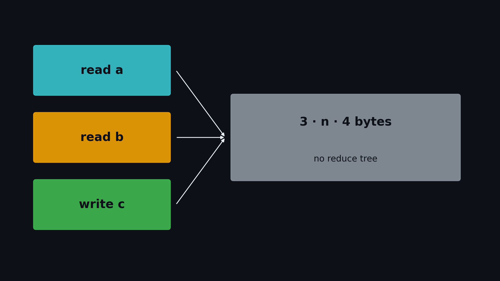
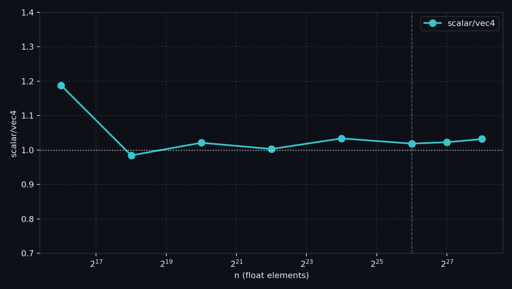
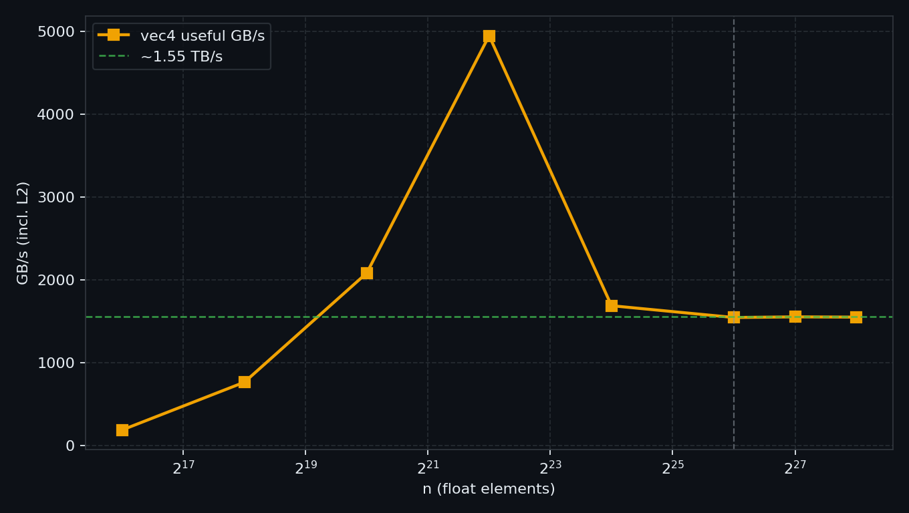

# D-03. Elementwise：手写逐元素加达到带宽顶


> D-01 / D-02 手写已达到 CUB / cuBLAS。  
> **本章继续手写**：`c[i]=a[i]+b[i]`（只测 add）。无官方单算子，对照有效带宽——**达到总线顶 = 达标**。  
> 本机：掉出缓存后约 **1.55 TB/s**，`float4` 相对标量约 **1.03×**。  
> 前三章「手写达到官方/带宽顶」到此收口；D-04～D-10 短章共用网格、block 和字节口径。

**配套可复现**：[Yapeng-Gao/AI-System-Performance-Lab](https://github.com/Yapeng-Gao/AI-System-Performance-Lab)。有用请 Star。本章示例：[`examples/04_operators/03_elementwise.cu`](https://github.com/Yapeng-Gao/AI-System-Performance-Lab/blob/main/examples/04_operators/03_elementwise.cu)。

## TL;DR

> 口径：RTX 5090 / `sm_120`，SMs=170。有效字节 `3*n*4`（两读一写），**含 L2**。CUDA event **median**。表见 [`docs/results/D-03_elementwise.md`](../../docs/results/D-03_elementwise.md)。

1. **定位**：手写逐元素加。达标 = 掉缓存后带宽顶住（约 **1.55 TB/s**）。
2. **形状**：两读一写，写出整段数组。纯带宽题。
3. **版本**：`scalar` → `vec4`。大数组约 **1.03×**。
4. **结果**：总线先顶住 → **达到带宽顶**。
5. **判停**：带宽不涨就收工。激活短章只换函数；要超过先靠融合少一次写。

---

## 1. 定义与形状

点积写出一个标量。逐元素加写出整段 `c`。流量公式变成「两读一写」。

| | 本章 |
|---|---|
| 输入 | `float* a`，`float* b`，长度 `n` |
| 输出 | `float* c`，`c[i]=a[i]+b[i]` |
| 有效字节 | `3 * n * 4` |
| 官方对照 | 有效带宽（无 cuBLAS/cuDNN 单算子） |
| 不是 | 带归约的 D-01 / D-02 |

| 章 | 流量形状 |
|---|---|
| D-01 | 1 读 → 1 个数 |
| D-02 | 2 读 → 1 个数 |
| D-03 | 2 读 1 写 → 整段 |



> 读 a、读 b、写 c。没有归约树。

## 2. 版本表

| 路径 | 加载 / 写回 | 网格 |
|---|---|---|
| `scalar` | 每次一个 float | `min(SMs*8, ceil(n/256))`，block 256 |
| `vec4` | 一次 `float4` 加载、相加、写回 | **同一 CTA 数**；循环上界改成 `n/4` |

`vec4` 不把 grid 改成 `n/4`：比的是加载宽度，不是「少发几个 block」。减法与加法访存相同，曲线只跑 add。

**正确性**：探针位置与闭式和逐元素相等（值在 0…510，float 精确）。

## 3. 本机数字与判停

```bash
./bin/04_operators_03_elementwise --mode sweep
```

| mode | 作用 |
|---|---|
| `sweep` | 主曲线（2^16…2^28） |
| `modes` | 定点两条 |
| `scalar` / `vec4` | 只跑一条 |

主结论看右半段（median 已过 0.05 ms）：

| n | 三流字节 | scalar_ms | vec4_ms | scalar/vec4 | vec4 GB/s |
|---:|---:|---:|---:|---:|---:|
| 2^26 | 768 MiB | 0.5316 | 0.5218 | **1.019** | **1543** |
| 2^27 | 1.5 GiB | 1.0619 | 1.0384 | **1.023** | **1551** |
| 2^28 | 3 GiB | 2.1474 | 2.0809 | **1.032** | **1548** |





> 右端加速比约 **1.03**。带宽曲线在大 n 上压到约 **1.55 TB/s**。左半段墙钟太短，不当结论。

三流已经把总线堵住，加宽加载空间很小。缓存内的数 TB/s 不当总线利用率。

## 4. 生产建议

| 信号 | 建议 |
|---|---|
| 还在标量加载，median > 0.05 ms | 换成 `float4`。本机约 **1.03×** |
| 带宽 ~1.55 TB/s 且不再涨 | **达标**（带宽顶）。瓶颈在总线 |
| 想超过单次 add | 融合少一次写；或后章激活算力缝 |
| Sigmoid / GELU 等 | 去 D-04～D-10，共用本章 harness |
| 需要归约 / median 太短 | 回 D-01/D-02；或加大 `--n` |

| 误区 | 纠正 |
|---|---|
| 逐元素加也该有 1.15× | 三流下本机约 **1.03×** |
| 缓存内数 TB/s = 打满 HBM | 大 n 回到 ~1.55 TB/s |
| 贴带宽顶 = 手写没意义 | 达到顶 = **达标**；超过靠融合/算力缝 |

**边界**：无官方单算子；`half2` 不做；不报 NCU；D-04～D-10 不重讲向量化加载。

## 5. 下一算子

下一张 D-04 Sigmoid：同一 harness，只换函数——相对本章报带宽，并写清特殊函数有没有变成算力墙。

---

> 本文配套代码与实测：[AI-System-Performance-Lab](https://github.com/Yapeng-Gao/AI-System-Performance-Lab)。觉得有用请 Star。  
> 本章示例：[`examples/04_operators/03_elementwise.cu`](https://github.com/Yapeng-Gao/AI-System-Performance-Lab/blob/main/examples/04_operators/03_elementwise.cu)。下一篇：[D 模块文章目录](https://github.com/Yapeng-Gao/AI-System-Performance-Lab/tree/main/article/04_operators/)。

## 参考文献

### A. 官方

1. [CUDA Pro Tip: Increase Performance with Vectorized Memory Access](https://developer.nvidia.com/blog/cuda-pro-tip-increase-performance-with-vectorized-memory-access/)：`float4` 对应更宽的 load/store，减少指令条数；寄存器压力高时可能不赚。

### B. 工程

2. 本专栏 D-01 / D-02：一元与双流归约上的加载收益，对照本章三流写回。
