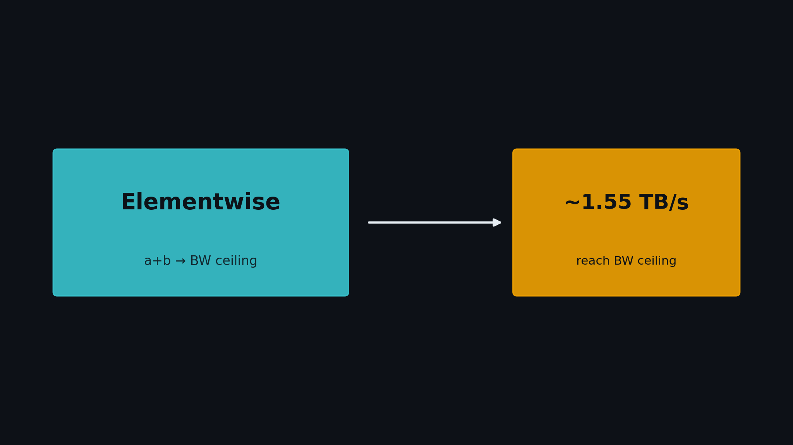

# D-03. Elementwise：手写逐元素加达到带宽顶



> D-01 / D-02 把手写求和、点积做到和 CUB / cuBLAS 一样快。  
> 本章做逐元素加法 `c[i]=a[i]+b[i]`（只测 add）。没有对应的官方单算子库，尺子改成**有效带宽**：大数组掉出缓存后，带宽顶住不再涨 = 达标。  
> 本机：大约 **1.55 TB/s**；`float4` 相对一次读一个 float 大约只快 **1.03×**。  
> 前三章「手写达到官方库 / 带宽顶」到此收口。后面激活短章（D-04～D-10）共用本章的网格、block，以及怎么算有效字节。

**配套可复现**：[Yapeng-Gao/AI-System-Performance-Lab](https://github.com/Yapeng-Gao/AI-System-Performance-Lab)。有用请 Star。本章示例：[`examples/04_operators/03_elementwise.cu`](https://github.com/Yapeng-Gao/AI-System-Performance-Lab/blob/main/examples/04_operators/03_elementwise.cu)。

## TL;DR

> 口径：RTX 5090 / `sm_120`，SMs=170。有效字节 `3*n*4`（两读一写），**含 L2**。CUDA event **median**。表见 [`docs/results/D-03_elementwise.md`](../../docs/results/D-03_elementwise.md)。

1. **结论**：逐元素加是纯带宽题；大数组上顶到约 **1.55 TB/s** 就达标。
2. **读写**：读两路、写一路，写出整段数组（不是一个标量）。
3. **怎么比**：`scalar` vs `vec4`。block 个数保持相同，只改一次读写多宽。
4. **数字**：大数组 `scalar/vec4`≈**1.03×**；带宽压到 ~**1.55 TB/s**。
5. **怎么用**：带宽不再涨就收工。后面激活短章只换函数；想更快，先靠融合少写一次显存。median < 0.05 ms 不当结论。

---

## 1. 定义与形状

点积写出一个数。逐元素加写出整段 `c`。流量变成「读 a、读 b、写 c」。

| | 本章 |
|---|---|
| 输入 | `float* a`，`float* b`，长度 `n` |
| 输出 | `float* c`，`c[i]=a[i]+b[i]` |
| 有效字节 | `3 * n * 4` |
| 官方对照 | 有效带宽（没有 cuBLAS / cuDNN 单算子可对） |
| 不是 | 带归约的 D-01 / D-02 |

| 章 | 读多少、写多少 |
|---|---|
| D-01 | 读 1 路 → 写 1 个数 |
| D-02 | 读 2 路 → 写 1 个数 |
| D-03 | 读 2 路、写 1 路 → 整段数组 |


> 读 a、读 b、写 c。没有归约。

## 2. 版本表

| 路径 | 怎么读 / 写 | 网格 |
|---|---|---|
| `scalar` | 每次一个 float | `min(SMs*8, ceil(n/256))`，block 256 |
| `vec4` | 一次 `float4` 读、加、写 | **block 个数相同**；循环上界改成 `n/4` |

`vec4` 不把 grid 改成按 `n/4` 发 block：要比的是一次读写多宽，不是少发几个 block。减法和加法访存相同，曲线只跑 add。

**正确性**：抽查若干位置，结果与闭式公式逐元素相等（值在 0…510，float 能精确表示）。

## 3. 实现思路与代码

没有归约。每个线程按固定步长跳着扫一段，读 `a`/`b`、写 `c`。要看两件事：

1. 标量路径够不够把显存总线堵住
2. 换成 `float4`、block 个数不变之后，大数组还能不能再快一点

| 步骤 | 做法 | 代码 |
|---|---|---|
| 标量 | `c[i]=a[i]+b[i]` | `kernel_scalar` |
| 加宽 | 上界 `n/4`，一次读写 `float4` | `kernel_vec4` |
| 带宽 | 有效字节 `3*n*4`，用 median 时间算 | `useful_gbps` |

```131:147:examples/04_operators/03_elementwise.cu
__global__ void kernel_scalar(const float* a, const float* b, float* c, int n) {
  for (int i = blockIdx.x * blockDim.x + threadIdx.x; i < n; i += blockDim.x * gridDim.x) {
    c[i] = a[i] + b[i];
  }
}

__global__ void kernel_vec4(const float* a, const float* b, float* c, int n) {
  const int n4 = n >> 2;
  const float4* a4 = reinterpret_cast<const float4*>(a);
  const float4* b4 = reinterpret_cast<const float4*>(b);
  float4* c4 = reinterpret_cast<float4*>(c);
  for (int i = blockIdx.x * blockDim.x + threadIdx.x; i < n4; i += blockDim.x * gridDim.x) {
    const float4 x = a4[i];
    const float4 y = b4[i];
    c4[i] = make_float4(x.x + y.x, x.y + y.y, x.z + y.z, x.w + y.w);
  }
}
```

两读一写已经把总线堵住，所以大数组上 `scalar/vec4` 只剩大约 **1.03×**。后面激活短章共用的，就是这套网格和读法。

## 4. 本机数字与判停

```bash
./bin/04_operators_03_elementwise --mode sweep
```

| mode | 作用 |
|---|---|
| `sweep` | 主曲线（2^16…2^28） |
| `modes` | 定点跑两条 |
| `scalar` / `vec4` | 只跑一条 |

看右半段（median 已经超过 0.05 ms）：

| n | 三路字节 | scalar_ms | vec4_ms | scalar/vec4 | vec4 GB/s |
|---:|---:|---:|---:|---:|---:|
| 2^26 | 768 MiB | 0.5316 | 0.5218 | **1.019** | **1543** |
| 2^27 | 1.5 GiB | 1.0619 | 1.0384 | **1.023** | **1551** |
| 2^28 | 3 GiB | 2.1474 | 2.0809 | **1.032** | **1548** |


> 右端加速比约 **1.03**。带宽曲线在大 n 上压到约 **1.55 TB/s**。左边时间太短，不当结论。

三路已经把总线堵住，加宽读取空间很小。更小数组上冒出的数 TB/s，先当还在吃缓存。

**判停**：大数组带宽不再涨 → 达到带宽顶，收工。

## 5. 生产建议

逐元素加已经顶到带宽：别再指望一次读更宽再快一截。想更快，少写一次显存（融合），或到后面看特殊函数有没有变成算力瓶颈。

| 信号 | 建议 |
|---|---|
| 还在一次读一个 float，且 median > 0.05 ms | 换成 `float4`。本机大约 **1.03×** |
| 带宽 ~1.55 TB/s 且不再涨 | 达标。瓶颈在显存总线 |
| 想超过单次 add | 融合少一次写；或后章看激活算力缝 |
| Sigmoid / GELU 等 | 去 D-04～D-10，共用本章这套测法 |
| 需要归约 / median 太短 | 回 D-01/D-02；或加大 `--n` |

| 误区 | 纠正 |
|---|---|
| 逐元素加也该有 1.15× | 三路读写下本机大约只有 **1.03×** |
| 缓存里冒出的数 TB/s = 打满显存 | 大 n 会回到 ~1.55 TB/s |
| 顶到带宽 = 手写没意义 | 顶到带宽 = 达标；再快靠融合或算力缝 |

**边界**：没有官方单算子可对；不做 `half2`；不报 NCU；D-04～D-10 不重讲怎么做向量化加载。

## 6. 下一算子

下一张 D-04 Sigmoid：同一套测法，只换函数。相对本章报带宽，并写清带 `exp` 之后有没有变成算力瓶颈。

---

> 本文配套代码与实测：[AI-System-Performance-Lab](https://github.com/Yapeng-Gao/AI-System-Performance-Lab)。觉得有用请 Star。  
> 本章示例：[`examples/04_operators/03_elementwise.cu`](https://github.com/Yapeng-Gao/AI-System-Performance-Lab/blob/main/examples/04_operators/03_elementwise.cu)。下一篇：[D-04. Sigmoid：手写激活，是否算力墙](D-04.%20Sigmoid：手写激活，是否算力墙.md)。

## 参考文献

### A. 官方

1. [CUDA Pro Tip: Increase Performance with Vectorized Memory Access](https://developer.nvidia.com/blog/cuda-pro-tip-increase-performance-with-vectorized-memory-access/)：`float4` 对应更宽的 load/store，减少指令条数；寄存器压力高时可能不赚。

### B. 工程

2. 本专栏 D-01 / D-02：一元与双路归约上的加载收益，对照本章「两读一写」。
