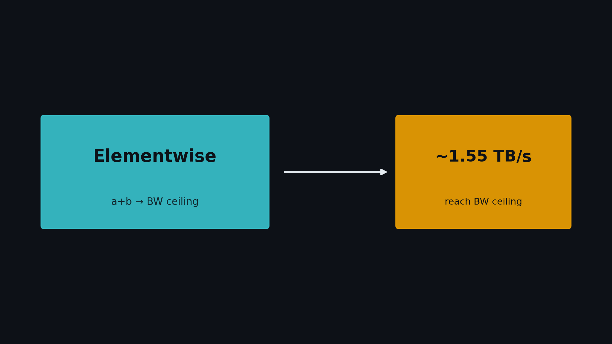
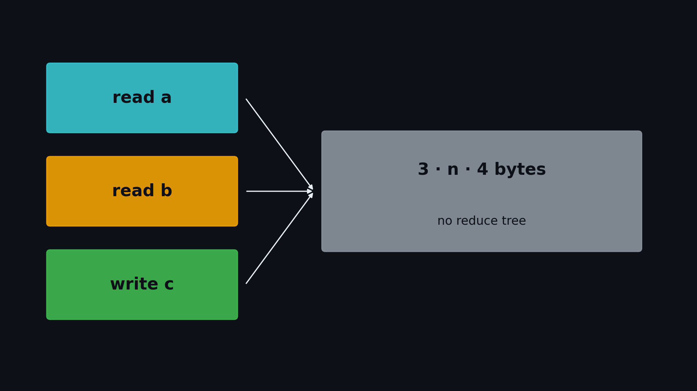
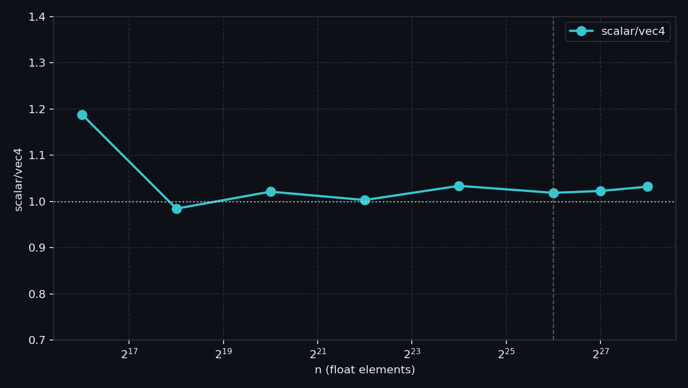
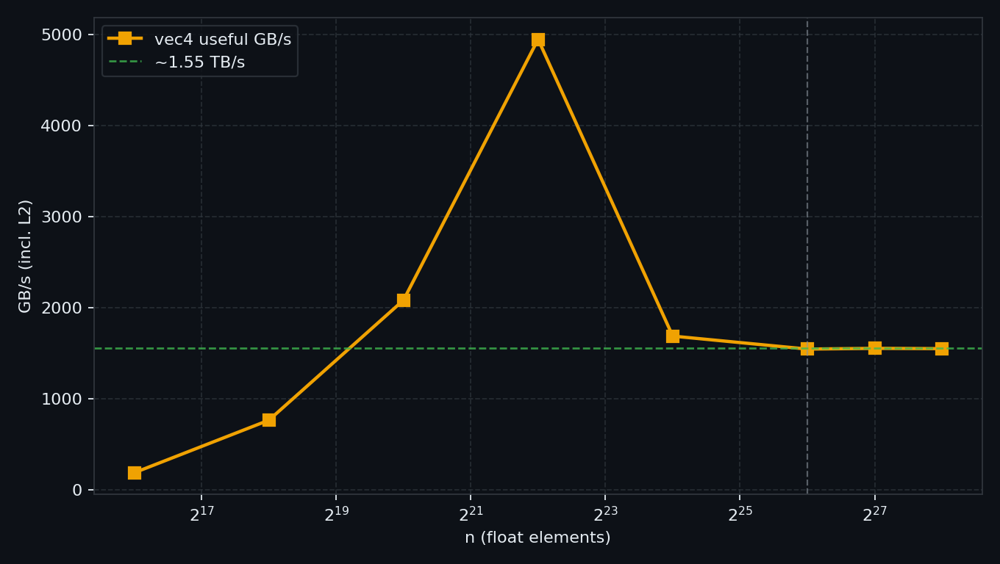

# D-03. 逐元素加达到带宽顶



> D-01 / D-02：求和、点积达到 CUB / cuBLAS。  
> 本章做 `c[i]=a[i]+b[i]`（只测 add）。无单算子库，尺子改成**有效带宽**：大数组掉出缓存后顶住不再涨 = 达标。  
> 本机：`float4` 约 **1.55 TB/s**；相对标量约 **1.03×**。  
> 前三章「达到官方 / 带宽顶」到此收口。D-04～D-10 共用本章网格、block 与有效字节口径。

**配套可复现**：[Yapeng-Gao/AI-System-Performance-Lab](https://github.com/Yapeng-Gao/AI-System-Performance-Lab)（文章 + `.cu` + 实测表）。有用请 Star。本章示例：[`examples/04_operators/03_elementwise.cu`](https://github.com/Yapeng-Gao/AI-System-Performance-Lab/blob/main/examples/04_operators/03_elementwise.cu)。

## TL;DR

> 口径：RTX 5090 / `sm_120`，SMs=170。有效字节 `3*n*4`（两读一写），**含 L2**。CUDA event **median**。表见 [`docs/results/D-03_elementwise.md`](../../docs/results/D-03_elementwise.md)。

1. **形状**：`c[i]=a[i]+b[i]`；读两路、写一路整段数组；大数组慢在显存流量。
2. **阶梯**：`scalar` → `vec4`；block 个数保持相同，只改一次读写多宽。
3. **天花板**：无 cuBLAS / cuDNN 单算子；大数组有效带宽 ~**1.55 TB/s** 不再涨 = 达标。
4. **数字**：大数组 `scalar/vec4`≈**1.03×**；`vec4` 带宽压到 ~**1548–1551 GB/s**。
5. **用法**：带宽顶了就收工。后面激活短章只换函数；想更快，先靠融合少写一次显存。median < 0.05 ms 不当结论。

---

## 1. 逐元素加：两读一写

定义：

\[
c[i] = a[i] + b[i],\quad i = 0,\ldots,n-1
\]

D-01 写一个标量；D-02 也写一个标量，但多读一路。逐元素加写出**整段** `c`。每个元素一次加，几乎不耗算力；`n` 一大，时间花在读 `a`、读 `b`、写 `c`。没有「部分和再归约」这一层，也没有对标的官方单算子 API，尺子只能是**有效字节 / 时间**算出来的带宽。

| | 本章 |
|---|---|
| 输入 | `float* a`，`float* b`，长度 `n`（256 的倍数） |
| 输出 | `float* c` |
| 有效字节 | `3 * n * 4`（两读一写） |
| 官方对照 | 有效带宽（无单算子库） |
| 不是 | D-01 / D-02 的归约；不是 D-04 起的非线性激活 |

| 邻章 | 读多少、写多少 |
|---|---|
| D-01 | 读 1 路 → 写 1 个数 |
| D-02 | 读 2 路 → 写 1 个数 |
| D-03 | 读 2 路、写 1 路 → 整段 `c` |



> 读 a、读 b、写 c。没有归约。

## 2. 两档版本

一个 kernel 盖住整段数组：线程按 **grid-stride** 跳着扫，各自处理一段下标。本章不比「少发几个 block」，只比**一次读写多宽**。

| 路径 | 怎么读 / 写 | 网格 |
|---|---|---|
| `scalar` | 每次一个 `float` | `min(SMs×8, ceil(n/256))`，block 256 |
| `vec4` | 一次 `float4` 读、加、写 | **block 个数与 scalar 相同**；循环上界 `n/4` |

`vec4` 不把 grid 改成按 `n/4` 发 block：要比的是访存宽度，不是 occupancy 形状。减法与加法访存相同，曲线只跑 add。

减法和乘法以后如果出现，也是同一套网格；D-04～D-10 短章沿用本章 block、`useful_gbps` 口径。

## 3. 手写主路径

没有归约。每个 block：grid-stride 扫下标 → 读 `a`/`b` → 写 `c`。

**grid-stride**：起点 `blockIdx*blockDim+threadIdx`，步长 `blockDim*gridDim`，把比线程总数更长的区间扫完。下面循环里的 `i += …` 就是这一步。

| 步骤 | 做法 | 代码 |
|---|---|---|
| 标量 | `c[i]=a[i]+b[i]` | `kernel_scalar` |
| 加宽 | 上界 `n/4`，一次读写 `float4` | `kernel_vec4` |
| 带宽 | 有效字节 `3*n*4`，median 时间 → `useful_gbps` | 见 `.cu` |

```131:147:examples/04_operators/03_elementwise.cu
__global__ void kernel_scalar(const float* a, const float* b, float* c, int n) {
  for (int i = blockIdx.x * blockDim.x + threadIdx.x; i < n; i += blockDim.x * gridDim.x) {
    c[i] = a[i] + b[i];
  }
}

__global__ void kernel_vec4(const float* a, const float* b, float* c, int n) {
  const int n4 = n >> 2;
  const float4* a4 = reinterpret_cast<const float4*>(a);
  const float4* b4 = reinterpret_cast<const float4*>(b);
  float4* c4 = reinterpret_cast<float4*>(c);
  for (int i = blockIdx.x * blockDim.x + threadIdx.x; i < n4; i += blockDim.x * gridDim.x) {
    const float4 x = a4[i];
    const float4 y = b4[i];
    c4[i] = make_float4(x.x + y.x, x.y + y.y, x.z + y.z, x.w + y.w);
  }
}
```

两读一写已经把总线堵得早。D-01 一元求和上加宽读大约 **1.15×**；本章三路流量下，`scalar/vec4` 大数组只剩大约 **1.03×**。后面激活短章共用这套网格与读法，只换元素函数。

## 4. 复现与正确性

```bash
./bin/04_operators_03_elementwise --mode sweep
```

| mode | 作用 |
|---|---|
| `sweep` | 主曲线（2^16…2^28） |
| `modes` | 定点两条 |
| `scalar` / `vec4` | 只跑一条 |

**正确性**：`a[i]=(i&255)`，`b[i]=((3*i)&255)`，和在 0…510，`float` 可精确表示。每次计时后抽查头/中/尾若干下标，与闭式 `a[i]+b[i]` 逐元素相等（`check_add`，见 `.cu`）。

**计时边界**：warmup + 多次 launch → **median**；对应 `time_scalar` / `time_vec4`（见 `.cu`）。主看右半段（median > 0.05 ms）。GB/s **含 L2**；小 `n` 冒出的数 TB/s 先当还在吃缓存，不当打满显存。

## 5. 达到带宽顶

尺子：**有效带宽**。大数组上曲线平在 ~**1.55 TB/s** → **达到带宽顶**。

看右半段（median 已经超过 0.05 ms）：

| n | 三路字节 | scalar_ms | vec4_ms | scalar/vec4 | vec4 GB/s |
|---:|---:|---:|---:|---:|---:|
| 2^26 | 768 MiB | 0.5316 | 0.5218 | **1.019** | **1543** |
| 2^27 | 1.5 GiB | 1.0619 | 1.0384 | **1.023** | **1551** |
| 2^28 | 3 GiB | 2.1474 | 2.0809 | **1.032** | **1548** |





> 右端加速比约 **1.03**。带宽曲线在大 n 上压到约 **1.55 TB/s**。左边时间太短，不当结论。

三路流量把总线堵住，加宽读取空间很小。更小数组上冒出的数 TB/s，先当还在吃缓存。

**判停**：大数组带宽不再涨 → 达到带宽顶，收工。D-01～D-03「手写达到官方 / 带宽顶」三连章在此收口。

## 6. 生产建议

逐元素加已经顶到带宽：别再指望一次读更宽再快一截。想更快，少写一次显存（融合），或到后面看特殊函数有没有变成算力瓶颈。

| 信号 | 建议 |
|---|---|
| 还在一次读一个 float，且 median > 0.05 ms | 换成 `float4`。本机大约 **1.03×** |
| 带宽 ~1.55 TB/s 且不再涨 | 达标。瓶颈在显存总线 |
| 想超过单次 add | 融合少一次写；或后章看激活算力缝 |
| Sigmoid / GELU 等 | 去 D-04～D-10，共用本章这套测法 |
| 需要归约 / median 太短 | 回 D-01/D-02；或加大 `--n` |

| 误区 | 纠正 |
|---|---|
| 逐元素加也该有 1.15× | 三路读写下本机大约只有 **1.03×** |
| 缓存里冒出的数 TB/s = 打满显存 | 大 n 会回到 ~1.55 TB/s |
| 顶到带宽 = 手写没意义 | 顶到带宽 = 达标；再快靠融合或算力缝 |

**边界**：没有官方单算子可对；不做 `half2`；不报 NCU；D-04～D-10 不重讲怎么做向量化加载。

## 7. 下一算子

D-04 Sigmoid：同一套网格与带宽口径，只换带 `exp` 的函数。看它在大 `n` 上有没有从带宽题滑向算力墙。

---

> 本文配套代码与实测：[AI-System-Performance-Lab](https://github.com/Yapeng-Gao/AI-System-Performance-Lab)。觉得有用请 Star。  
> 本章示例：[`examples/04_operators/03_elementwise.cu`](https://github.com/Yapeng-Gao/AI-System-Performance-Lab/blob/main/examples/04_operators/03_elementwise.cu)。下一篇：[D 模块文章目录](https://github.com/Yapeng-Gao/AI-System-Performance-Lab/tree/main/article/04_operators/)。

## 参考文献

### A. 官方

1. [CUDA Pro Tip: Increase Performance with Vectorized Memory Access](https://developer.nvidia.com/blog/cuda-pro-tip-increase-performance-with-vectorized-memory-access/)：`float4` 对应更宽的 load/store，减少指令条数；寄存器压力高时可能不赚。

### B. 工程

2. 本专栏 D-01 / D-02：一元与双路归约上的加载收益，对照本章「两读一写」。
