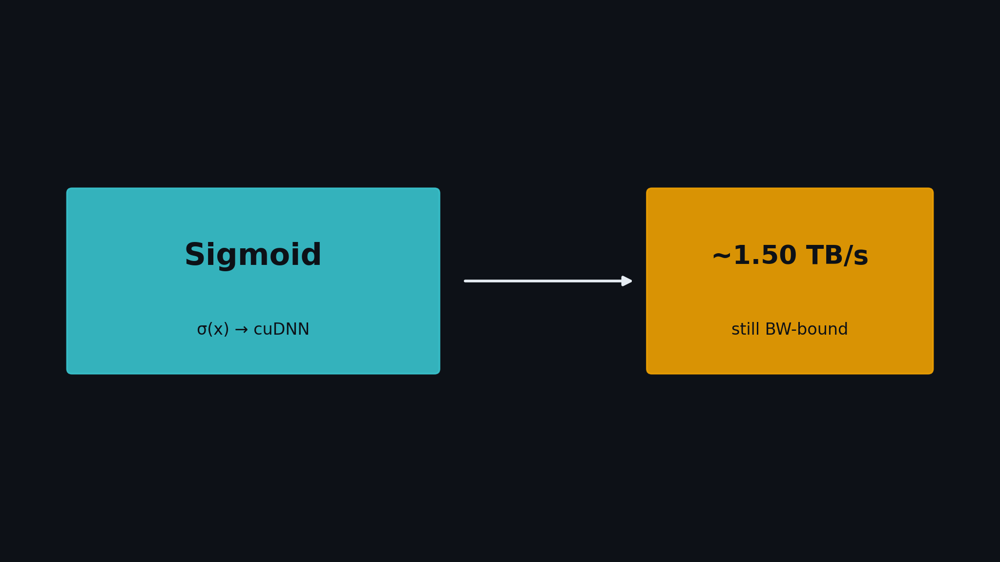
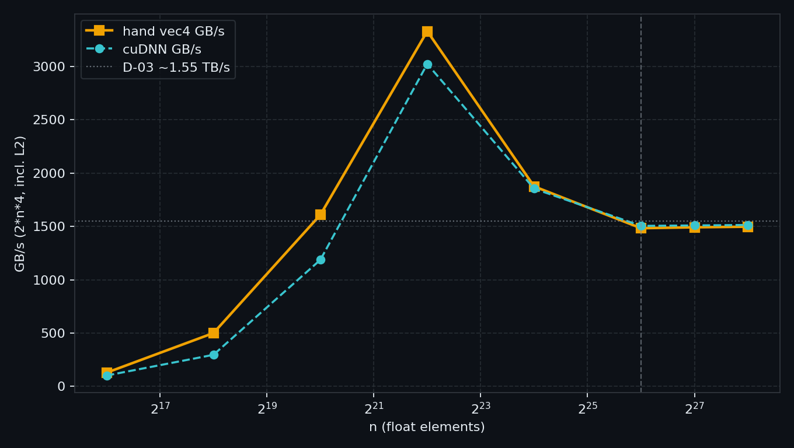

# D-04. Sigmoid 达到 cuDNN



> D-03：逐元素加顶到约 **1.55 TB/s**，并定下激活短章共用的网格、`float4` 与 median。  
> 本章写 `sigmoid(x)`：带 `expf` 的 S 形，对照 `cudnnActivationForward`（Sigmoid）。  
> 本机 `vec4/cudnn`≈**1.01**；前向 ~**1.50 TB/s** → **仍慢在读写显存，不是算力墙**。

**配套可复现**：[Yapeng-Gao/AI-System-Performance-Lab](https://github.com/Yapeng-Gao/AI-System-Performance-Lab)（文章 + `.cu` + 实测表）。有用请 Star。本章示例：[`examples/04_operators/04_sigmoid.cu`](https://github.com/Yapeng-Gao/AI-System-Performance-Lab/blob/main/examples/04_operators/04_sigmoid.cu)。

## TL;DR

> 口径：RTX 5090 / `sm_120`，SMs=170。前向有效字节 `2*n*4`，**含 L2**。CUDA event **median**。表见 [`docs/results/D-04_sigmoid.md`](../../docs/results/D-04_sigmoid.md)。

1. **形状**：`y[i]=σ(x[i])`；读一路、写一路；与 D-03 同网格，只换逐元素函数。
2. **阶梯**：`scalar` → `vec4` → `cudnn`；`float4` 加载沿用 D-03，本章不重讲。
3. **天花板**：`cudnnActivationForward`（Sigmoid）；`vec4/cudnn`≈1 → **达到库**。
4. **数字**：1 GiB 上 `vec4/cudnn`≈**1.011**；前向 ~**1.50 TB/s**（低于 D-03 三路顶，因少一路读）。
5. **用法**：追上 cuDNN 且大数组仍贴带宽就收工；想更快，融进相邻算子，别抠 `expf`。

---

## 1. Sigmoid：1/(1+e^{-x})

定义：

\[
\sigma(x) = \frac{1}{1 + e^{-x}}
\]

把实数压进 **(0, 1)**：\(x\to+\infty\) 时趋近 1，\(x\to-\infty\) 时趋近 0，\(x=0\) 为 0.5。早期分类头、门控、Swish 的内核都绕不开这一形。设备上常用 `expf(-x)` 再求倒数；每个元素独立，没有跨线程归约。

| | 本章 |
|---|---|
| 前向 | `y[i] = σ(x[i])` |
| 反传 | `dx[i] = dy[i] · y[i] · (1 − y[i])`（`σ' = y(1−y)`） |
| 有效字节 | 前向 `2*n*4`（读 x、写 y）；反传 `3*n*4`（读 dy、y，写 dx） |
| 官方对照 | `cudnnActivationForward` / `Backward`，`CUDNN_ACTIVATION_SIGMOID` |
| 不是 | D-03 两读一写加；不是带 `exp` 就一定算力瓶颈（本章用带宽与库比墙钟） |

| 邻章 | 已有 | 本章不重复 |
|---|---|---|
| D-03 | 网格、`min(SMs×8, …)`、block 256、`float4` 主路径 | 不重讲向量化加载与带宽顶定义 |
| D-05～D-06 | 同测法换公式 | 本章只讲 Sigmoid |

输入：`x[i]=((i&255)/255)*8−4`（约在 [-4, 4]，避免 exp 溢出探针）。正确性对 host double 重算，相对误差 ≤ **1e-5**。

## 2. 三档版本

测法与 D-03 相同：grid-stride 扫全长 `n`，比较**读宽**与**是否调库**，不换 block 个数。

| 路径 | 怎么读/写 | 这一档看什么 |
|---|---|---|
| `scalar` | 每次 1 个 `float` | 基线 |
| `vec4` | 一次 `float4` 读、算、写 | 主手写 |
| `cudnn` | `cudnnActivationForward` | 官方天花板 |

handle、tensor 描述符在计时外建好；计时内只跑 Forward（或 Backward）。`CUDNN_ROOT` 默认 `$HOME/cudnn-9.12`，改路径后需重跑 cmake。

```bash
export CUDNN_ROOT=${CUDNN_ROOT:-$HOME/cudnn-9.12}
./bin/04_operators_04_sigmoid --mode sweep
./bin/04_operators_04_sigmoid --mode modes --n $((1<<26))
```

反传：`bwd` / `modes` 里含手写与 cuDNN Backward，口径同前向，不另占章号。

## 3. 手写主路径

骨架与 D-03 `kernel_vec4` 一致：上界 `n/4`，四点各调一次 `act_f`。变的只是 `act_f` 里塞 `expf`。

| 步骤 | 做法 | 代码 |
|---|---|---|
| 公式 | `1/(1+exp(-x))`；host/device 共用 | `act_f` |
| 标量前向 | 逐元素 `act_f` | `kernel_fwd_scalar` |
| 向量化前向 | `make_float4` 四点 | `kernel_fwd_vec4` |
| 反传 | `dx = dy * y * (1-y)` | `kernel_bwd_*` |
| 官方 | 计时内 Forward / Backward | `time_fwd_cudnn` / `time_bwd_cudnn` |

```142:144:examples/04_operators/04_sigmoid.cu
static __host__ __device__ __forceinline__ float act_f(float x) {
  return 1.f / (1.f + expf(-x));
}
```

```156:170:examples/04_operators/04_sigmoid.cu
__global__ void kernel_fwd_scalar(const float* x, float* y, int n) {
  for (int i = blockIdx.x * blockDim.x + threadIdx.x; i < n; i += blockDim.x * gridDim.x) {
    y[i] = act_f(x[i]);
  }
}

__global__ void kernel_fwd_vec4(const float* x, float* y, int n) {
  const int n4 = n >> 2;
  const float4* x4 = reinterpret_cast<const float4*>(x);
  float4* y4 = reinterpret_cast<float4*>(y);
  for (int i = blockIdx.x * blockDim.x + threadIdx.x; i < n4; i += blockDim.x * gridDim.x) {
    const float4 a = x4[i];
    y4[i] = make_float4(act_f(a.x), act_f(a.y), act_f(a.z), act_f(a.w));
  }
}
```

```346:353:examples/04_operators/04_sigmoid.cu
static float time_fwd_cudnn(Buffers& b, CudnnAct& c, int runs, int warmup) {
  cudnn_set_n(c, b.n);
  const float alpha = 1.f, beta = 0.f;
  const float ms = time_median(b, runs, warmup, [&] {
    CUDNN_CHECK(cudnnActivationForward(c.handle, c.act, &alpha, c.desc, b.x, &beta, c.desc, b.y));
  });
  check_fwd(b, "cudnn");
  return ms;
}
```

## 4. 复现与正确性

```bash
./bin/04_operators_04_sigmoid --mode sweep
```

| mode | 作用 |
|---|---|
| `sweep` | 主曲线（2^16…2^28） |
| `modes` | 定点三档前向 + 反传 |
| `scalar` / `vec4` / `cudnn` / `bwd` | 单路径 |

**正确性**：device 对 host double `σ(x)`；失败即退出。反传对解析式抽查。

**计时**：warmup + 多次 run 取 **median**；看右半段（median > 0.05 ms）。GB/s 用 `2*n*4`/时间，**含 L2**；左端冒出的数 TB/s 先当缓存，不当打满显存。

## 5. 达到 cuDNN

尺子：`cudnnActivationForward`（Sigmoid）。`vec4/cudnn`≈1 → **达到**官方。

| n | vec4_ms | cudnn_ms | vec4/cudnn | vec4 GB/s |
|---:|---:|---:|---:|---:|
| 2^26 | 0.362 | 0.357 | 1.015 | 1483 |
| 2^27 | 0.720 | 0.712 | 1.012 | 1491 |
| 2^28 | 1.435 | 1.419 | **1.011** | **1497** |



> 右端手写与 cuDNN 叠在约 **1.50 TB/s**。`expf` 没有把瓶颈从显存推到算力。

反传 `n=2^26`：vec4 **0.521 ms** / cudnn **0.514 ms**，`vec4/cudnn`≈**1.014**。

**判停**：`vec4/cudnn`≈1，且大数组带宽仍贴 D-03～D-06 同墙 → 收工。

## 6. 生产建议

标准 Sigmoid：调 cuDNN，或手写 `float4` 做到同一档。想超过单次激活：与卷积/线性层融合，少写一次显存。

| 信号 | 建议 |
|---|---|
| `vec4/cudnn`≈1，GB/s ~1.50 TB/s | 达标 |
| 还在标量读、median 已 > 0.05 ms | 换 `float4`（读法见 D-03） |
| 想超过库 | 融合相邻算子，不是再抠 `expf` |
| 更轻的激活 | 去 D-05 ReLU |

| 误区 | 纠正 |
|---|---|
| 带 `exp` 一定算力瓶颈 | 本机大数组仍是带宽，并追上 cuDNN |
| 激活没有官方可对 | 有：cuDNN Activation |
| 该重讲 `float4` | 在 D-03；本章只换 `act_f` |

**边界**：float 前向/反传；不报 NCU；不写 cuDNN 教程。

## 7. 下一算子

D-05 ReLU：同一套 D-03 测法，公式 `max(0,x)`，继续对 cuDNN。

---

> 本文配套代码与实测：[AI-System-Performance-Lab](https://github.com/Yapeng-Gao/AI-System-Performance-Lab)。觉得有用请 Star。  
> 本章示例：[`examples/04_operators/04_sigmoid.cu`](https://github.com/Yapeng-Gao/AI-System-Performance-Lab/blob/main/examples/04_operators/04_sigmoid.cu)。下一篇：[D 模块文章目录](https://github.com/Yapeng-Gao/AI-System-Performance-Lab/tree/main/article/04_operators/)。

## 参考文献

### A. 官方

1. cuDNN：`cudnnActivationForward` / `cudnnActivationBackward`（`CUDNN_ACTIVATION_SIGMOID`）。本章只对照，不讲课。
2. CUDA Math API：`expf`（器件端）。

### B. 工程

3. 本专栏 D-03 Elementwise：网格、`float4` 与带宽顶约 **1.55 TB/s**（三路）；激活前向为两路 **~1.50 TB/s**。
