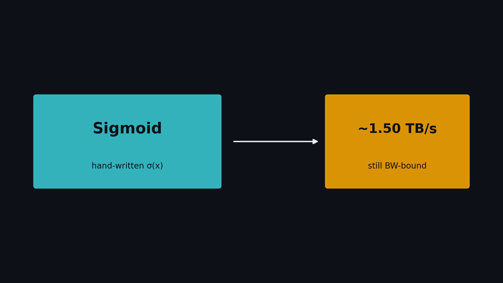
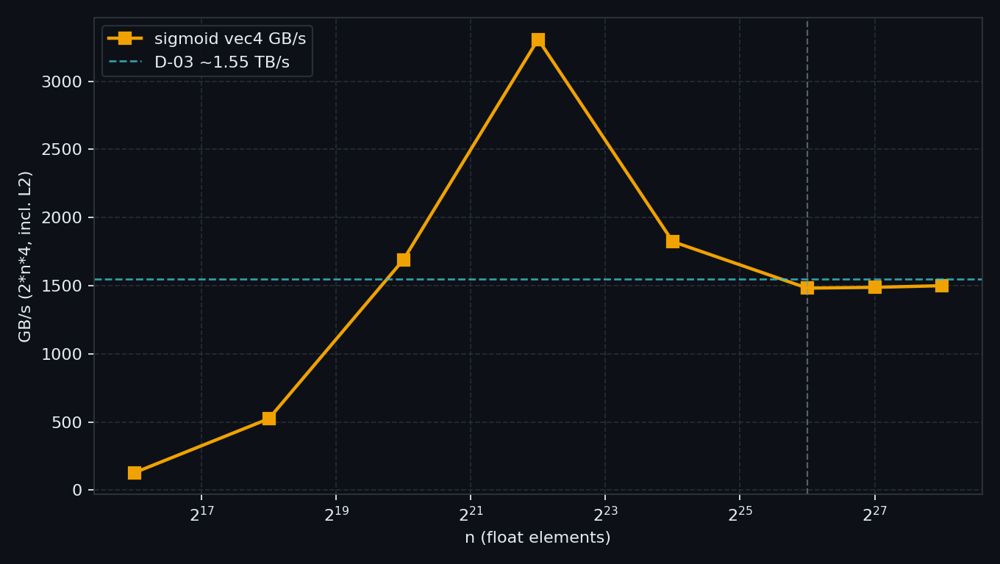

# D-04. Sigmoid：手写激活，是否算力墙



> D-03 把手写 add 推到带宽顶（~1.55 TB/s）。  
> **短章**：同一套网格 / block / median，只换函数。本章手写 `sigmoid`，看 `expf` 有没有把墙推到算力。  
> 本机：大数组前向约 **1.50 TB/s** → **仍是带宽题**。

**配套可复现**：[Yapeng-Gao/AI-System-Performance-Lab](https://github.com/Yapeng-Gao/AI-System-Performance-Lab)。有用请 Star。本章示例：[`examples/04_operators/04_sigmoid.cu`](https://github.com/Yapeng-Gao/AI-System-Performance-Lab/blob/main/examples/04_operators/04_sigmoid.cu)。

## TL;DR

> 口径：RTX 5090 / `sm_120`，SMs=170。前向有效字节 `2*n*4`，**含 L2**。CUDA event **median**。表见 [`docs/results/D-04_sigmoid.md`](../../docs/results/D-04_sigmoid.md)。

1. **公式**：`y = 1/(1+exp(-x))`。反传一档：`dx = dy * y * (1-y)`。
2. **结果**：大数组前向（两流）vec4 约 **1.50 TB/s**；反传（三流）定点贴 D-03 的 **1543 GB/s**。
3. **判停**：未打成算力墙。`scalar/vec4` 约 **1.04～1.09×**。
4. **不重讲**：向量化加载口径沿用 D-03。

---

## 1. 公式与形状

| | 本章 |
|---|---|
| 前向 | `y[i] = sigmoid(x[i])`，一元 |
| 反传 | `dx[i] = dy[i] * y[i] * (1-y[i])` |
| 有效字节 | 前向 `2*n*4`；反传 `3*n*4` |
| 官方对照 | 无单算子；对照带宽 + 相对 D-03 |

输入：`x[i] = ((i&255)/255)*8 - 4`（约 [-4, 4]）。正确性对 host double，探针相对误差 ≤ 1e-5。

## 2. 版本

| 路径 | 做什么 |
|---|---|
| `scalar` / `vec4` | 前向；`vec4` 与 D-03 同 CTA 数 |
| `bwd` | 反传 scalar + vec4（`modes` 也会跑） |

```bash
./bin/04_operators_04_sigmoid --mode sweep
./bin/04_operators_04_sigmoid --mode modes --n $((1<<26))
```

## 3. 本机数字

主结论看右半段（median 已过 0.05 ms）。前向是两流 `2*n*4`；图上虚线是 D-03 三流顶，只作同机量级参照。同字节公式的锁点看反传。

| n | 两流字节 | vec4_ms | scalar/vec4 | vec4 GB/s |
|---:|---:|---:|---:|---:|
| 2^26 | 512 MiB | 0.362 | 1.04× | 1482 |
| 2^27 | 1 GiB | 0.722 | 1.06× | 1488 |
| 2^28 | 2 GiB | 1.432 | **1.09×** | **1500** |



> 右端停在约 **1.50 TB/s**。左半段数 TB/s 是 L2，不当总线结论。虚线 ≈ D-03 三流顶；本机 `expf` 没把右端拉开。

反传 `n=2^26`（三流 `3*n*4`）：vec4 **0.522 ms**、**1543 GB/s**，与 D-03 add 同档。

## 4. 生产建议

| 信号 | 建议 |
|---|---|
| 前向右端 ~1.50 TB/s，反传贴 1543 | **达标**（带宽界）。别再抠 `expf` 赢总线 |
| 想超过单次 sigmoid | 融进邻接 epilogue（少一次读写），不是再换加载宽度 |
| 下一激活 | 去 D-05；同 harness。掉出带宽再展开，贴顶就薄写 |

| 误区 | 纠正 |
|---|---|
| 特殊函数一定算力墙 | 5090 大数组上本章仍贴带宽 |
| 两流 GB/s 必须等于 D-03 三流顶 | 流数不同；同尺看反传三流是否贴顶 |
| 该重讲 float4 | 口径在 D-03；本章只换函数 |

## 5. 下一算子

下一张短章 D-05 ReLU：同一 harness，公式更轻，对照是否更贴带宽。

---

> 本文配套代码与实测：[AI-System-Performance-Lab](https://github.com/Yapeng-Gao/AI-System-Performance-Lab)。觉得有用请 Star。  
> 本章示例：[`examples/04_operators/04_sigmoid.cu`](https://github.com/Yapeng-Gao/AI-System-Performance-Lab/blob/main/examples/04_operators/04_sigmoid.cu)。下一篇：[D 模块文章目录](https://github.com/Yapeng-Gao/AI-System-Performance-Lab/tree/main/article/04_operators/)。

## 参考文献

### A. 官方

1. CUDA Math API：`expf` 等特殊函数（器件端）。本章用它做前向，不展开指令级剖析。

### B. 工程

2. 本专栏 D-03 Elementwise：三流带宽顶 ~1.55 TB/s。本章用同一把尺看一元激活。
