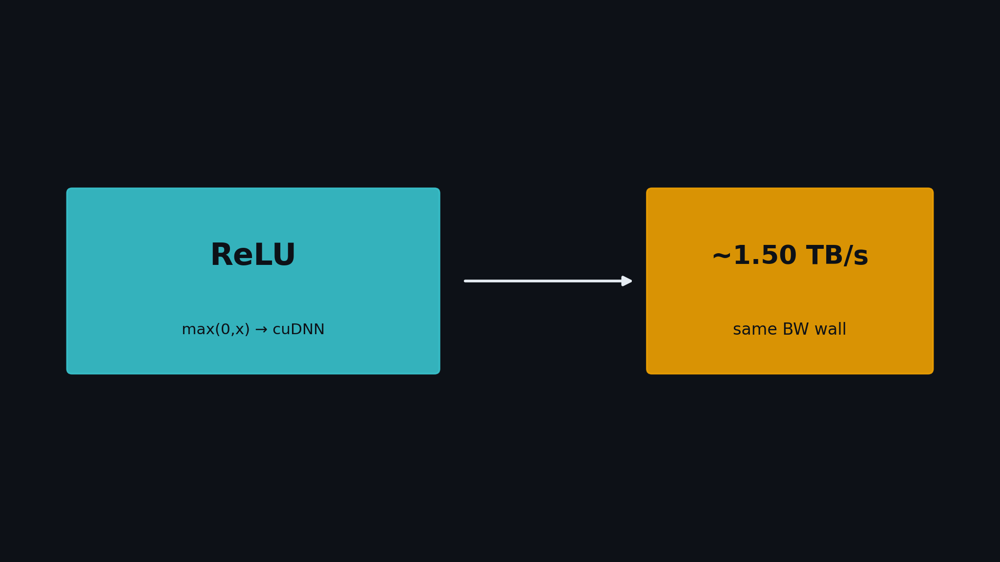
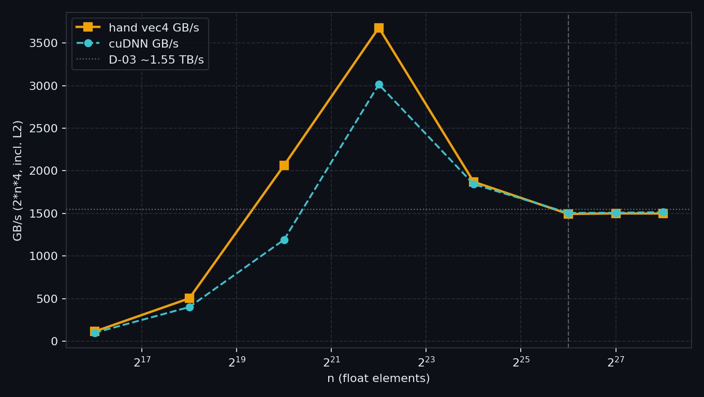

# D-05. ReLU 达到 cuDNN



> D-04：Sigmoid 追上 cuDNN（`vec4/cudnn`≈**1.01**），大数组仍 ~**1.50 TB/s**。  
> 本章换成更轻的 `max(0,x)`：没有 `expf`，看墙钟能不能拉开。  
> 本机仍 **1.01** / **1.50 TB/s** → **与 Sigmoid 同墙**。

**配套可复现**：[Yapeng-Gao/AI-System-Performance-Lab](https://github.com/Yapeng-Gao/AI-System-Performance-Lab)（文章 + `.cu` + 实测表）。有用请 Star。本章示例：[`examples/04_operators/05_relu.cu`](https://github.com/Yapeng-Gao/AI-System-Performance-Lab/blob/main/examples/04_operators/05_relu.cu)。

## TL;DR

> 口径：RTX 5090 / `sm_120`，SMs=170。前向 `2*n*4`，**含 L2**。CUDA event **median**。表见 [`docs/results/D-05_relu.md`](../../docs/results/D-05_relu.md)。

1. **形状**：`y[i]=max(0,x[i])`；负半轴硬截断为 0，正半轴恒等。
2. **阶梯**：`scalar` / `vec4` / `cudnn`（`CUDNN_ACTIVATION_RELU`）； harness 同 D-04 / D-03。
3. **天花板**：cuDNN Activation；`vec4/cudnn`≈1 → **达到库**。
4. **数字**：`vec4/cudnn`≈**1.011**；~**1.50 TB/s**，与 Sigmoid 叠线。
5. **用法**：更轻不等于大数组更快；想超过，融进相邻算子。

---

## 1. ReLU：max(0,x)

定义：

\[
\text{ReLU}(x) = \max(0,\, x)
\]

负半轴输出 0，正半轴斜率为 1。实现只需比较与选择，没有超越函数——直觉上该比 Sigmoid「便宜」。本章要验证的正是这点：在 **同一套两读一写 harness** 上，去掉 `expf` 之后，大数组墙钟会不会明显离开 ~1.50 TB/s 那条线。

反传在 \(y>0\) 处传梯度，否则为 0（0 点次梯度不定，与 cuDNN 约定对齐即可）。

| | 本章 |
|---|---|
| 前向 | `y[i] = max(0, x[i])` |
| 反传 | `dx[i] = dy[i] · 𝟙(y[i] > 0)` |
| 有效字节 | 前向 `2*n*4`；反传 `3*n*4` |
| 官方对照 | `CUDNN_ACTIVATION_RELU` |
| 不是 | 「更轻 ⇒ 大数组必然更快」（本机仍带宽限） |

输入同 D-04。正确性：host 与 device **逐元素精确相等**（`fmaxf` 路径）。

## 2. 三档版本

与 D-04 相同三档：只换 `act_f`，网格与 `float4` 读法沿用 D-03。

| 路径 | 做什么 |
|---|---|
| `scalar` | 标量前向 |
| `vec4` | 主手写 |
| `cudnn` | `cudnnActivationForward`（ReLU） |

```bash
export CUDNN_ROOT=${CUDNN_ROOT:-$HOME/cudnn-9.12}
./bin/04_operators_05_relu --mode sweep
./bin/04_operators_05_relu --mode modes --n $((1<<26))
```

## 3. 手写主路径

测法与 D-04 相同，只换 `act_f`。算术变轻之后，若 `vec4/cudnn` 与右半段 GB/s 仍和 Sigmoid 重叠，说明瓶颈在显存流量，不在「有没有 `expf`」。

| 步骤 | 做法 | 代码 |
|---|---|---|
| 公式 | `fmaxf(x, 0)` | `act_f` |
| 前向 | 同 D-04 骨架 | `kernel_fwd_scalar` / `kernel_fwd_vec4` |
| 反传 | `dy * (y>0)` | `kernel_bwd_*` |
| 官方 | `CUDNN_ACTIVATION_RELU` | Forward / Backward |

```142:144:examples/04_operators/05_relu.cu
static __host__ __device__ __forceinline__ float act_f(float x) {
  return fmaxf(x, 0.f);
}
```

```162:175:examples/04_operators/05_relu.cu
__global__ void kernel_fwd_vec4(const float* x, float* y, int n) {
  const int n4 = n >> 2;
  const float4* x4 = reinterpret_cast<const float4*>(x);
  float4* y4 = reinterpret_cast<float4*>(y);
  for (int i = blockIdx.x * blockDim.x + threadIdx.x; i < n4; i += blockDim.x * gridDim.x) {
    const float4 a = x4[i];
    y4[i] = make_float4(act_f(a.x), act_f(a.y), act_f(a.z), act_f(a.w));
  }
}

__global__ void kernel_bwd_scalar(const float* y, const float* dy, float* dx, int n) {
  for (int i = blockIdx.x * blockDim.x + threadIdx.x; i < n; i += blockDim.x * gridDim.x) {
    dx[i] = dy[i] * (y[i] > 0.f ? 1.f : 0.f);
  }
}
```

## 4. 复现与正确性

```bash
./bin/04_operators_05_relu --mode sweep
```

| mode | 作用 |
|---|---|
| `sweep` | 主曲线 |
| `modes` | 定点三档 + 反传 |
| `scalar` / `vec4` / `cudnn` / `bwd` | 单路径 |

**正确性**：前向 host `fmaxf` 对照；反传门控对照。**计时**：median；GB/s **含 L2**；左段 median < 0.05 ms 不当结论。

## 5. 达到 cuDNN

| n | vec4_ms | cudnn_ms | vec4/cudnn | vec4 GB/s |
|---:|---:|---:|---:|---:|
| 2^26 | 0.359 | 0.356 | 1.009 | 1494 |
| 2^27 | 0.716 | 0.712 | 1.005 | 1501 |
| 2^28 | 1.433 | 1.417 | **1.011** | **1499** |



> 右端与 D-04 / cuDNN 叠在约 **1.50 TB/s**。去掉 `expf` 没有拉开与总线的距离。

反传 `n=2^26`：vec4 **0.523 ms** / cudnn **0.515 ms**，`vec4/cudnn`≈**1.015**。

**判停**：追上库且贴带宽 → 收工。

## 6. 生产建议

单次前向：调 cuDNN 或手写 `float4` 同档，不必为「去掉 exp」再开一条专用路径。想超过单次 ReLU，靠融合少写一次显存，而不是把 `fmaxf` 再抠一遍。

| 信号 | 建议 |
|---|---|
| `vec4/cudnn`≈1，~1.50 TB/s | 达标；生产任选库或 `float4` |
| 期待比 Sigmoid 快一截 | 大数组本机不成立；比的是库与带宽 |
| 负半轴要光滑 | 去 D-06 ELU |

| 误区 | 纠正 |
|---|---|
| ReLU 一定比 Sigmoid 快很多 | 本机大数组同堵带宽 |
| 左端数 TB/s = 打满显存 | 看右端 median |
| 必须对齐 D-03 **1.55 TB/s** | 前向两路读写字节更少，~1.50 TB/s 正常 |

## 7. 下一算子

D-06 ELU：负半轴 `α(e^x−1)`，看半边 `exp` 会不会掉出带宽。

---

> 本文配套代码与实测：[AI-System-Performance-Lab](https://github.com/Yapeng-Gao/AI-System-Performance-Lab)。觉得有用请 Star。  
> 本章示例：[`examples/04_operators/05_relu.cu`](https://github.com/Yapeng-Gao/AI-System-Performance-Lab/blob/main/examples/04_operators/05_relu.cu)。下一篇：[D 模块文章目录](https://github.com/Yapeng-Gao/AI-System-Performance-Lab/tree/main/article/04_operators/)。

## 参考文献

### A. 官方

1. cuDNN：`CUDNN_ACTIVATION_RELU`（Forward / Backward）。只对照。

### B. 工程

2. 本专栏 D-03 / D-04：同一带宽尺 + cuDNN 对照。
