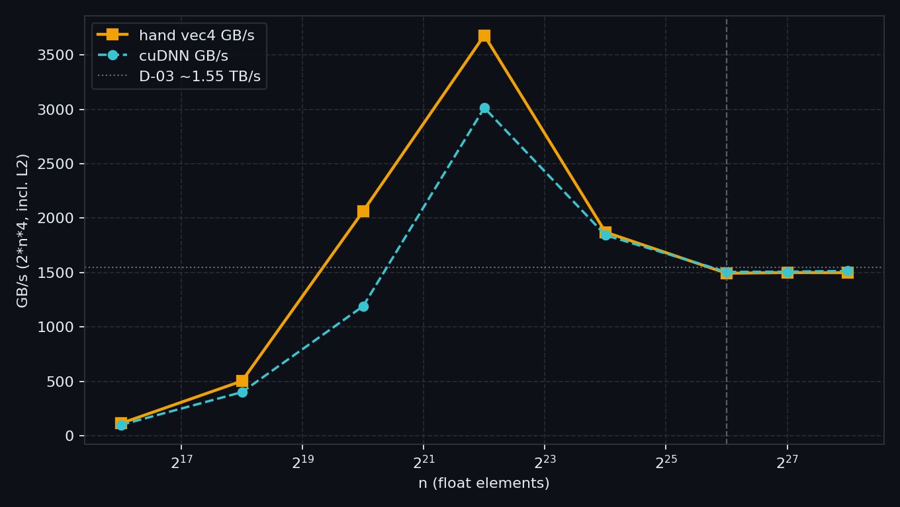

# D-05. ReLU：更轻激活，是否更贴带宽


> D-04 手写 sigmoid 追上 cuDNN（`vec4/cudnn`≈1.01），仍慢在读/写显存。  
> 本章短章：同一套测法，换成更轻的 `max(0,x)`，继续对 cuDNN。  
> 本机：`vec4/cudnn`≈**1.01**；前向约 **1.50 TB/s** → **和 D-04 同一条带宽线**。公式更轻，方案仍要写清。

**配套可复现**：[Yapeng-Gao/AI-System-Performance-Lab](https://github.com/Yapeng-Gao/AI-System-Performance-Lab)。有用请 Star。本章示例：[`examples/04_operators/05_relu.cu`](https://github.com/Yapeng-Gao/AI-System-Performance-Lab/blob/main/examples/04_operators/05_relu.cu)。

## TL;DR

> 口径：RTX 5090 / `sm_120`，SMs=170。前向 `2*n*4`，**含 L2**。CUDA event **median**。表见 [`docs/results/D-05_relu.md`](../../docs/results/D-05_relu.md)。

1. **结论**：去掉 `expf` 之后，大数组上并没有明显更快；仍追上 cuDNN，仍贴带宽。
2. **公式**：前向 `y = max(0, x)`；反传 `dx = dy * (y > 0)`。
3. **怎么比**：同 D-04；`float4` 读法不重讲。
4. **数字**：`vec4/cudnn`≈**1.01**；~**1.50 TB/s**。
5. **怎么用**：更轻不等于大数组上再快一截。想超过，融进相邻算子。

---

## 1. 定义与形状

| | 本章 |
|---|---|
| 前向 | `y[i] = max(0, x[i])` |
| 反传 | `dx[i] = dy[i] * (y[i] > 0)` |
| 有效字节 | 前向 `2*n*4`；反传 `3*n*4` |
| 官方对照 | cuDNN Activation；同时对照带宽 |

输入同 D-04：`x` 大约在 [-4, 4]。正确性对 host 精确相等。

## 2. 版本表

| 路径 | 做什么 |
|---|---|
| `scalar` / `vec4` / `cudnn` | 前向三档 |
| `bwd` / `modes` | 反传手写 + cuDNN |

```bash
export CUDNN_ROOT=${CUDNN_ROOT:-$HOME/cudnn-9.12}
./bin/04_operators_05_relu --mode sweep
./bin/04_operators_05_relu --mode modes --n $((1<<26))
```

## 3. 实现思路与代码

与 D-04 同一套测法，只换 `act_f`。去掉 `expf` 之后，如果大数组上仍追上 cuDNN、带宽仍贴顶，说明「更轻」几乎换不来速度——瓶颈还在显存，不在算力。

| 步骤 | 做法 | 代码 |
|---|---|---|
| 公式 | `max(0,x)`；反传看 `y>0` 开门 | `act_f` / `kernel_bwd_*` |
| 前向 | 同 D-04：`scalar` → `vec4` | `kernel_fwd_*` |
| 官方 | `CUDNN_ACTIVATION_RELU` | Forward / Backward |

```142:144:examples/04_operators/05_relu.cu
static __host__ __device__ __forceinline__ float act_f(float x) {
  return fmaxf(x, 0.f);
}
```

```162:175:examples/04_operators/05_relu.cu
__global__ void kernel_fwd_vec4(const float* x, float* y, int n) {
  const int n4 = n >> 2;
  const float4* x4 = reinterpret_cast<const float4*>(x);
  float4* y4 = reinterpret_cast<float4*>(y);
  for (int i = blockIdx.x * blockDim.x + threadIdx.x; i < n4; i += blockDim.x * gridDim.x) {
    const float4 a = x4[i];
    y4[i] = make_float4(act_f(a.x), act_f(a.y), act_f(a.z), act_f(a.w));
  }
}

__global__ void kernel_bwd_scalar(const float* y, const float* dy, float* dx, int n) {
  for (int i = blockIdx.x * blockDim.x + threadIdx.x; i < n; i += blockDim.x * gridDim.x) {
    dx[i] = dy[i] * (y[i] > 0.f ? 1.f : 0.f);
  }
}
```

读数看两样：`vec4/cudnn`，以及右半段 GB/s。不要因为「ReLU 更轻」就预期大数组再快一截——本机与 D-04 叠在同一条线上。

## 4. 本机数字与判停

```bash
./bin/04_operators_05_relu --mode sweep
```

看右半段（median 已经超过 0.05 ms）。

| n | vec4_ms | cudnn_ms | vec4/cudnn | vec4 GB/s |
|---:|---:|---:|---:|---:|
| 2^26 | 0.359 | 0.356 | 1.009 | 1494 |
| 2^27 | 0.716 | 0.712 | 1.005 | 1501 |
| 2^28 | 1.433 | 1.417 | **1.011** | **1499** |



> 右端手写与 cuDNN 叠在大约 **1.50 TB/s**。左边不当结论。去掉 `expf` 没有拉开与总线的距离。

反传 `n=2^26`：vec4 **0.523 ms** / cudnn **0.515 ms**，`vec4/cudnn`≈**1.015**。

**判停**：追上库且贴带宽 → 收工。

## 5. 生产建议

调 cuDNN，或手写做到同一档。想超过：融进相邻算子。

| 信号 | 建议 |
|---|---|
| `vec4/cudnn`≈1，且 GB/s 贴顶 | 达标 |
| 想超过 | 融进相邻算子一起算，少写一次显存 |
| 下一激活仍贴顶 | 仍写清「换了什么公式、为何没更快」；真掉出带宽再展开 |

| 误区 | 纠正 |
|---|---|
| ReLU 一定比 sigmoid 快一截 | 本机大数组同堵在带宽，并都追上 cuDNN |
| 两路 GB/s 必须对齐 D-03 三路顶 | 前向只有两路；看 `vec4/cudnn` 和反传三路即可 |
| 左边冒出的数 TB/s = 打满显存 | 还在缓存里；看右端 |

## 6. 下一算子

下一张短章 D-06 ELU：同一套测法；负半轴带 `exp` 时，会不会掉出带宽。

---

> 本文配套代码与实测：[AI-System-Performance-Lab](https://github.com/Yapeng-Gao/AI-System-Performance-Lab)。觉得有用请 Star。  
> 本章示例：[`examples/04_operators/05_relu.cu`](https://github.com/Yapeng-Gao/AI-System-Performance-Lab/blob/main/examples/04_operators/05_relu.cu)。下一篇：[D 模块文章目录](https://github.com/Yapeng-Gao/AI-System-Performance-Lab/tree/main/article/04_operators/)。

## 参考文献

### A. 官方

1. cuDNN：`CUDNN_ACTIVATION_RELU`（Forward / Backward）。只对照。

### B. 工程

2. 本专栏 D-03 / D-04：同一带宽尺 + cuDNN 对照。
