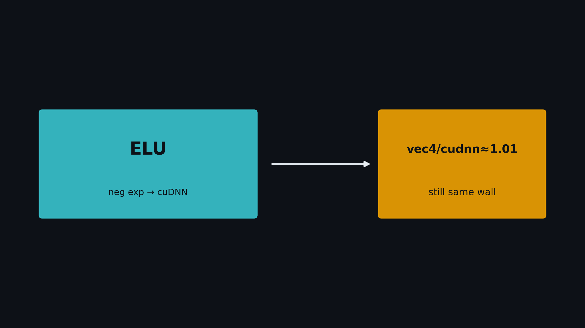
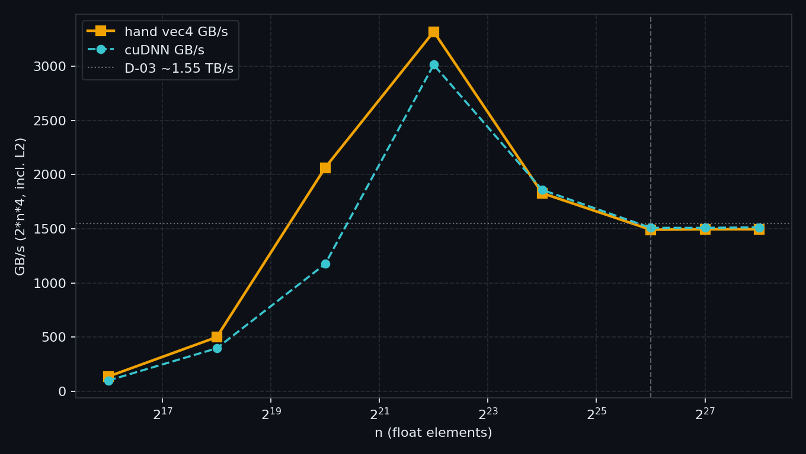

# D-06. ELU 达到 cuDNN



> D-04 / D-05：Sigmoid / ReLU 均 `vec4/cudnn`≈**1.01**，~**1.50 TB/s**。  
> 本章写 ELU：正半轴恒等，负半轴 `α(e^x−1)`（本章 α=1）。相对 ReLU 多半边 `expf`。  
> 本机仍 **1.01** / **1.50 TB/s** → **没有掉出带宽**。

**配套可复现**：[Yapeng-Gao/AI-System-Performance-Lab](https://github.com/Yapeng-Gao/AI-System-Performance-Lab)（文章 + `.cu` + 实测表）。有用请 Star。本章示例：[`examples/04_operators/06_elu.cu`](https://github.com/Yapeng-Gao/AI-System-Performance-Lab/blob/main/examples/04_operators/06_elu.cu)。

## TL;DR

> 口径：RTX 5090 / `sm_120`，SMs=170。前向 `2*n*4`，**含 L2**。CUDA event **median**。表见 [`docs/results/D-06_elu.md`](../../docs/results/D-06_elu.md)。

1. **形状**：\(x\ge0\) 时 \(y=x\)；\(x<0\) 时 \(y=\alpha(e^x-1)\)。
2. **阶梯**：`scalar` / `vec4` / `cudnn`（`CUDNN_ACTIVATION_ELU`，coef=α）；测法同 D-04。
3. **天花板**：cuDNN ELU；`vec4/cudnn`≈1 → **达到库**。
4. **数字**：`vec4/cudnn`≈**1.012**；~**1.50 TB/s**。
5. **用法**：半边 `exp` 仍不打赢带宽；想更快，融合。

---

## 1. ELU：负半轴 α(e^x−1)

分段定义（α>0，本章 **α=1**）：

\[
\text{ELU}(x) =
\begin{cases}
x, & x \ge 0 \\
\alpha\left(e^{x} - 1\right), & x < 0
\end{cases}
\]

正半轴与 ReLU 一样直通；负半轴光滑贴近 −α。相对 Sigmoid，正半轴不再饱和；相对 ReLU，只在 \(x<0\) 多一次 `expf`（本机 `x` 约在 [-4,4]，两半都会踩到）。

本章问题：半边特殊函数够不够把大数组打出 ~1.50 TB/s，并和 cuDNN 拉开？若仍贴墙，说明「偶发 `expf`」在这套流量下仍买不走带宽瓶颈。

| | 本章 |
|---|---|
| 前向 | 上式，α=1 |
| 反传 | \(y>0\)：`dx=dy`；否则 `dx=dy·(y+α)` |
| 有效字节 | 前向 `2*n*4`；反传 `3*n*4` |
| 官方对照 | `CUDNN_ACTIVATION_ELU`（coef=α） |
| 不是 | 「负半轴有 exp ⇒ 一定算力墙」 |

## 2. 三档版本

| 路径 | 做什么 |
|---|---|
| `scalar` / `vec4` | 前向手写 |
| `cudnn` | cuDNN ELU |
| `bwd` / `modes` | 反传手写 + cuDNN Backward |

网格、`float4`、median 与 D-03 harness 一致（见 D-04 开篇）。

```bash
export CUDNN_ROOT=${CUDNN_ROOT:-$HOME/cudnn-9.12}
./bin/04_operators_06_elu --mode sweep
./bin/04_operators_06_elu --mode modes --n $((1<<26))
```

## 3. 手写主路径

同一套 D-03 / D-04 harness，只换分支公式。读数仍看 `vec4/cudnn` 与右半段 GB/s；与 D-04 / D-05 重叠 → 半边 `exp` **没有**打出带宽。

| 步骤 | 做法 | 代码 |
|---|---|---|
| 公式 | 分支 + 负半轴 `expf` | `act_f` |
| 反传 | `y>0` 直通；否则乘 `(y+α)` | `kernel_bwd_*` |
| 官方 | coef=α | Forward / Backward |

```142:145:examples/04_operators/06_elu.cu
static __host__ __device__ __forceinline__ float act_f(float x) {
  const float kAlpha = 1.f;
  return (x >= 0.f) ? x : (kAlpha * (expf(x) - 1.f));
}
```

```163:178:examples/04_operators/06_elu.cu
__global__ void kernel_fwd_vec4(const float* x, float* y, int n) {
  const int n4 = n >> 2;
  const float4* x4 = reinterpret_cast<const float4*>(x);
  float4* y4 = reinterpret_cast<float4*>(y);
  for (int i = blockIdx.x * blockDim.x + threadIdx.x; i < n4; i += blockDim.x * gridDim.x) {
    const float4 a = x4[i];
    y4[i] = make_float4(act_f(a.x), act_f(a.y), act_f(a.z), act_f(a.w));
  }
}

__global__ void kernel_bwd_scalar(const float* y, const float* dy, float* dx, int n) {
  const float alpha = 1.f;
  for (int i = blockIdx.x * blockDim.x + threadIdx.x; i < n; i += blockDim.x * gridDim.x) {
    const float yi = y[i];
    dx[i] = dy[i] * (yi > 0.f ? 1.f : (yi + alpha));
  }
}
```

## 4. 复现与正确性

```bash
./bin/04_operators_06_elu --mode sweep
```

| mode | 作用 |
|---|---|
| `sweep` | 主曲线 |
| `modes` | 定点 + 反传 |
| 单路径 | `scalar` / `vec4` / `cudnn` / `bwd` |

**正确性**：host 分段公式对照；**计时**：median，含 L2，看右半段。

## 5. 达到 cuDNN

| n | vec4_ms | cudnn_ms | vec4/cudnn | vec4 GB/s |
|---:|---:|---:|---:|---:|
| 2^26 | 0.360 | 0.356 | 1.012 | 1491 |
| 2^27 | 0.718 | 0.712 | 1.009 | 1496 |
| 2^28 | 1.436 | 1.419 | **1.012** | **1496** |



> 右端与 D-04 / D-05 / cuDNN 重叠。负半轴 `exp` **没有**把算子打出带宽。

反传 `n=2^26`：`vec4/cudnn`≈**1.013**。

**判停**：追上库且未掉出带宽 → 收工。

## 6. 生产建议

单次前向：调 cuDNN 或手写 `float4` 同档；α 与 cuDNN coef 对齐即可。半边 `exp` 没有把大数组打出 ~1.50 TB/s——别为「负半轴更贵」单独换尺子。

| 信号 | 建议 |
|---|---|
| ≈1.01 且 ~1.50 TB/s | 达标；生产任选库或 `float4` |
| 负半轴仍担心算力 | 本机大数组证据不支持；先融合 |
| Transformer 常用 GELU | 去 D-07（legacy Activation 无 GELU） |

| 误区 | 纠正 |
|---|---|
| 负半轴 `exp` 一定算力瓶颈 | 本机未掉出带宽 |
| 左端 TB/s = 显存打满 | 看右端 |

## 7. 下一算子

D-07 GELU：erf 精确与 tanh 近似，尺子改 host + 带宽（legacy Activation 无 GELU）。

---

> 本文配套代码与实测：[AI-System-Performance-Lab](https://github.com/Yapeng-Gao/AI-System-Performance-Lab)。觉得有用请 Star。  
> 本章示例：[`examples/04_operators/06_elu.cu`](https://github.com/Yapeng-Gao/AI-System-Performance-Lab/blob/main/examples/04_operators/06_elu.cu)。下一篇：[D 模块文章目录](https://github.com/Yapeng-Gao/AI-System-Performance-Lab/tree/main/article/04_operators/)。

## 参考文献

### A. 官方

1. cuDNN：`CUDNN_ACTIVATION_ELU`（Forward / Backward，coef=α）。只对照。

### B. 工程

2. 本专栏 D-04 / D-05：同一带宽尺 + cuDNN 对照。
