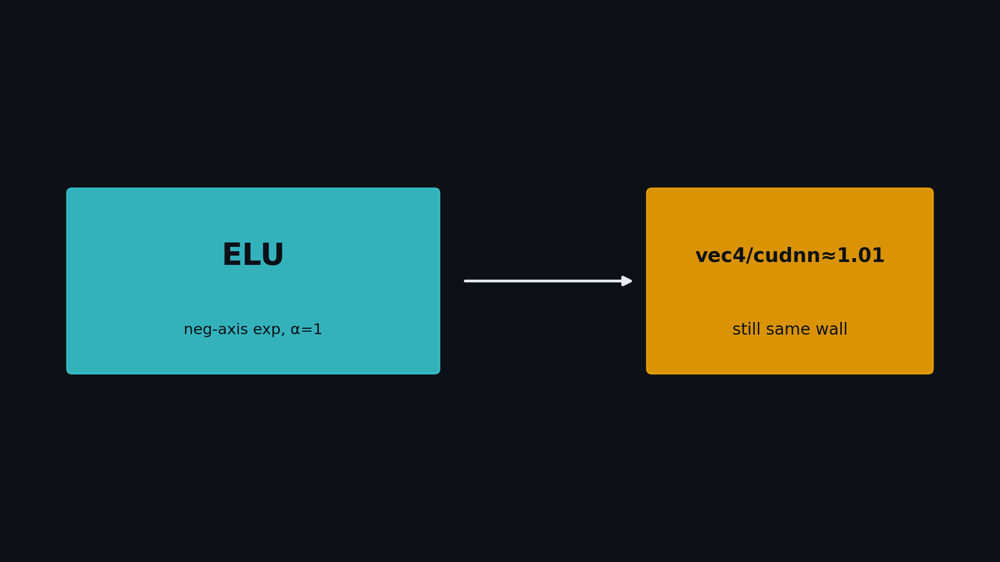
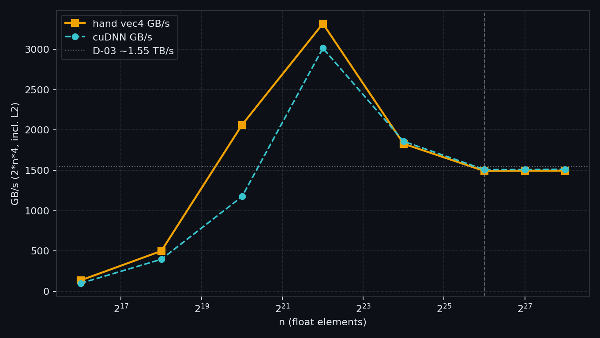

# D-06. ELU：负半轴带 exp，是否掉出带宽



> D-04 / D-05：sigmoid / ReLU 都是 `vec4/cudnn`≈1.01，大约 1.50 TB/s。  
> 本章短章：同一套测法，负半轴换成 `α(e^x−1)`（α=1）。  
> 本机：仍约 **1.01** / **1.50 TB/s** → **没有掉出带宽**。负半轴有 `exp`，方案仍要写清。

**配套可复现**：[Yapeng-Gao/AI-System-Performance-Lab](https://github.com/Yapeng-Gao/AI-System-Performance-Lab)。有用请 Star。本章示例：[`examples/04_operators/06_elu.cu`](https://github.com/Yapeng-Gao/AI-System-Performance-Lab/blob/main/examples/04_operators/06_elu.cu)。

## TL;DR

> 口径：RTX 5090 / `sm_120`，SMs=170。前向 `2*n*4`，**含 L2**。CUDA event **median**。表见 [`docs/results/D-06_elu.md`](../../docs/results/D-06_elu.md)。

1. **结论**：负半轴带 `exp`，大数组上仍追上 cuDNN，仍贴带宽。
2. **公式**：`x≥0` 时 `y=x`；`x<0` 时 `y=α(e^x−1)`，α=1。反传：`y>0` 时 `dx=dy`，否则 `dx=dy*(y+α)`。
3. **怎么比**：同 D-04；官方是 cuDNN `CUDNN_ACTIVATION_ELU`。`float4` 读法不重讲。
4. **数字**：`vec4/cudnn`≈**1.01**；~**1.50 TB/s**。
5. **怎么用**：追上库且未掉出带宽就收工。想超过，融进相邻算子。

---

## 1. 定义与形状

| | 本章 |
|---|---|
| 前向 | `x≥0 → y=x`；`x<0 → y=α(e^x−1)`，α=1 |
| 反传 | `y>0 → dx=dy`；否则 `dx=dy*(y+α)` |
| 有效字节 | 前向 `2*n*4`；反传 `3*n*4` |
| 官方对照 | cuDNN `CUDNN_ACTIVATION_ELU`（coef=α） |

## 2. 版本表

| 路径 | 做什么 |
|---|---|
| `scalar` / `vec4` / `cudnn` | 前向三档 |
| `bwd` / `modes` | 反传手写 + cuDNN |

```bash
export CUDNN_ROOT=${CUDNN_ROOT:-$HOME/cudnn-9.12}
./bin/04_operators_06_elu --mode sweep
./bin/04_operators_06_elu --mode modes --n $((1<<26))
```

## 3. 实现思路与代码

仍是 D-03 / D-04 那套测法。相对 ReLU，负半轴多一次 `expf`；相对 Sigmoid，正半轴是直通，`exp` 只打在一半元素上。

要看的是：半边特殊函数，够不够让大数组掉出带宽、并和 cuDNN 拉开差距。

| 步骤 | 做法 | 代码 |
|---|---|---|
| 公式 | 正半轴直通；负半轴 `α(e^x−1)` | `act_f` |
| 反传 | `y>0` 开门；否则乘 `(y+α)` | `kernel_bwd_*` |
| 官方 | `CUDNN_ACTIVATION_ELU`，coef=α | Forward / Backward |

```142:145:examples/04_operators/06_elu.cu
static __host__ __device__ __forceinline__ float act_f(float x) {
  const float kAlpha = 1.f;
  return (x >= 0.f) ? x : (kAlpha * (expf(x) - 1.f));
}
```

```163:178:examples/04_operators/06_elu.cu
__global__ void kernel_fwd_vec4(const float* x, float* y, int n) {
  const int n4 = n >> 2;
  const float4* x4 = reinterpret_cast<const float4*>(x);
  float4* y4 = reinterpret_cast<float4*>(y);
  for (int i = blockIdx.x * blockDim.x + threadIdx.x; i < n4; i += blockDim.x * gridDim.x) {
    const float4 a = x4[i];
    y4[i] = make_float4(act_f(a.x), act_f(a.y), act_f(a.z), act_f(a.w));
  }
}

__global__ void kernel_bwd_scalar(const float* y, const float* dy, float* dx, int n) {
  const float alpha = 1.f;
  for (int i = blockIdx.x * blockDim.x + threadIdx.x; i < n; i += blockDim.x * gridDim.x) {
    const float yi = y[i];
    dx[i] = dy[i] * (yi > 0.f ? 1.f : (yi + alpha));
  }
}
```

读数看两样：`vec4/cudnn`，以及右半段 GB/s。本机与 D-04 / D-05 重叠 → 负半轴 `exp` **没有**把算子打出带宽。

## 4. 本机数字与判停

```bash
./bin/04_operators_06_elu --mode sweep
```

看右半段（median 已经超过 0.05 ms）。

| n | vec4_ms | cudnn_ms | vec4/cudnn | vec4 GB/s |
|---:|---:|---:|---:|---:|
| 2^26 | 0.360 | 0.356 | 1.012 | 1491 |
| 2^27 | 0.718 | 0.712 | 1.009 | 1496 |
| 2^28 | 1.436 | 1.419 | **1.012** | **1496** |



> 右端与 D-04 / D-05 / cuDNN 重叠。左边不当结论。

反传 `n=2^26`：`vec4/cudnn`≈**1.013**。

**判停**：追上库且未掉出带宽 → 收工。

## 5. 生产建议

调 cuDNN，或手写做到同一档。想超过：融进相邻算子。

| 信号 | 建议 |
|---|---|
| ≈1.01 且贴顶 | 达标 |
| 想超过 | 融进相邻算子一起算，少写一次显存 |
| 下一激活仍贴顶 | 仍写清「换公式 → 方案 → 读数」；真掉出带宽再展开 |

| 误区 | 纠正 |
|---|---|
| 负半轴 `exp` 一定变成算力瓶颈 | 本机大数组没有掉出 |
| 左边冒出的数 TB/s = 打满显存 | 还在缓存里 |

## 6. 下一算子

D-07 GELU：同一套测法；写清 tanh 近似与 erf 的数值差，以及是否掉出带宽。

---

> 本文配套代码与实测：[AI-System-Performance-Lab](https://github.com/Yapeng-Gao/AI-System-Performance-Lab)。觉得有用请 Star。  
> 本章示例：[`examples/04_operators/06_elu.cu`](https://github.com/Yapeng-Gao/AI-System-Performance-Lab/blob/main/examples/04_operators/06_elu.cu)。下一篇：[D 模块文章目录](https://github.com/Yapeng-Gao/AI-System-Performance-Lab/tree/main/article/04_operators/)。

## 参考文献

### A. 官方

1. cuDNN：`CUDNN_ACTIVATION_ELU`（Forward / Backward，coef=α）。只对照。

### B. 工程

2. 本专栏 D-04 / D-05：同一带宽尺 + cuDNN 对照。
