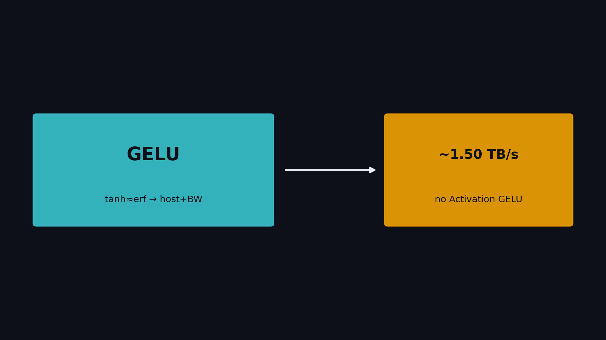
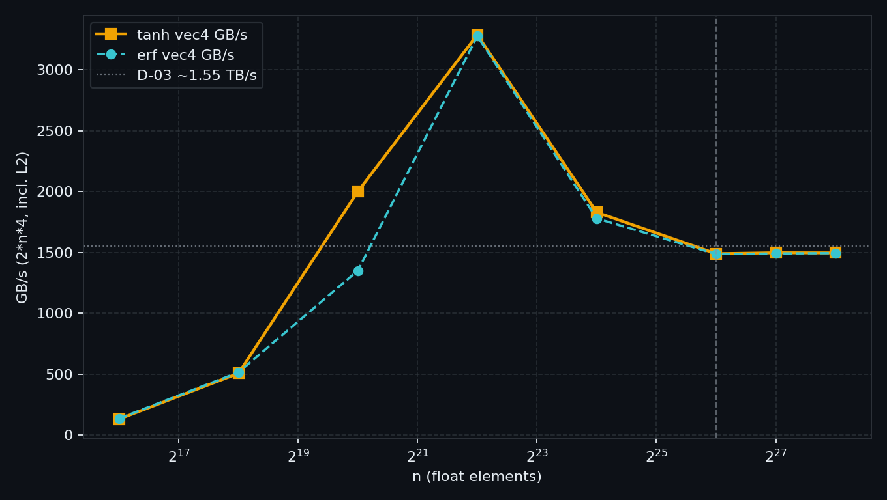

# D-07. GELU 贴带宽



> D-04～D-06：带或不带 `exp`，大数组都 `vec4/cudnn`≈**1.01**、~**1.50 TB/s**。  
> 本章写 GELU：精确式用 `erff`，工程常用 tanh 近似。legacy cuDNN Activation **没有** GELU，尺子改成 **host 真值 + 带宽墙**。  
> 本机 tanh ≈ erf ≈ **1.50 TB/s**；近似相对精确 **max abs≈5e-4**。

**配套可复现**：[Yapeng-Gao/AI-System-Performance-Lab](https://github.com/Yapeng-Gao/AI-System-Performance-Lab)（文章 + `.cu` + 实测表）。有用请 Star。本章示例：[`examples/04_operators/07_gelu.cu`](https://github.com/Yapeng-Gao/AI-System-Performance-Lab/blob/main/examples/04_operators/07_gelu.cu)。

## TL;DR

> 口径：RTX 5090 / `sm_120`，SMs=170。前向 `2*n*4`，**含 L2**。CUDA event **median**。表见 [`docs/results/D-07_gelu.md`](../../docs/results/D-07_gelu.md)。

1. **公式**：精确 `0.5x(1+erf(x/√2))`；默认前向 tanh 近似（GPT/ONNX）。
2. **两档**：`tanh` / `erf` 各走 `scalar`→`vec4`；无 cuDNN Activation 列。
3. **尺子**：D-03 网格与 median；host 自洽 + 右端 ~**1.50 TB/s**。
4. **数字**：`tanh_vec4/erf_vec4`≈**1.00**；探针 tanh vs erf **max abs≈5e-4**。
5. **用法**：生产常用 tanh；要更贴金标切 erf。想超过，融合。

---

## 1. GELU：erf 与 tanh 近似

精确 GELU（Hendrycks & Gimpel）：

\[
\text{GELU}(x) = \frac{x}{2}\left(1 + \mathrm{erf}\left(\frac{x}{\sqrt{2}}\right)\right)
\]

把 ReLU 的硬折角换成「按 \(x\) 平滑开阀」：小 \(|x|\) 时介于 0 与 \(x\) 之间，大正 \(x\) 趋近 \(x\)。设备上用 `erff`；代价高于 ReLU，但 Transformer FFN 里仍是逐元素、无归约。

工程近似（ONNX `approximate="tanh"` / GPT 常用）：

\[
\text{GELU}_\text{tanh}(x) = \frac{x}{2}\left(1 + \tanh\left(\sqrt{\frac{2}{\pi}}\left(x + 0.044715\,x^3\right)\right)\right)
\]

用 `tanhf` 替代 `erff`，少调库依赖、与多数训练图一致；与精确式在主流激活区间差在 **1e-3～1e-4** 量级（本章探针 **max abs≈5e-4**）。近 \(x=0\) 时相对误差会虚高，判错先看 **abs**。

| | 本章 |
|---|---|
| 精确 | `gelu_erf_f` |
| 默认前向 | `gelu_tanh_f` |
| 反传 | 对所选公式解析导（`--mode bwd`，`--formula` 可切） |
| 有效字节 | 前向 `2*n*4`；反传 `3*n*4` |
| 官方对照 | legacy Activation **无 GELU**；不对 Graph Pointwise 做教程 |

## 2. 两档公式

| 路径 | 做什么 |
|---|---|
| `scalar` / `vec4` | 单公式前向（`--formula tanh\|erf`，默认 tanh） |
| `sweep` | 两公式一起扫 n |
| `modes` / `bwd` | 定点 + 反传 |

仍用 D-03 harness：grid-stride、`float4`、median；本章不重讲块大小与有效字节算法。

```bash
./bin/04_operators_07_gelu --mode sweep
./bin/04_operators_07_gelu --mode modes --n $((1<<26))
```

## 3. 手写主路径

| 步骤 | 做法 | 代码 |
|---|---|---|
| 两档公式 | erf / tanh 内联 | `gelu_erf_f` / `gelu_tanh_f` |
| 向量化 | 四点各调一次 | `kernel_fwd_vec4_*` |
| 反传 | 解析导 | `gelu_*_bwd_f` |
| 数值 | device 对各自 host；另报 tanh vs erf | `check_fwd` |

```143:154:examples/04_operators/07_gelu.cu
// Exact GELU.
static __host__ __device__ __forceinline__ float gelu_erf_f(float x) {
  return 0.5f * x * (1.f + erff(x * 0.7071067811865476f));  // 1/sqrt(2)
}

// Tanh approximation (GPT / ONNX approximate="tanh").
static __host__ __device__ __forceinline__ float gelu_tanh_f(float x) {
  const float k = 0.7978845608028654f;  // sqrt(2/pi)
  const float c = 0.044715f;
  const float inner = k * (x + c * x * x * x);
  return 0.5f * x * (1.f + tanhf(inner));
}
```

```188:196:examples/04_operators/07_gelu.cu
__global__ void kernel_fwd_vec4_tanh(const float* x, float* y, int n) {
  const int n4 = n >> 2;
  const float4* x4 = reinterpret_cast<const float4*>(x);
  float4* y4 = reinterpret_cast<float4*>(y);
  for (int i = blockIdx.x * blockDim.x + threadIdx.x; i < n4; i += blockDim.x * gridDim.x) {
    const float4 a = x4[i];
    y4[i] = make_float4(gelu_tanh_f(a.x), gelu_tanh_f(a.y), gelu_tanh_f(a.z), gelu_tanh_f(a.w));
  }
}
```

## 4. 复现与正确性

```bash
./bin/04_operators_07_gelu --mode sweep
```

| mode | 作用 |
|---|---|
| `sweep` | tanh / erf 双曲线 |
| `modes` | 定点 |
| `--formula` | 单公式 |
| `bwd` | 反传 |

**正确性**：各公式 device 对 **各自** host 重算过线。另抽 tanh 输出与 **erf 金标**比：报告 **max abs**（主）；max rel 在近零点可虚大，不当实现 bug 的首选信号。

**计时**：median，含 L2；看右半段。

## 5. 贴带宽

无 cuDNN Activation 列；判停与 D-03～D-06 同墙：**~1.50 TB/s** 且 host 过线。

| n | tanh_vec4_ms | erf_vec4_ms | tanh/erf | tanh GB/s |
|---:|---:|---:|---:|---:|
| 2^26 | 0.360 | 0.361 | 0.998 | 1490 |
| 2^27 | 0.717 | 0.720 | 0.996 | 1498 |
| 2^28 | 1.435 | 1.436 | **0.999** | **1497** |



> 右端与 D-04～D-06 重叠。更重的一组特殊函数 **没有**把算子打出带宽。

数值：tanh 相对 erf 金标 **max abs≈5e-4**；max rel≈0.45 出在近零点，属近似误差而非 kernel 写错。反传 `n=2^26`：tanh vec4 ≈ **1.55 TB/s**（三路字节）。

**判停**：贴同墙且 host 过线 → 收工。

## 6. 生产建议

默认 tanh 近似；对齐 ONNX / 训练图。要更贴 erf 定义：`--formula erf` 或框架侧切精确 GELU。超过单次 GELU：与线性层融合。

| 信号 | 建议 |
|---|---|
| ~1.50 TB/s，tanh≈erf 墙钟 | 达标（带宽） |
| 探针 rel 大 | 先看 **max abs≈5e-4** |
| 要 cuDNN 单列 | legacy Activation 无；Graph Pointwise 另章，本章不开 |
| Swish | 去 D-08 |

| 误区 | 纠正 |
|---|---|
| GELU 一定掉出带宽 | 本机大数组没有 |
| 没 cuDNN 就不能判停 | host + 带宽墙够用 |
| tanh 与 erf 墙钟应差很多 | 本机 **tanh/erf≈1.00** |

## 7. 下一算子

D-08 Swish：`x·σ(x)`，恢复 cuDNN 对照，看是否仍贴带宽。

---

> 本文配套代码与实测：[AI-System-Performance-Lab](https://github.com/Yapeng-Gao/AI-System-Performance-Lab)。觉得有用请 Star。  
> 本章示例：[`examples/04_operators/07_gelu.cu`](https://github.com/Yapeng-Gao/AI-System-Performance-Lab/blob/main/examples/04_operators/07_gelu.cu)。下一篇：[D 模块文章目录](https://github.com/Yapeng-Gao/AI-System-Performance-Lab/tree/main/article/04_operators/)。

## 参考文献

### A. 官方

1. ONNX Gelu：erf 默认；`approximate=tanh` 公式。只对齐定义。  
2. cuDNN Graph Pointwise：`GELU_*` / `GELU_APPROX_TANH_*`；legacy Activation 无 GELU。本章默认不对 Graph。

### B. 工程

3. Hendrycks & Gimpel, GELU（arXiv:1606.08415）：定义出处一句。  
4. 本专栏 D-03～D-06：同一带宽尺与 D-03 harness。
