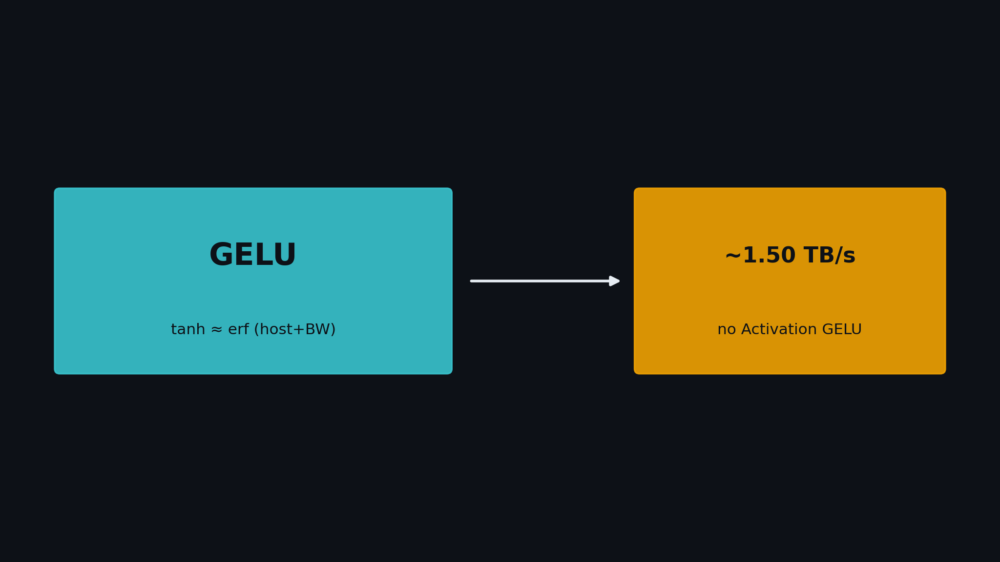
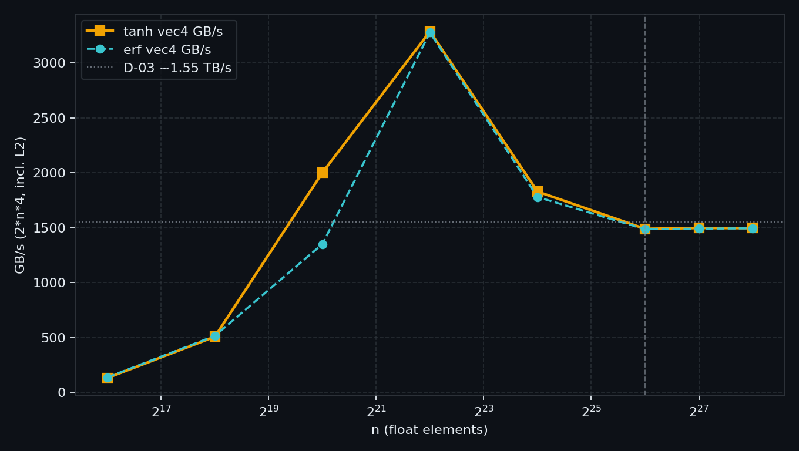

# D-07. GELU：tanh 近似与 erf，是否掉出带宽



> D-04～D-06：sigmoid / ReLU / ELU 都是 `vec4/cudnn`≈1.01，大约 1.50 TB/s。  
> 本章短章：同一套测法，换成 GELU。legacy Activation **没有** GELU，尺子改成 host + 带宽。  
> 本机：tanh ≈ erf ≈ **1.50 TB/s** → **没有掉出带宽**。近似与精确的数值差写清即可。

**配套可复现**：[Yapeng-Gao/AI-System-Performance-Lab](https://github.com/Yapeng-Gao/AI-System-Performance-Lab)。有用请 Star。本章示例：[`examples/04_operators/07_gelu.cu`](https://github.com/Yapeng-Gao/AI-System-Performance-Lab/blob/main/examples/04_operators/07_gelu.cu)。

## TL;DR

> 口径：RTX 5090 / `sm_120`，SMs=170。前向 `2*n*4`，**含 L2**。CUDA event **median**。表见 [`docs/results/D-07_gelu.md`](../../docs/results/D-07_gelu.md)。

1. **结论**：大数组上 tanh 近似与 erf 都贴 ~1.50 TB/s，未掉出带宽。
2. **公式**：精确 `0.5 x (1+erf(x/√2))`；近似 `0.5 x (1+tanh(√(2/π)(x+0.044715 x³)))`（默认前向）。
3. **怎么比**：同 D-03 网格 / `float4` / median。无 cuDNN Activation 可对；host 自洽；近似差看 **abs**（rel 近零会虚高）。
4. **数字**：右半段 ~**1.50 TB/s**；`tanh_vec4/erf_vec4`≈**1.00**；探针 max abs≈**5e-4**。
5. **怎么用**：生产常用 tanh 近似；要更贴金标就切 erf。想超过带宽顶，融进相邻算子。

---

## 1. 定义与形状

| | 本章 |
|---|---|
| 精确 | `y = 0.5 x (1 + erf(x / √2))` |
| 近似（默认） | `y = 0.5 x (1 + tanh(√(2/π) (x + 0.044715 x³)))` |
| 反传 | 对默认公式解析导（`--mode bwd`；`--formula` 可切 erf） |
| 有效字节 | 前向 `2*n*4`；反传 `3*n*4` |
| 官方对照 | legacy Activation **无 GELU**；本章不做 Graph Pointwise 教程 |

## 2. 版本表

| 路径 | 做什么 |
|---|---|
| `scalar` / `vec4` | 单公式前向（`--formula tanh\|erf`，默认 tanh） |
| `sweep` | 两档公式一起扫 n |
| `modes` / `bwd` | 定点前向 + 反传 |

```bash
./bin/04_operators_07_gelu --mode sweep
./bin/04_operators_07_gelu --mode modes --n $((1<<26))
```

## 3. 实现思路与代码

仍是 D-03 那套测法。相对 Sigmoid / ELU，这里没有 cuDNN Activation 可对，所以判停改成：host 真值过线，大数组是否还贴 D-03～D-06 那堵墙。

| 步骤 | 做法 | 代码 |
|---|---|---|
| 两档公式 | erf 精确；tanh 近似 | `gelu_erf_f` / `gelu_tanh_f` |
| 向量化 | 同 D-03 `float4` | `kernel_fwd_vec4_*` |
| 反传 | 解析导；`dy` 探针填 1 | `gelu_*_bwd_f` |
| 数值 | device 对各自 host；另报 tanh vs erf 金标 | `check_fwd` |

```143:154:examples/04_operators/07_gelu.cu
// Exact GELU.
static __host__ __device__ __forceinline__ float gelu_erf_f(float x) {
  return 0.5f * x * (1.f + erff(x * 0.7071067811865476f));  // 1/sqrt(2)
}

// Tanh approximation (GPT / ONNX approximate="tanh").
static __host__ __device__ __forceinline__ float gelu_tanh_f(float x) {
  const float k = 0.7978845608028654f;  // sqrt(2/pi)
  const float c = 0.044715f;
  const float inner = k * (x + c * x * x * x);
  return 0.5f * x * (1.f + tanhf(inner));
}
```

```188:196:examples/04_operators/07_gelu.cu
__global__ void kernel_fwd_vec4_tanh(const float* x, float* y, int n) {
  const int n4 = n >> 2;
  const float4* x4 = reinterpret_cast<const float4*>(x);
  float4* y4 = reinterpret_cast<float4*>(y);
  for (int i = blockIdx.x * blockDim.x + threadIdx.x; i < n4; i += blockDim.x * gridDim.x) {
    const float4 a = x4[i];
    y4[i] = make_float4(gelu_tanh_f(a.x), gelu_tanh_f(a.y), gelu_tanh_f(a.z), gelu_tanh_f(a.w));
  }
}
```

读数看两样：右半段 GB/s，以及 `tanh_vec4/erf_vec4`。本机两者重叠 → 更重的特殊函数 **没有**把算子打出带宽。

## 4. 本机数字与判停

```bash
./bin/04_operators_07_gelu --mode sweep
```

看右半段（median 已经超过 0.05 ms）。

| n | tanh_vec4_ms | erf_vec4_ms | tanh/erf | tanh GB/s |
|---:|---:|---:|---:|---:|
| 2^26 | 0.360 | 0.361 | 0.998 | 1490 |
| 2^27 | 0.717 | 0.720 | 0.996 | 1498 |
| 2^28 | 1.435 | 1.436 | **0.999** | **1497** |



> 右端与 D-03～D-06 重叠。左边不当结论。

数值：device 对各自 host 过线。tanh 相对 erf 金标：探针 **max abs≈5e-4**；max rel≈0.45 出在近零点，不当实现误差。反传 `n=2^26`：tanh vec4 ≈ **1.55 TB/s**。

**判停**：贴同墙且 host 过线 → 收工。无 Activation 可对，不另开 Graph 课。

## 5. 生产建议

默认用 tanh 近似；要更贴金标就切 erf。想超过：融进相邻算子。

| 信号 | 建议 |
|---|---|
| ~1.50 TB/s 且 tanh≈erf | 达标 |
| 要更贴 erf 金标 | `--formula erf` |
| 想超过 | 融进相邻算子一起算，少写一次显存 |

| 误区 | 纠正 |
|---|---|
| GELU 一定比 ReLU 掉出带宽 | 本机大数组没有 |
| 探针 rel 大 = kernel 写错 | 先看 max abs；近零 rel 虚高，差来自近似 |
| 没有 cuDNN 列就不能判停 | host + 同墙带宽够用 |

## 6. 下一算子

D-08 Swish：同一套测法；写清 `x·sigmoid(x)` 与是否掉出带宽。

---

> 本文配套代码与实测：[AI-System-Performance-Lab](https://github.com/Yapeng-Gao/AI-System-Performance-Lab)。觉得有用请 Star。  
> 本章示例：[`examples/04_operators/07_gelu.cu`](https://github.com/Yapeng-Gao/AI-System-Performance-Lab/blob/main/examples/04_operators/07_gelu.cu)。下一篇：[D 模块文章目录](https://github.com/Yapeng-Gao/AI-System-Performance-Lab/tree/main/article/04_operators/)。

## 参考文献

### A. 官方

1. ONNX Gelu：erf 默认；`approximate=tanh` 公式。只对齐定义。  
2. cuDNN Graph Pointwise：有 `GELU_*` / `GELU_APPROX_TANH_*`；legacy Activation 无 GELU。本章默认不对 Graph。

### B. 工程

3. Hendrycks & Gimpel, GELU（arXiv:1606.08415）：定义出处一句。  
4. 本专栏 D-03～D-06：同一带宽尺。
